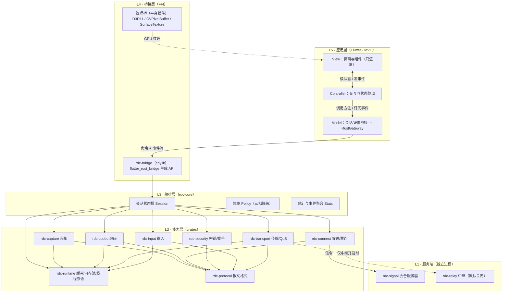
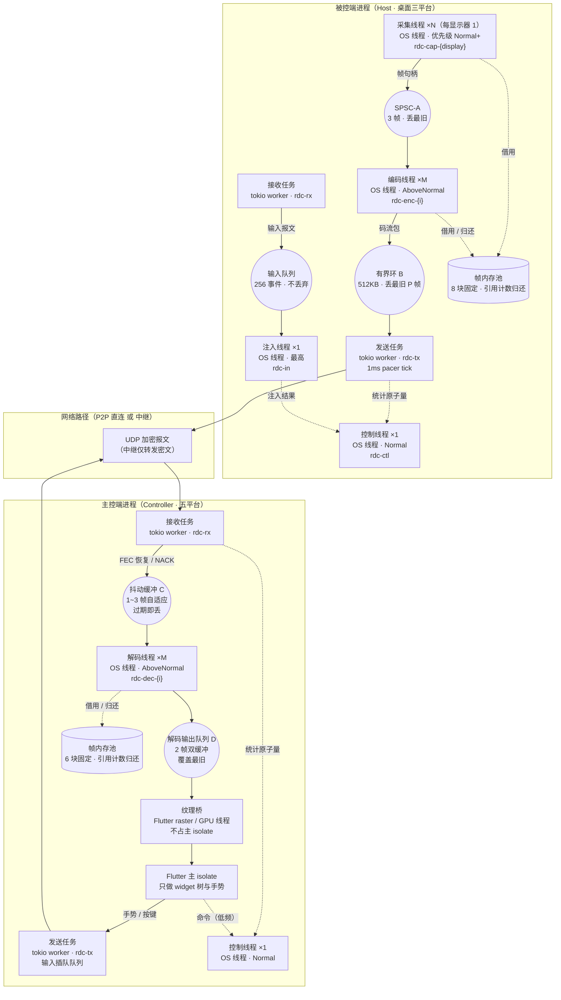
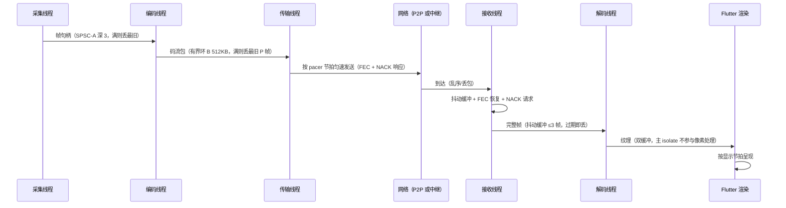

# 01 · 总体架构

> 本文只描述设计，不含实现代码。所有模块名、目录名与《09 · 目录结构与命名规范》保持一致。
> 版本：v1.0　日期：2026-11-06

---

## 1. 目标与不可破坏约束

| 编号 | 约束 | 说明 |
|---|---|---|
| C1 | 媒体默认直连 | 信令服务器只做注册、地址交换、心跳，不承载画面 / 音频 / 输入 |
| C2 | 中继默认关闭 | 中继是独立进程 `rdc-relay`，只有用户在设置页显式开启后才允许建立连接 |
| C3 | 不自动降级 | 打洞失败只报错并引导，绝不静默切中继；是否降级由三档策略决定 |
| C4 | 端到端加密 | 会话密钥只存在于两端；信令与中继都只能看到密文 |
| C5 | 画质优先、手感优先 | 编码协商 HEVC 硬编优先，质量降级时优先保帧率 |
| C6 | 代码自研 | 参考 Sunshine / RustDesk 的**结构与思路**，不复制 copyleft 代码 |
| C7 | 应用层 MVC | MVC 只在 Flutter 应用层生效；Rust 核心按 crate 分层，核心层不得出现任何 UI 概念 |
| C8 | 全链路多线程 | 采集/编码/发送/接收/解码分属独立线程；阶段间用无锁 SPSC 环形缓冲；视频丢旧留新；输入最高优先级且永不被视频阻塞；禁止跨线程大锁 |

---

## 2. 分层视图



**分层铁律**

1. `L5` 只能通过 `rdc-bridge` 暴露的 API 与事件流访问核心，不允许 Dart 直接持有指针、句柄或裸字节缓冲区。
2. `L3/L2` 不得出现 `widget`、`page`、`controller` 等 UI 概念；核心层永远不知道"界面长什么样"。
3. `L1` 与 `L2` 之间只有网络协议，不存在进程内调用（中继与信令都是独立可部署进程）。

---

## 3. 线程与任务模型（全链路）

### 3.1 七条线程铁律

| 编号 | 铁律 | 理由 / 落地方式 |
|---|---|---|
| T1 | 网络用 **tokio 多线程 runtime**（worker 数 = 物理核数，至少 2） | 异步 IO 密集，天然适合；UDP 收发、pacer tick、握手、重连计时都在 runtime 内 |
| T2 | 采集与编码用**专用 OS 线程**，禁止放进异步任务 | 采集 `AcquireNextFrame` 与硬编 `Encode` 都是阻塞式、毫秒级、需线程亲和（编码器上下文绑定线程）。`spawn_blocking` 只允许用于**短时（< 50ms）一次性调用**（设备枚举、编码器初始化），长驻循环一律 `std::thread` |
| T3 | 阶段之间只通过**无锁 SPSC 环形缓冲**传递 | 每段只有一个生产者一个消费者，无需锁；环形缓冲由 `rdc-runtime::ring` 统一提供，容量在创建处固定 |
| T4 | 视频帧**丢旧留新**，绝不因积压而增加延迟 | 队列满时丢弃最旧的 P 帧，保留最新帧与 I 帧；丢帧计数上报 QoS，作为拥塞信号 |
| T5 | 输入通道**独立线程 + 最高优先级 + 独立队列** | 输入线程不持有任何编码相关锁、不等待视频队列；仅做「取事件 → 平台注入」。任何情况下不得被视频编码阻塞 |
| T6 | **禁止跨线程大锁**；必须加锁处写明锁范围与持有时长上限 | 共享状态优先用原子量 / 单线程所有权（actor）/ seqlock 快照；允许的锁仅限配置类短锁，持有 ≤ 50 µs，且不得在持锁期间调用平台 API 或 `await` |
| T7 | 每个线程有**名字、优先级、退出令牌、panic 隔离** | 命名如 `rdc-cap-0`、`rdc-enc-1`；线程 panic 由 supervisor 捕获并转 `RdcError`，不允许静默死线程导致"画面卡住但无报错" |

**帧内存池**：所有帧缓冲来自 `rdc-runtime::pool` 的固定块池（默认 8 块，按最大分辨率预分配），以引用计数借用/归还，**禁止逐帧 `Vec` 分配**，避免分配器抖动与内存增长。

### 3.2 线程 / 任务拓扑图



**读图要点**

1. 三个"墙"：采集墙（采集→编码）、发包墙（编码→发送）、呈现墙（接收→解码→纹理）。每一堵墙都是一个 SPSC 环，环上不允许出现第二个生产者。
2. 输入链路（`C_UI → C_TX → 网络 → H_RX → H_INQ → H_INJ`）全程不与视频链路共享队列，也不共享锁。
3. 帧内存池两端各一份、各自归还，**不跨进程、不跨 FFI 共享**。

### 3.3 主控端（Controller）线程规格

| 单元 | 数量 | 类型 | 优先级 | 通信方式 | 缓冲区与上限 | 职责 |
|---|---|---|---|---|---|---|
| Flutter 主 isolate | 1 | Dart isolate | 系统默认 | 方法调用 / `ValueNotifier` | — | widget 树、手势、路由、文本输入；**不做解码、不做像素处理** |
| 纹理桥 | 1（平台线程） | Flutter raster / GPU 线程 | 系统默认 | 纹理注册回调 | 双缓冲 | 把解码结果提交为 Flutter 纹理；回调内不做解码 |
| `rdc-rx` | 1 | tokio task | Normal | UDP socket → 环 C | 抖动缓冲 1~3 帧 | 收包、解密、FEC 恢复、NACK 生成、反馈上报 |
| `rdc-tx` | 1 | tokio task | AboveNormal | 环 + 插队队列 | 输入队列 256 / 视频 20ms 配额 | 打包、加密、pacer、发送 |
| `rdc-dec-{i}` | 1~2 | OS 线程 | AboveNormal | 环 C → 环 D | 环 D 深 2（覆盖最旧） | 硬件解码，向纹理桥提交 |
| `rdc-ctl` | 1 | OS 线程 | Normal | 有界 channel(64) | 64 条消息 | 会话状态机、编码协商、降级决策、重连编排 |
| 事件聚合 | 1 | tokio task（4Hz） | Lowest | 原子量快照 → FRB | 32 条合并 | 统计聚合后推送 Dart，不逐帧推送 |

### 3.4 被控端（Host）线程规格

| 单元 | 数量 | 类型 | 优先级 | 通信方式 | 缓冲区与上限 | 职责 |
|---|---|---|---|---|---|---|
| `rdc-cap-{display}` | 每显示器 1 | OS 线程 | Normal+ | 环 A | 深 3 帧，丢最旧 | 平台采集；`FrameSink` 回调 1ms 内返回 |
| `rdc-enc-{i}` | M = clamp(物理核数 − 2, 1, 4) | OS 线程 | AboveNormal | 环 A → 环 B | 环 B 512KB 或 2 帧 | 独占编码器上下文；编码线程数**不超过显示器数**，多余实例只做热备 |
| `rdc-tx` | 1 | tokio task | AboveNormal | 环 B + 插队 | 视频 20ms 配额 | FEC 编码、打包、加密、pacer 匀速发送 |
| `rdc-rx` | 1 | tokio task | Normal | UDP socket → 输入队列 | 输入队列 256 | 收包、解密、NACK/反馈处理、重传 |
| `rdc-in` | 1 | OS 线程 | **最高** | 输入队列 → 平台 API | 256 事件 | `SendInput` / `CGEvent` / uinput，单次注入 ≤ 1ms |
| `rdc-ctl` | 1 | OS 线程 | Normal | 有界 channel(64) | 64 条消息 | 握手、密钥、权限位、状态机、编码重配下发 |

**编码线程数为什么这样定**：硬件编码器本身高度并行且占用固定硬件单元，多开实例收益有限；把核数留给系统与网络更划算。若显示器数 > 上限，则多个显示器共享编码线程（按帧交替），并在统计中标注 `encoder_shared=true`。

### 3.5 缓冲与背压策略

| 环 | 位置 | 容量 | 满时策略 | 背压信号 |
|---|---|---|---|---|
| A 采集→编码 | Host | 3 帧 | 丢最旧帧；若最旧是 I 帧则丢次旧 P 帧，保证每 GOP 至少一个 I | `dropped_pre_encode` 计数 → QoS |
| B 编码→发送 | Host | `max(目标码率 × 200 ms, 2 帧)`，**下限 8 MB** | 丢最旧 P 帧，保留 I；连续丢 3 帧判定拥塞 | `send_queue_ms > 20` → 降码率 |
| C 抖动缓冲 | Controller | 1~3 帧自适应 | 丢弃超过 `deadline` 的帧 | `late_frames` → 调整深度 |
| D 解码→纹理 | Controller | 2 帧 | **覆盖最旧**（不排队） | 出现覆盖即说明解码跟不上 → 降分辨率 |
| E 输入队列 | Host | 256 事件 | **不阻塞生产者**；溢出则丢最旧并计数告警 | `input_overflow` → 日志 + UI 提示 |
| F 控制消息 | 两端 | 64 条 | 短时阻塞（≤ 5ms），超时返回 `Busy` | 不允许无限等待 |
| G 事件推送 | Controller → Dart | 32 条，4Hz 合并 | 只保留最新聚合值 | 前端不感知丢事件 |

**统一原则**：所有环都**有界**；没有任何"无限增长"的队列；任何丢弃都要计数并可被观测（详见 `04-传输协议.md` §9）。

### 3.6 锁与共享状态

| 场景 | 方案 | 约束 |
|---|---|---|
| 统计指标（码率/丢包/RTT/队列深度） | 原子量（`AtomicU64`/`AtomicU32`），读取方做快照 | 无锁，允许轻微不一致 |
| 会话状态机 | 单线程所有权（`rdc-ctl` 独占），外部只发消息 | 状态只在控制线程内变更 |
| 编解码配置（码率/帧率/色度） | 允许 `Mutex<VideoConfig>`，只在重配时短暂持有 | 持锁 ≤ 50µs，持锁期间禁止调用平台 API / 禁止 `await` |
| 帧内存池 | 原子引用计数（借用/归还） | 归还即 CAS，不做全局锁 |
| 设备/权限列表 | 启动时构建后只读（`Arc<[T]>`） | 变更走"重建 + 原子替换指针" |

**代码注释要求**：每一处 `Mutex`/`RwLock` 必须写明 `// 锁范围：…；持有时长上限：…；禁止在持锁期间 …`（见 `09-目录结构与命名规范.md` §4.6）。

**禁止项**：`Mutex` 跨 `await`、在锁内做 IO/平台调用、持锁回调用户代码、用一把全局锁保护多个无关子系统。

### 3.7 Flutter 侧线程约定

| 事项 | 约定 |
|---|---|
| 主 isolate 职责 | 只做 widget 树、手势、路由、文本输入；**不做解码、不做像素转换、不解析大 JSON** |
| 解码位置 | Rust 的 `rdc-dec-*` OS 线程；Dart 侧永不接触像素 |
| 纹理更新 | 由 `FlutterTexture` 回调在 raster/GPU 线程执行，主 isolate 只收到"帧号变了"的轻量通知 |
| Rust → Dart 事件 | 4Hz 聚合推送，主 isolate 只做 `ValueNotifier` 赋值 |
| Dart → Rust 输入 | 走 FRB 异步流，由 FRB worker 线程消费；主 isolate 只 `add()`，不做同步等待 |
| 禁止 | 在 `build()` 内订阅流 / 做计算 / 调 FFI；在 `setState` 里做坐标换算 |

### 3.8 逻辑优先级到系统优先级的映射

| 逻辑优先级 | 使用者 | Windows | macOS | Linux | Android |
|---|---|---|---|---|---|
| P0 最高 | 输入注入 / 输入发送 | `THREAD_PRIORITY_HIGHEST` | `QOS_CLASS_USER_INTERACTIVE` | `nice -10`（无权限则退回 0 并记录） | `THREAD_PRIORITY_URGENT_DISPLAY` |
| P1 高 | 编码 / 解码 / 发送 | `THREAD_PRIORITY_ABOVE_NORMAL` | `QOS_CLASS_USER_INITIATED` | `nice -5` | `THREAD_PRIORITY_DISPLAY` |
| P2 普通 | 采集 / 网络 / 控制 | `THREAD_PRIORITY_NORMAL` | `QOS_CLASS_USER_INITIATED` | `nice 0` | `THREAD_PRIORITY_DEFAULT` |
| P3 低 | 统计 / 日志 / 事件推送 | `THREAD_PRIORITY_BELOW_NORMAL` | `QOS_CLASS_UTILITY` | `nice +5` | `THREAD_PRIORITY_BACKGROUND` |

**跨平台约束**：优先级设置失败（权限不足、平台不支持）时必须**降级到默认并记录日志**，不得因此启动失败。

### 3.9 线程生命周期与故障隔离

1. **启动顺序**：`rdc-ctl` → 网络 runtime → 解码/编码 → 采集 → 输入。任一步失败回滚已启动线程。
2. **停止顺序**：采集（停止产出）→ 编码（flush）→ 发送（排空 pacer）→ 接收 → 解码 → 控制线程。
3. **退出令牌**：所有长驻线程共享 `AtomicBool` + `Condvar` 唤醒，禁止用 `sleep` 轮询退出标志。
4. **panic 隔离**：每个 OS 线程入口包 `catch_unwind`；捕获后上报 `RdcError{code: THREAD_PANIC}` 并让会话进入 `Degrading`，不静默退出。
5. **超时守护**：pacer 与 NACK 定时器若连续 2s 未 tick，判定 runtime 被阻塞并记录（用于排查"忘了用 spawn_blocking"的误用）。


---

## 4. flutter_rust_bridge 边界

### 4.1 允许跨边界的内容

| 类别 | 方向 | 形态 | 频率上限 |
|---|---|---|---|
| 命令 | Dart → Rust | 同步/异步函数调用 | 用户操作级（低频） |
| 事件 | Rust → Dart | `StreamSink` 结构化对象 | 4 Hz（统计）/ 即时（状态） |
| 小数据 | 双向 | 字符串、整数、配置结构 | 低频 |
| 视频帧 | Rust → Flutter | **不走 FRB** | 60~120 fps |

### 4.2 视频帧的传递（关键决策）

FRB 传 GPU 句柄不安全也不高效，因此设计三条路径，按平台选择：

| 方案 | 机制 | 优点 | 代价 |
|---|---|---|---|
| A · 外部纹理（推荐） | Rust 解码到平台纹理（D3D11 / CVMetalTexture / GLES），通过自研平台插件注册 `Texture` 给 Flutter | 零拷贝、延迟最低 | 需要写平台侧插件代码（Win/mac/Linux/Android/iOS） |
| B · YUV Plane + `decodeImageFromPixels` | Rust 把 NV12/I420 平面拷贝给 Dart，Dart 组图 | 无平台插件、最快落地 | 每帧 1~3 次内存拷贝，1080p60 约 5~15ms CPU |
| C · 编码流直通 | Rust 只转发码流，Dart 侧用平台解码器 | 边界简单 | Dart 侧解码生态弱、难做零拷贝 |

阶段 3 先用 B 验证链路，阶段 3 后半段换 A；C 只作为调试手段。

### 4.3 FRB 使用纪律

1. **不做逐帧调用**：任何"每帧一次"的函数都视为设计错误。
2. **不在回调里做重活**：Rust → Dart 的事件只带已聚合的统计与状态。
3. **错误统一为可判别枚举**：返回 `RdcError { code, message, retryable }`，Dart 侧按 `code` 决定 UI 文案。
4. **生命周期显式**：`RustLib.init()` 由 Model 层调用一次；会话对象由控制器创建/销毁，必须有 `dispose`。

---

## 5. 数据流向（采集 → 编码 → 传输 → 解码 → 渲染）



### 5.1 延迟口径与软件开销预算（软件不设人为上限）

**先分清三个量，避免"端到端"一词被混用**：

| 口径 | 定义 | 测量方式 | 用途 |
|---|---|---|---|
| **管线延迟** | 采集时间戳 → 解码提交/上屏 | 画面内时间码（HUD 标"估计值"） | 定位各环节瓶颈 |
| **玻璃到玻璃 G2G** | 屏幕像素变化 → 主控端像素变化 | 240fps 高速相机对拍 | **验收仲裁口径** |
| **输入延迟** | 按键事件 → 被控端注入完成 | 240fps 相机 + 事件标记 | 手感验收 |

> 时间码口径只能测到"采集时间戳之后"的管线，天然不含采集等待相位与显示扫描；两端口径必须同时报，差值要能解释。偏移估计用最小 RTT，误差 1~5ms，因此 HUD 只作相对指标，不作验收值。**±1 帧不等于 16.7ms**：它随刷新率变化（60Hz 16.7ms / 120Hz 8.3ms / 144Hz 6.9ms）。

**软件开销不得用毫秒硬编码**：帧级管线的调度粒度是**帧周期**，故下表以"帧"为单位给出软件可控开销，并换算三档刷新率。这张表是**软件优化目标**，不是端到端承诺——端到端由硬件与网络决定。

| 环节 | 软件可控开销（帧） | 60Hz | 120Hz | 144Hz | 可压缩手段（对应 `11-优化项与优先级.md`） |
|---|---|---|---|---|---|
| 采集后处理（拷贝/缩放/格式转换） | 0.1~0.3 | 1.7~5.0 ms | 0.8~2.5 ms | 0.7~2.1 ms | 零拷贝、GPU 直通、禁止 CPU 缩放；光标不进画面（#1） |
| 编码 | 0.2~0.5（≤1440p）<br/>0.5~1.0（4K / 4:4:4 / 10-bit） | 3.3~8.3<br/>8.3~16.7 | 1.7~4.2<br/>4.2~8.3 | 1.4~3.5<br/>3.5~6.9 | NVENC ULL / VT RealTime、intra-refresh 替代 IDR（#3）、静态拉长 GOP（#4） |
| 打包 + pacer | ≤ 0.1 | ≤ 1.7 | ≤ 0.8 | ≤ 0.7 | 1ms pacer tick、单帧分片铺开（#2）、小缓冲 |
| 网络（LAN 有线） | 0.02~0.1 | 0.3~1.7 | 0.2~0.8 | 0.1~0.7 | 千兆/2.5G；Wi-Fi 6 单列（见下） |
| 抖动缓冲 | **0 / 1 / 2 帧**（自适应） | 0 / 16.7 / 33.4 | 0 / 8.3 / 16.6 | 0 / 6.9 / 13.8 | 下限 0 帧、过期即丢、解码队列上限 2（#5） |
| 解码 | 0.2~0.5 | 3.3~8.3 | 1.7~4.2 | 1.4~3.5 | 硬解 + 零拷贝到平台纹理 |
| 呈现（vsync 等待） | 0~1 帧 | 0~16.7 | 0~8.3 | 0~6.9 | 原生视频层可省掉合成器一帧；Flutter 外部纹理至少 0~1 帧 |
| **软件可控合计** | **0.7~3.5 帧**（管线口径不含呈现时 0.7~2.5 帧） | **12~58 ms** | **6~29 ms** | **5~24 ms** | — |
| 采集等待（相位，非软件可控） | 平均 0.5 / P99 1 帧 | 8.3 / 16.7 | 4.2 / 8.3 | 3.5 / 6.9 | 跟随刷新、脏区判定，只能逼近不能消除 |
| 面板扫描/响应（非软件可控） | 由显示器决定 | 3~15 ms | 2~8 ms | 1~5 ms | 不在软件范围内 |

**参考刻度（Observation Baseline，不是软件承诺）**

| 场景 | 管线 P99 参考 | G2G P99 参考 | 说明 |
|---|---|---|---|
| 局域网 1080p60 4:2:0 | 20~30 ms | 30~45 ms | 常见硬件可达；验收按实测记录 |
| 局域网 1080p120（120Hz 屏 + 原生视频层） | 15~20 ms | 18~28 ms | **20 ms 为尽力值（best-effort），单列，不作验收门槛** |
| 局域网 1440p120 / 4K60 4:2:0 10-bit | 25~40 ms | 35~55 ms | 受编码吞吐与解码器影响 |
| 局域网 4K120 4:4:4 10-bit | 50 ms+ | 60 ms+ | 仅在硬件全链路支持时可达，多数消费级卡不成立 |
| 同城公网（1080p60） | 35~50 ms | 45~55 ms | 参考刻度 45 ms |
| 跨省公网（1080p60） | 45~70 ms | 75~90 ms | 参考刻度 85 ms；链路抖动大时以实测记录 |

> 设计取舍：呈现环节**不做**"平滑缓冲"，宁可丢帧也不累积延迟；平滑只发生在抖动缓冲，深度由拥塞控制器决定，不由 UI 决定。
> 验收方式：**分档记录**——每个「档位 × 网络场景 × 平台」记录 p50/p95/p99 与达标情况，未达参考值不判失败，但必须记录**限制来源**（硬件编码器 / 对端解码器 / 网络带宽 / 用户偏好 / 策略），并保证"显示的就是实际生效值"。
> 达标口径：**99% 的帧在已协商的档位内上屏**；档位本身由能力协商决定，软件不做静态截断（见 `06-采集与编码.md` §2.2 与 §2.7）。

### 5.2 软件开销与线程模型的关系（为什么能压到 2~3 帧以内）

| 开销环节 | 依赖的线程设计 | 若违反会怎样 |
|---|---|---|
| 采集后处理 0.1~0.3 帧 | 采集独占 OS 线程，回调只写 SPSC-A（1ms 内返回） | 采集与编码同线程 → 排队至少 +5ms |
| 编码 0.2~1.0 帧 | 编码独占线程，不与网络/jitter 争抢；M=clamp(核数−2,1,4) | 编码排队 → 帧积压，延迟随负载线性上升 |
| 打包/pacer ≤ 0.1 帧 | `rdc-tx` 单任务 + 1ms tick；输入插队不占令牌 | 大锁或共享队列 → pacer 抖动，突发拥塞 |
| 网络 0.02~0.1 帧 | tokio 多线程 runtime，绑核与优先级见 §3.8 | 阻塞调用混入 async → 整个 runtime 卡顿 |
| 抖动/解码 0~1 帧 | 环 B 有界、解码队列 2、丢旧留新 | 无界队列 → 延迟只增不减（bufferbloat） |
| 呈现 0~1 帧 | 解码在 Rust OS 线程、Flutter 主 isolate 只渲染；高刷档走原生视频层 | 主 isolate 做解码 → 抖动随 GC/布局放大 |

> 结论：**低延迟不是靠调参调出来的，是靠线程隔离 + 有界缓冲 + 丢旧留新保证的**。软件侧只能压掉"可控开销"这一列；采集相位、vsync、面板响应属于硬件与系统，必须如实标注而非藏进预算。任何一处引入跨线程大锁或额外缓冲层，都会使 P99 直接失守，这也是 §3 线程铁律的由来。

---

## 6. 会话生命周期

```mermaid
stateDiagram-v2
  [*] --> Idle
  Idle --> Registered: 注册成功（被控端）
  Idle --> Resolving: 主控端发起连接
  Resolving --> Negotiating: 收到候选 / 打洞指令
  Negotiating --> SecureHandshake: 路径建立（IPv6/UDP/TCP）
  Negotiating --> PolicyDecision: 全部路径失败
  PolicyDecision --> Negotiating: 允许中继（用户开启）
  PolicyDecision --> Failed: 严格 P2P / 用户拒绝
  SecureHandshake --> Streaming: 密钥确认 + 编码协商完成
  Streaming --> Degrading: 质量指标越界
  Degrading --> Streaming: 稳定后回升
  Streaming --> Reconnecting: 掉线
  Reconnecting --> SecureHandshake: 重连成功（会话凭证复用）
  Reconnecting --> Failed: 超过重试上限
  Streaming --> Closing --> [*]
  Failed --> [*]
```

- **重连不重建会话**：保留会话 ID、密钥、编码协商结果；仅重建网络路径。**解码器不销毁**，重连后请求关键帧即可恢复；只有分辨率/编码参数发生变化、或解码器报告设备丢失（device lost）时才重建。
- **中继切换需要重新协商媒体密钥**（路径变化不应让旧密钥继续暴露给新路径），但会话与权限位保持；路径切换不触发解码器重建。

---

## 7. 关键架构决策（ADR 摘要）

| 编号 | 决策 | 理由 | 代价 |
|---|---|---|---|
| ADR-01 | 核心用 Rust，UI 用 Flutter，桥接用 FRB | 复用一套核心覆盖 5 平台；UI 生产力高 | 需维护 FFI 边界与平台纹理插件 |
| ADR-02 | 解码在 Rust，渲染在 Flutter | 硬解 + 零拷贝；Dart 侧生态弱 | 纹理桥是各平台工作量 |
| ADR-03 | 信令与中继为独立进程 | 可分别部署；中继默认关闭更容易保证 | 运维两个进程 |
| ADR-04 | 自定义 UDP 协议而非 WebRTC | 完全掌控 QoS/FEC/通道优先级，无浏览器约束 | 全部算法自研、兼容性自测 |
| ADR-05 | MVC 只在 Flutter 层 | 核心层保持可测试、可 CLI 驱动 | 需要严格的目录与依赖约束 |
| ADR-06 | 能力协商取代静态规格上限 | 硬件代际差异大，静态上限要么误导用户要么浪费硬件 | 需实现探测、组合校验与"限制来源"UI |
| ADR-07 | 延迟验收采用"管线 + G2G"双口径 | 单口径会被误当成用户感知延迟 | 需场地、相机与更长验收周期 |

---

## 8. 能力协商总则（软件不设人为上限）

**立场**：软件侧**不设**分辨率、帧率、色度、位深的静态上限。4K120、1440p144、4:4:4、10-bit 等全部作为"可实现能力"开放，只要编码端、解码端与网络三者支持就启用；软件不做截断，只做**可行性判定与外因说明**。

| 项 | 规则 |
|---|---|
| 探测时机 | 启动时探测编码器；会话建立时交换 `EncoderCaps` / `DecoderCaps`；编码器初始化后做一次真实档位试编（不是 128×128 快照） |
| 探测维度 | 按**组合**探测：`codec × profile × chroma × bit_depth × 分辨率 × 帧率 × 码率`；不得把四个维度当独立开关逐项协商 |
| 协商结果 | 取双方交集 ∩ 网络可用带宽 ∩ 用户偏好 ∩ 本机策略；结果缓存在会话内，会话中不得翻转为对方未声明的能力 |
| 限制来源 | 必须可枚举并在 UI 展示：`hw_encoder_limit` / `decoder_limit` / `network_limit` / `user_preference` / `policy_limit` |
| 降档透明 | 任何自动降档都要显示"原档位 → 现档位 + 原因"，例如「显卡编码器上限 4K60，已降档」「带宽不足，4K → 1440p」「对端不支持 4:4:4」；禁止静默降档 |
| 与验收的关系 | 指标表是**硬件能力参考基线**，不是软件达标线；验收按档位记录实测值与限制来源（见 §5.1 与 `10-里程碑与验收.md`） |

> 一句话：**软件负责"把硬件能做的都做出来并说清楚为什么没做到"，不负责替硬件许愿。**

---

## 修订记录

| 日期 | 变更 | 来源 |
|---|---|---|
| 2026-11-07 | §5.1 由"毫秒预算 + 20ms 硬指标"改为"帧周期表达的软件开销预算 + 双口径 + 参考刻度"；20ms 改为 120Hz 专项尽力值 | 15 号评审 C10/C33、§3.1/§3.4 |
| 2026-11-07 | 新增 §8 能力协商总则（软件不设人为上限 + 限制来源展示） | 用户决策；15 号评审 §3.2/§7.2 |
| 2026-11-07 | C11：环 B 容量改为 `max(码率×200ms, 2 帧)`、下限 8 MB | 15 号评审 C11 |
| 2026-11-07 | C03：重连不重建解码器，仅参数变化或设备丢失才重建 | 15 号评审 C03 |
| 2026-11-07 | 新增 ADR-06 / ADR-07 | 本次修订 |
