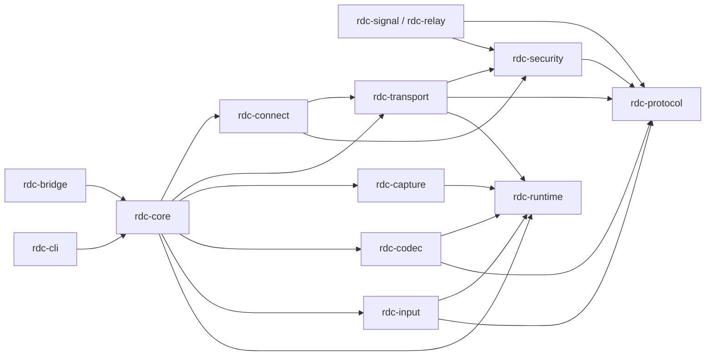

# 02 · 模块设计

> 只描述职责、依赖与接口契约（trait 签名要点），不写实现。
> 目录以《09 · 目录结构与命名规范》为准。

---

## 1. Rust 侧：crate 划分与依赖关系



> 依赖方向以 `09-目录结构与命名规范.md` §2.3 为唯一约束；本图与之逐边对齐。

### 1.1 crate 职责表

| crate | 类型 | 职责 | 允许依赖 | 禁止依赖 |
|---|---|---|---|---|
| `rdc-protocol` | lib | 信令 + 媒体报文的类型、序列化、版本兼容、错误码 | 标准库、serde | 任何 IO、平台 API、其他 rdc crate |
| `rdc-runtime` | lib | **线程与缓冲基础设施**：SPSC 环形缓冲、有界队列、帧内存池、原子统计、线程名/优先级/退出令牌 | 标准库、原子原语库 | 任何 rdc crate、任何业务协议 |
| `rdc-security` | lib | 身份密钥、临时密钥、HKDF、AEAD、权限位、配对码校验 | protocol；外部密码学库 | transport/connect/core |
| `rdc-capture` | lib | 平台采集抽象与后端（DXGI/WGC/SCK/PipeWire/X11）；产出帧来自内存池 | protocol、runtime、平台 API（仅 `platform/<os>`） | transport/connect/core、codec |
| `rdc-codec` | lib | 编码器抽象与后端（NVENC/AMF/QSV/VAAPI/VideoToolbox） | protocol、runtime；厂商 SDK 按 §1.2 平台专有后端管理 | transport/connect/core |
| `rdc-transport` | lib | UDP 多通道、FEC、NACK、拥塞控制、时钟同步、重连；发送/接收任务与 NACK 定时器 | protocol、security、runtime | capture/codec/input/core、任何 UI 概念 |
| `rdc-connect` | lib | 候选收集、IPv6/UDP/TCP 打洞、NAT 判定、路径选择 | protocol、security、transport | capture/codec/input |
| `rdc-input` | lib | 输入事件模型、坐标变换、平台注入（被控）/触摸映射（主控） | protocol、runtime、平台 API（仅 `platform/<os>`） | transport/connect/core |
| `rdc-core` | lib | 编排：会话状态机、三档策略、质量阶梯、统计聚合、事件分发；**多账号授权判定（`authz`）、角色/接管状态机、审计日志（仅元数据）** | 以上全部 | bridge、任何 Dart/Flutter 概念 |
| `rdc-bridge` | cdylib | FRB 暴露面：命令 + 事件流 + 错误映射；纹理桥句柄注册 | core、protocol | 业务实现（只做类型转换与生命周期托管） |
| `rdc-signal` | bin | 会合服务器：注册、地址交换、配对码校验、限流、中继票据签发 | protocol、security | 媒体处理 |
| `rdc-relay` | bin | 中继：会话配对、转发已加密的媒体包、流量统计与配额 | protocol、security | 解密媒体（**禁止**） |
| `rdc-cli` | bin | 无 UI 验证：`host` / `connect` / `bench` / `selftest` | core、protocol | bridge |

### 1.2 平台专有后端（厂商编码 SDK，不是 crate 依赖）

| 后端 | 交付形态 | 依赖边界 | 许可与分发约束 |
|---|---|---|---|
| NVENC（NVIDIA） | 运行时由驱动提供；随包只带调用代码/headers | 只在 `rdc-codec/src/platform/` 内出现，禁止跨平台引用 | nv-codec-headers 为 MIT；NVENC SDK 为 NVIDIA 专有许可；**不得在非 NVIDIA 硬件上模拟**，**不得单独再分发 SDK 运行库**；发布前做许可审查 |
| AMF（AMD） | 运行时由显卡驱动提供 | 同上 | MIT（GPUOpen）；遵守显卡驱动 EULA，不建议自行再分发运行时 |
| oneVPL / QSV（Intel） | 目标机安装或随包 runtime | 同上 | MIT；需探测 runtime 版本与 GPU 代际 |
| VideoToolbox（Apple） | 系统框架，仅 Apple 平台 | 同上 | 不能单独再分发；App Store、公证与 TCC 另计 |

**边界**：上表不是 Cargo 依赖，不得写入任何 `[dependencies]`；`rdc-codec` 的普通 crate 依赖只有 `protocol` 与 `runtime`。厂商 SDK 的许可审查放在发布闸门，缺失审查不得出包。

### 1.3 依赖铁律

1. **单向依赖**：`protocol` 是最底层，任何 crate 都不得反向依赖 `core`。
2. **平台代码隔离**：平台 API 只出现在 `capture` / `codec` / `input` / `bridge` 的 `platform/<os>` 模块中，用 `cfg(target_os)` 分文件。
3. **核心可测**：`core` 必须能在没有屏幕、没有 GPU 的 CI 环境编译并通过单元测试（平台后端用 mock 注入）。

---

## 2. 关键接口契约（trait 要点，不含实现）

### 2.1 `CaptureSource`（rdc-capture）

| 方法 | 参数 | 返回 | 说明 |
|---|---|---|---|
| `enumerate` | — | `Vec<DisplayInfo>` | 显示器列表：分辨率、刷新率、缩放、HDR、主屏标记 |
| `start` | `CaptureConfig`（显示器 ID、目标帧率、是否含光标、色度/位深） | `Result<(), CaptureError>` | 启动采集；失败需区分"权限缺失/显示器消失/被独占" |
| `set_sink` | `Arc<dyn FrameSink>` | — | 帧回调；回调必须非阻塞 |
| `reconfigure` | `CaptureConfig` | `Result<(), CaptureError>` | 在线改帧率/显示器 |
| `stop` | — | `()` | 幂等 |

约定：`FrameSink::on_frame(Frame)` 必须在 1ms 内返回；禁止在回调里做编码。

### 2.2 `VideoEncoder`（rdc-codec）

| 方法 | 参数 | 返回 | 说明 |
|---|---|---|---|
| `probe` | 编码格式列表 | `Vec<EncoderCaps>` | 能力：codec、色度、位深、最大分辨率/帧率、是否支持运行时重配 |
| `configure` | `VideoConfig`（codec、分辨率、fps、码率、色度、位深、低延迟档） | `Result<(), CodecError>` | 失败要能区分"硬件不支持"与"参数非法" |
| `push` | `Frame` + `FrameMeta`（pts、帧号、强制关键帧） | `Result<(), CodecError>` | 非阻塞；**编码器内部不排队**，背压由调用方的环 A / 环 B 承担（与 §2.8 一致） |
| `poll_packet` | — | `Option<EncodedPacket>` | 输出码流包（含分片建议大小） |
| `reconfigure` | `VideoConfig` | `Result<(), CodecError>` | 在线重配：码率即时生效；分辨率/帧率触发一次关键帧 |
| `request_keyframe` | — | `()` | 供 NACK/FEC 恢复与重连使用 |

### 2.3 `Transport`（rdc-transport）

| 方法 | 参数 | 返回 | 说明 |
|---|---|---|---|
| `open` | `TransportConfig`（对端地址、会话 ID、密钥、初始码率） | `Result<TransportHandle, TransportError>` | 严格模式失败即错误 |
| `send` | `StreamId` + `&[u8]` | `Result<(), SendError>` | 输入通道走插队队列 |
| `set_target_bitrate` | `u32` | `()` | 由拥塞控制或质量阶梯调用 |
| `stats` | — | `TransportStats` | RTT、丢包、发送队列、FEC 恢复数、NACK 数 |
| `close` | — | `()` | 幂等，触发对端 FIN |

### 2.4 `CongestionController`

| 方法 | 说明 |
|---|---|
| `on_ack(batch)` | 接收端回传的到达时间与序号，用于延迟梯度计算 |
| `on_loss(report)` | 丢包率与突发长度，决定 FEC 冗余与码率回退 |
| `on_rtt(rtt)` | 用于 pacer 与重传判定 |
| `target_bitrate()` | 当前允许的发送码率（总码率，含 FEC 开销） |
| `on_probe_result(...)` | 探测簇结果，用于快速回升 |

### 2.5 `InputInjector`（被控端）/ `InputMapper`（主控端）

| 接口 | 要点 |
|---|---|
| `InputInjector::inject(InputEvent)` | 鼠标绝对/相对、按键、滚轮、触摸；返回是否被系统接受 |
| `InputInjector::set_viewport(viewport)` | 多屏与 DPI 缩放映射 |
| `InputMapper::map_pointer(...)` | 把触摸/鼠标位置经统一变换矩阵映射到远端坐标 |

### 2.6 `SignalingClient`（rdc-connect）

| 方法 | 说明 |
|---|---|
| `register(id, pub_key)` | 返回 `ObservedAddr`（STUN 结果） |
| `call(target, pairing_code, allow_relay)` | `allow_relay` 由设置页决定，默认 false |
| `accept/refuse(session)` | 被控端应答 |
| `candidates(session, list)` | 交换候选地址（IPv6/UDP/TCP） |
| `relay_ticket(session)` | 仅当 `allow_relay=true` 时可申请 |
| `bye(session)` | 结束会话 |

### 2.7 错误模型（跨 FFI 统一）

```
RdcError {
  code: ErrorCode,        // 可判别枚举，如 P2P_FAILED / NO_PERMISSION / CODEC_UNSUPPORTED
  message: String,        // 面向日志
  user_hint: Option<String>,  // 面向用户的一句话建议
  retryable: bool,
}
```

### 2.8 接口的线程语义（谁在哪个线程调用）

**规则**：trait 方法必须能回答三个问题——「谁调用」「是否阻塞」「有没有内部队列」。三者写进 trait 的文档注释，缺一视为接口未定义完成。

| 接口 / 方法 | 调用线程 | 阻塞性 | 内部队列与上限 |
|---|---|---|---|
| `CaptureSource::start / stop / reconfigure` | `rdc-ctl`（控制线程） | 阻塞，允许 ≤ 50ms | 无 |
| `CaptureSource::set_sink` 的回调 `FrameSink::on_frame` | 采集线程 `rdc-cap-*` | **必须非阻塞，1ms 内返回** | 只做「写入 SPSC-A」，满则丢最旧 |
| `VideoEncoder::configure / reconfigure / request_keyframe` | `rdc-ctl` | 阻塞，允许 ≤ 50ms | 无（配置锁 ≤ 50µs） |
| `VideoEncoder::push` | 编码线程（由编码线程拉取环 A 后调用） | **非阻塞** | 内部不排队；排队发生在环 A/B |
| `VideoEncoder::poll_packet` | 编码线程 | 非阻塞，无包返回 `None` | 输出写环 B |
| `Transport::send`（输入通道） | `rdc-tx`（tokio） | 非阻塞，失败立即返回 | 插队队列 256，最高优先级 |
| `Transport::send`（视频通道） | `rdc-tx` | 非阻塞 | 受 pacer 令牌桶约束，队列 > 20ms 即丢最旧 |
| `Transport::stats` | 统计任务（4Hz） | 非阻塞（原子快照） | — |
| `CongestionController::on_ack / on_loss / on_rtt` | `rdc-rx` / `rdc-tx` | 非阻塞，纯计算 | 内部只存滑动窗口（固定长度） |
| `InputInjector::inject` | `rdc-in`（最高优先级） | 阻塞，单次 ≤ 1ms | 无；排队发生在输入队列（256） |
| `InputMapper::map_pointer` | Dart 主 isolate → FRB worker | 纯计算，无锁 | 无；只读矩阵快照 |
| `SignalingClient::*` | `rdc-ctl` / 网络任务 | 异步 | 有界 channel(16) |

**线程归属表（谁创建/拥有线程）**

| crate | 拥有的线程/任务 | 说明 |
|---|---|---|
| `rdc-runtime` | 不创建线程，只提供线程构造器与缓冲原语 | 统一命名、优先级、panic 隔离 |
| `rdc-capture` | `rdc-cap-{display}` | 每显示器一个，随会话启停 |
| `rdc-codec` | `rdc-enc-{i}` / `rdc-dec-{i}` | 编码器上下文与线程强绑定，禁止跨线程调用 |
| `rdc-transport` | `rdc-tx` / `rdc-rx` / NACK 定时器 / 反馈定时器（均 tokio task） | 全部跑在共享的多线程 runtime 上 |
| `rdc-input` | `rdc-in`（仅被控端） | 最高优先级，独立队列 |
| `rdc-core` | `rdc-ctl` + 统计聚合任务 | 唯一允许改会话状态的地方 |
| `rdc-bridge` | 不创建线程 | 只做类型转换，不得把阻塞调用放进 FRB 回调 |

**禁止**：任何 crate 私自 `thread::spawn` 而不经过 `rdc-runtime::thread`；任何 trait 实现里把阻塞调用藏在"看起来非阻塞"的方法里。

---

## 3. Flutter 侧：MVC 模块划分

### 3.1 三层职责

| 层 | 目录 | 允许 | 禁止 |
|---|---|---|---|
| Model | `lib/model/` | 数据类、状态缓存、RustGateway（FFI 封装）、事件流订阅、持久化 | 任何 `Widget` / `BuildContext` / 导航 |
| View | `lib/view/` | 渲染、布局、样式、动画、手势采集（只上报） | 直接调 FFI、直接改模型、业务判断 |
| Controller | `lib/controller/` | 处理交互、调用 Model、驱动状态、导航、弹窗编排 | 直接写 UI 代码、直接持有 Widget |

### 3.2 一个界面 = 一个 Controller + 一个 Model

| 页面 | View | Controller | Model |
|---|---|---|---|
| 首页（远程控制入口：输入 ID / 配对码） | `view/pages/home_page.dart` | `controller/home_controller.dart` | `model/device/device_list_model.dart`、`model/session/connect_model.dart` |
| 会话页（画面 + 工具栏 + 统计） | `view/pages/session_page.dart`、`view/components/takeover_dialog.dart` | `controller/session_controller.dart` | `model/session/session_model.dart` |
| 方向与视口（旋转、缩放、平移） | 无独立页面（由 session_page 组合） | `controller/viewport_controller.dart` | `model/session/viewport_model.dart` |
| 设置页入口（分组见 §3.2.1） | `view/pages/settings_page.dart` | `controller/settings_controller.dart` | `model/settings/app_settings_model.dart` |
| 诊断页（降级历史、日志导出） | `view/pages/diagnostics_page.dart` | `controller/diagnostics_controller.dart` | `model/stats/diagnostics_model.dart` |
| 系统授权引导（macOS 屏幕录制 / Android 无障碍） | `view/pages/permission_guide_page.dart` | `controller/permission_guide_controller.dart` | `model/device/permission_guide_model.dart` |
| 设备列表（别名/分组/在线状态/信任策略） | `view/pages/device_page.dart` | `controller/device_controller.dart` | `model/device/device_list_model.dart` |
| 账号与登录（**可选增强**，不登录也可用） | `view/pages/account_page.dart`、`view/components/account_tile.dart` | `controller/account_controller.dart` | `model/account/account_model.dart` |
| 远程访问权限（设置内独立入口，上下单栏） | `view/permission/permission_page.dart` | `controller/permission_controller.dart` | `model/permission/permission_model.dart` |
| 屏幕墙（多路预览） | `view/pages/wall_page.dart`、`view/components/wall_tile.dart` | `controller/wall_controller.dart` | `model/wall/wall_model.dart` |
| 文件传输面板（进度/暂停/记录） | `view/components/transfer_panel.dart`、`view/pages/transfer_record_page.dart` | `controller/transfer_controller.dart` | `model/transfer/transfer_model.dart` |
| 剪贴板开关与确认 | `view/components/clipboard_tile.dart` | `controller/clipboard_controller.dart` | `model/clipboard/clipboard_model.dart` |
| 主界面壳（模式胶囊 + 内容区） | `view/shell/shell_page.dart`、`view/shell/mode_capsule.dart` | `controller/shell_controller.dart` | `model/shell/shell_model.dart` |
| 快速设置面板（高频可写子集） | `view/quick_settings/quick_settings_panel.dart` | `controller/quick_settings_controller.dart` | 复用 `model/settings/app_settings_model.dart`（不新建 Model） |
| 新手引导（可跳过、可再次打开） | `view/onboarding/onboarding_drawer.dart` | `controller/onboarding_controller.dart` | `model/onboarding/onboarding_model.dart` |
| 通知中心（连接/设备/授权/接管事件） | `view/notification/notification_center_panel.dart` | `controller/notification_controller.dart` | `model/notification/notification_model.dart` |

### 3.2.1 设置页分组（只登记存在与归属）

设置页采用"上下单栏分组框"，每个分组只做该页内的区块，不改变 `settings_page.dart` 的入口；远程访问权限沿用 13 号的独立入口，不在设置页内重建。分组不裁剪 14 号已设计的内容。

| 分组 | View | Controller | Model | 所属层 |
|---|---|---|---|---|
| 常规 | `view/settings/sections/general_section.dart` | `controller/settings_controller.dart` | `model/settings/app_settings_model.dart` | View / Controller / Model |
| 连接与显示 | `view/settings/sections/connection_display_section.dart` | 同上 | 同上 | View / Controller / Model |
| 键鼠与快捷键 | `view/settings/sections/keyboard_mouse_section.dart` | 同上 | 同上 | View / Controller / Model |
| 文件与剪贴板 | `view/settings/sections/file_clipboard_section.dart` | 同上 | 同上 | View / Controller / Model |
| 网络 | `view/settings/sections/network_section.dart` | 同上 | 同上 | View / Controller / Model |
| 安全与隐私 | `view/settings/sections/security_privacy_section.dart` | 同上 | 同上 | View / Controller / Model |
| 远程访问权限（13 号已有） | `view/permission/permission_page.dart` | `controller/permission_controller.dart` | `model/permission/permission_model.dart` | View / Controller / Model |
| 关于与更新 | `view/settings/sections/about_update_section.dart` | `controller/settings_controller.dart` | `model/settings/app_settings_model.dart` | View / Controller / Model |

### 3.3 共享基础设施

| 模块 | 位置 | 职责 |
|---|---|---|
| `RustGateway` | `model/gateway/rust_gateway.dart` | 唯一允许 import 生成代码 `src/rust/` 的文件；封装命令、事件流、错误转换 |
| `EventBridge` | `model/gateway/event_bridge.dart` | 把 Rust 事件流分发给多个 Model，避免重复订阅 |
| `AppSettings` | `model/settings/` | 中继开关、地址、三档策略、编码偏好、方向策略的持久化 |
| `ThemeTokens` | `core/theme/` | 颜色、间距、字号，View 只引用 token，不写字面色值 |

### 3.4 组件规范

- View 的每个组件文件顶部用 `// =====** 组件名 =====**` 分区；
- Controller 与 Model 文件用 `// =========** 名称 =========`，名称与对应 View 文件保持一致；
- 页面级组件不得直接 `import` FFI；统一经由 Controller → Model → Gateway。

### 3.5 移动端方向控制（横竖屏）

| 归属 | 内容 |
|---|---|
| `ViewportController` | 方向策略（跟随系统/锁横/锁竖）、方向切换编排、变换矩阵重算、缩放/平移手势 |
| `ViewportModel` | 保存 `orientation`、`scale`、`offset`、`Matrix4`、可用视口尺寸；**不持有解码器** |
| `SessionModel` | 持有解码器与网络会话；方向切换时**不做任何重建**，只通知 ViewportModel 重算 |
| `SessionView` | 监听 `ViewportModel`，用 `Transform` 渲染，方向切换时只换布局与工具栏形态 |
| 旋转期间的状态归属 | 由 `ViewportController` 独占；`SessionController` 只转发系统方向事件，避免两个控制器争抢状态 |

**方向切换不中断会话的三条保证**

1. 解码器、UDP 会话、输入通道生命周期绑定 `SessionModel`，与 View 重建解耦；
2. 纹理桥输出的纹理不随方向销毁，View 只改渲染变换；
3. 坐标映射矩阵由 `ViewportModel` 重算，输入事件在下一次采样才生效（避免切换瞬间的中间态点击）。

### 3.6 Flutter 侧线程与 isolate 约束

| 位置 | 允许做的事 | 明确禁止 |
|---|---|---|
| Dart 主 isolate | widget 树、布局、手势采集、路由、`ValueNotifier` 赋值 | 解码、像素转换、大 JSON 解析、同步等待 FFI、在 `build()` 内订阅流 |
| Rust `rdc-dec-*` OS 线程 | 硬件解码、向纹理桥提交 | 回写 Dart 侧像素 |
| Flutter raster / GPU 线程（纹理桥回调） | 把解码结果提交为纹理（`copyPixelBuffer`） | 在回调里做解码或等待 |
| FRB worker 线程 | 消费 Dart → Rust 的异步命令与输入流 | 执行阻塞型采集/编码 |
| 事件聚合任务（4Hz） | 原子量快照 → `StreamSink` | 逐帧推送、在事件里夹带大对象 |

**Model 层的线程纪律**：`RustGateway` 是唯一允许接触生成代码的文件；订阅事件时只做「转换 + 通知」，不在此处做业务计算；Controller 的回调必须轻量（< 1ms），重活交回 Rust。

### 3.7 剪贴板 / 文件 / 多设备的 MVC 归属

| 能力 | Rust 侧（不属 MVC） | Model | Controller | View |
|---|---|---|---|---|
| 剪贴板采集与落板 | `rdc-core::clipboard` + 平台实现（`rdc-capture` 同层） | `clipboard_model`（同步状态、跳过原因、限流提示） | `clipboard_controller`（开关、手动触发、确认弹窗） | `clipboard_tile`（开关与状态） |
| 敏感格式识别 / 排除名单 | Rust（安全边界，不能在 Dart 做） | 只接收"已跳过 + 原因"事件 | 展示原因、编辑排除名单 | — |
| 文件传输引擎 | `rdc-core::transfer`（分块、BLAKE3、断点、暂停） | `transfer_model`（任务列表、进度、暂停/取消、记录） | `transfer_controller`（发起、确认、重试） | `transfer_panel`、`transfer_record_page` |
| 路径安全校验 | Rust（接收端强制，Dart 不得替代） | 只展示"已拒绝"结果 | 展示错误、引导选择落点 | — |
| 设备列表与信任 | Rust 提供身份指纹与签名；本地存储由 Dart | `device_list_model`（别名/分组/策略/有效期/在线状态） | `device_controller` | `device_page` |
| 屏幕墙 | Rust 提供多路 `session_id` 与子码流解码 | `wall_model`（布局、每路状态、轮巡、筛选） | `wall_controller`（进入单屏、重排、轮巡） | `wall_page`、`wall_tile` |
| 账号登录与 token | `rdc-signal` 账号服务 + `rdc-core::account`（token 刷新、公钥上报） | `account_model`（登录态、token 缓存、同账号设备列表、刷新失败降级） | `account_controller`（登录/登出/注销、同步开关、错误提示） | `account_page`、`account_tile` |
| 同账号设备发现与互信 | Rust 验签与信任判定（**唯一判定点**） | 只接收"该设备来自同账号"的标记与列表版本 | 展示来源标记、切换单台策略 | `device_page` 中的来源角标 |
| 多账号授权（grant） | `rdc-core::authz`（令牌校验、权限交集、撤销世代）+ 账号服务 `/v1/grants` | `permission_model`（授权列表、权限位、有效期、撤销状态、信任设备、接管策略） | `permission_controller`（邀请、改权限、撤销、续期提示、接管策略） | `permission_page` 的「授权访问者」「信任设备」两个区块 |
| 会话内角色与接管 | `rdc-core::session`（角色状态机、输入闸门） | `session_model`（当前控制者、观看者数、接管请求状态） | `session_controller`（申请控制、让位、踢出、断开） | `session_page` 常驻提示条、`takeover_dialog` |
| 审计日志 | `rdc-core::audit`（本地环形日志，仅元数据） | `diagnostics_model`（只读查询与导出） | `diagnostics_controller` | `diagnostics_page` 审计页签 |

**多账号授权的分层约束**：

1. **授权判定只在 Rust**：令牌签名、有效期、权限交集、撤销世代全部在 `rdc-core::authz` 完成；Dart 不得依据"UI 上显示已授权"放行任何能力。
2. **输入闸门在传输层**：非控制者的输入包在 `rdc-transport` 直接丢弃，不经 Dart、不经注入线程（避免"UI 以为没注入，实际已注入"）。
3. **审计日志不经 Dart 落盘**：Rust 侧写本地环形日志，Dart 只做查询与导出；日志字段由 Rust 定义，禁止 Dart 追加自由文本以防注入。
4. **owner 踢出必须验签**：`kick` 由 Rust 用 owner 绑定公钥验签通过后执行，Dart 的"踢出"按钮只是发起请求。

> 页面细节（7 个区块、字段校验、空状态、审计字段、MVC 文件规模）以 `13-权限设置页设计.md` 为准。该页按用户要求采用 `view/permission/`（而非 `view/pages/`），属于**约定内的特例**，同一页面仍保持"Page + Controller + Model"三文件对应。

**账号层的分层约束（方案三：本地优先）**：

1. **账号是可选的增强，不是使用前提**——`account_model` 未登录时整个应用功能完整，设备列表全部来自本地地址簿。
2. **账号不可达不阻断连接**：`account_model` 刷新 token 失败只降级为"未登录态"，已缓存信任关系与地址簿继续生效（见 `07-安全设计.md` §2.3）。
3. **信任判定不在 Dart**：同账号是否可信由 Rust 依据公钥列表与双向验签给出结论，Dart 只做展示，不得自行把"同账号"当成"已信任"。
4. **账号不上行媒体类数据**：`account_model` 只传邮箱/设备名/平台/公钥，剪贴板、文件、画面、连接历史一律不经此处。

**红线**：

1. 剪贴板内容与文件字节**从不进入 Dart**；Dart 只处理"元数据与状态"。
2. 路径校验、敏感格式识别、限流全部在 Rust 侧，Dart 侧的任何"再校验"只用于提示，不承担安全职责。
3. 屏幕墙的每路预览使用独立 `Texture` 与独立 `session_id`，`wall_model` 不持有像素。

---

## 4. 模块间调用示例（文字版时序）

**开始会话**

1. View 点击"连接" → `HomeController.connect(id, code)`；
2. Controller → `ConnectModel.requestConnect(...)`（参数含当前设置的 `allow_relay` 与策略）；
3. Model → `RustGateway.startSession(...)`（FFI）；
4. Rust `core` 驱动 `connect`（打洞）→ `security`（握手）→ `transport`（建流）→ `codec`（协商）；
5. 状态与统计经事件流回到 Gateway → EventBridge → Model → Controller → View 刷新。

**质量降级**

1. `rdc-transport` 统计越界 → `core` 的质量阶梯模块决策；
2. 若需重配编码：`codec.reconfigure(...)`；若需 FEC 调整：`transport.set_fec(...)`；
3. 决策原因写入统计事件（含触发指标）→ UI 提示条 + 诊断日志。

---

## 修订记录

| ID | 修订内容 |
|---|---|
| C12 | 本文件不定义 `StreamKind`；数值 0~7 的协议语义以 `04-传输协议.md` §1.1 为准，命名登记见 `09-目录结构与命名规范.md` §5.2。 |
| C24 | §3.2 补登记 14 号新增的主界面壳（模式胶囊 + 内容区）、快速设置面板、新手引导、通知中心；§3.2.1 补登记设置页分组（常规/连接与显示/键鼠与快捷键/文件与剪贴板/网络/安全与隐私/远程访问权限/关于与更新），均只登记存在与归属。 |
| C25 | 以 09 为唯一命名源：`devices_page`/`devices_controller` 改为 `device_page`/`device_controller`；`connect_page`/`connect_controller` 对齐为 `home_page`/`home_controller`；补齐 `wall_page`、`transfer_record_page`、`transfer_panel`、`clipboard_tile`、`wall_tile`、`account_tile`、`takeover_dialog` 等条目；`EventBus` 对齐 `event_bridge.dart`。 |
| C27 | §1 依赖图与 §1.1 允许依赖全部对齐 09 §2.3；厂商 SDK 从普通 crate 依赖中单列为 §1.2「平台专有后端」，注明许可审查、不得模拟、不得单独再分发。 |
| C26 | §2.2 `VideoEncoder::push` 由"内部有界队列"改为"**内部不排队**、背压由环 A/环 B 承担"，与 §2.8 统一。 |
