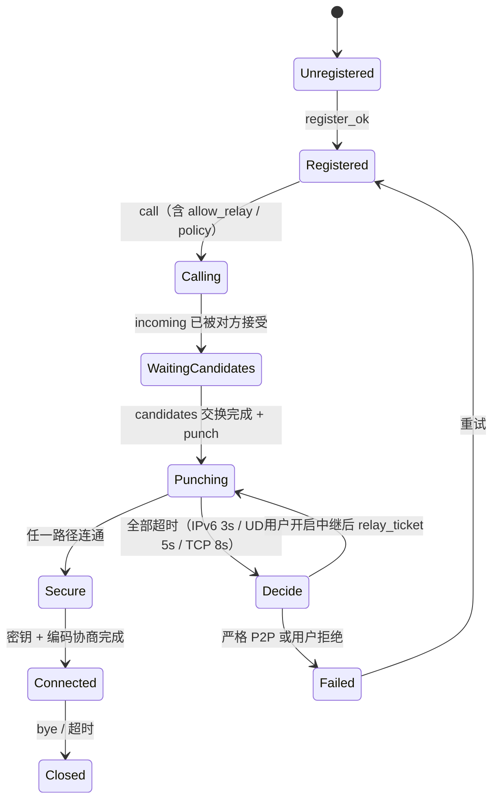
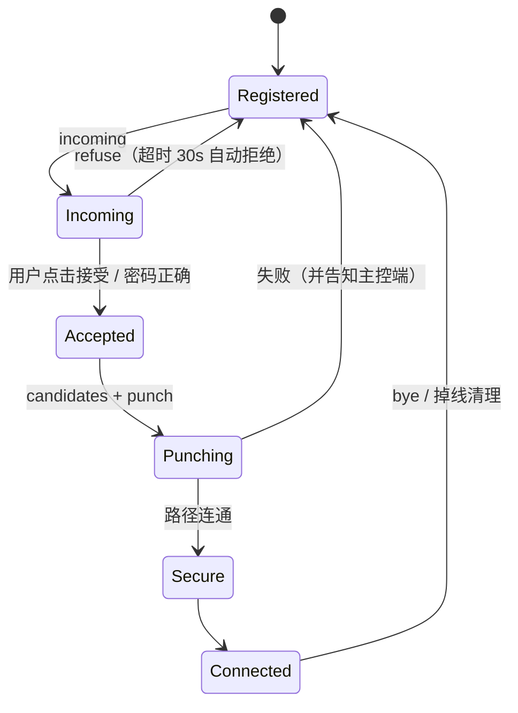
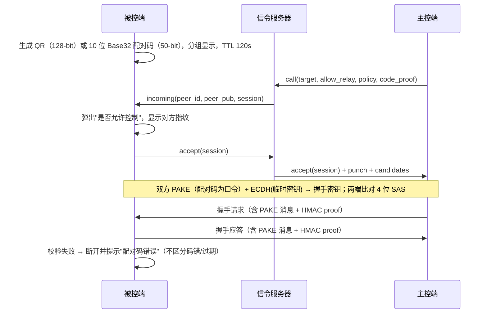
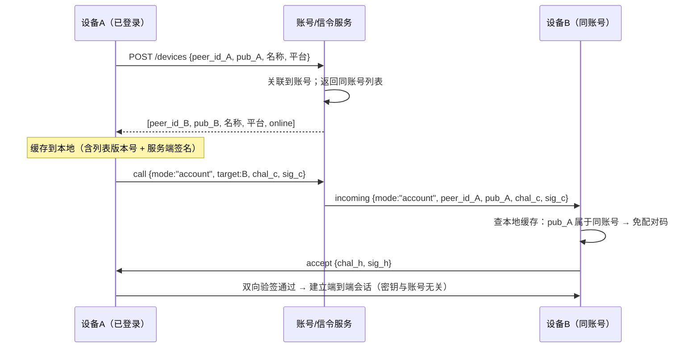
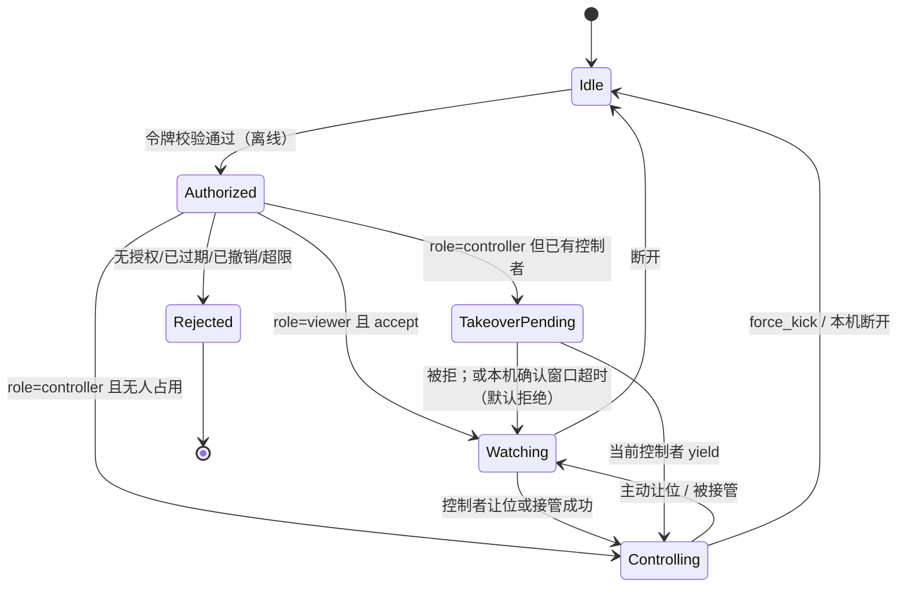

# 03 · 信令协议

> 范围：注册、呼叫、应答、候选交换、中继票据、断开。
> 传输载体：**TLS 1.3 over QUIC**（默认，UDP 21116，安全层在服务端终止）；回退 **TLS 1.3 over TCP**（443）。
> **信令与媒体使用独立 socket**：信令走自己的 QUIC 长连接（keepalive 维持 NAT 映射），**不与媒体包共用 socket**；共用 socket 会让媒体拥塞反压信令、也让信令的 TLS 记录层与媒体 AEAD 混在一起，二者都不接受。
> 信令服务器**不接触任何媒体内容**；中继票据只是一个"授权凭证"，媒体仍端到端加密。
> **禁止**：任何 token、`peer_id`、设备地址以明文出现在 UDP/TCP 载荷或 URL query 中（详见 `07-安全设计.md` §2.4）。

---

## 1. 协议总则

| 项 | 约定 |
|---|---|
| 编码 | JSON（字段 snake_case），后续可换 MessagePack，语义不变 |
| 版本 | 报文顶层 `v` 字段；不一致直接返回 `version_mismatch` |
| 单包上限 | 4 KB（超出丢弃，不回包，防反射放大） |
| 重传 | 信令侧自己做：请求类消息超时 1s 重发，最多 3 次（带指数退避） |
| 幂等 | `register` / `keepalive` / `bye` 必须幂等 |
| 时间 | 所有 TTL 由服务端计时，客户端不得自报时间 |

---

## 2. 消息类型

### 2.1 公共信封

```json
{
  "v": 1,
  "type": "call",
  "id": "ctrl-01",
  "seq": 12,
  "ts": 1762300000123,
  "sig": "base64(hmac)"
}
```

| 字段 | 说明 |
|---|---|
| `v` | 协议版本 |
| `type` | 消息类型 |
| `id` | 发送方 peer ID |
| `seq` | 单调递增序号（防重放；服务端按 peer 记录窗口） |
| `ts` | 客户端毫秒时间戳（仅用于观测，不参与鉴权） |
| `sig` | 对 `{type,id,seq,ts,body}` 的 HMAC-SHA256（密钥来自注册时下发的会话 token） |

### 2.2 消息清单

| type | 方向 | 关键字段 | 语义 |
|---|---|---|---|
| `register` | C→S | `pub_key`, `device_name`, `platform`, `caps` | 注册 / 上线 |
| `register_ok` | S→C | `observed`, `token`, `ttl` | 返回观测地址（STUN 结果）与会话 token |
| `keepalive` | C→S | — | 刷新在线状态（20~30s） |
| `call` | C→S | `target`, `allow_relay`, `policy`, `code_proof` | 主控端发起呼叫 |
| `incoming` | S→H | `peer_id`, `peer_pub`, `session`, `allow_relay` | 通知被控端有人呼叫 |
| `accept` | H→S→C | `session` | 被控端同意 |
| `refuse` | H→S→C | `session`, `reason` | 拒绝（忙 / 用户拒绝 / 配对码错误） |
| `candidates` | 双向经 S | `session`, `list[]` | 交换候选：`ipv6` / `udp` / `tcp`，含优先级 |
| `relay_request` | C→S | `session`, `code_proof` | **仅当用户开启中继**时申请票据 |
| `relay_ticket` | S→C | `relay_addr`, `ticket`, `expires` | 票据：允许的会话、端口、带宽上限 |
| `punch` | S→C/H | `peer_addr`, `session`, `role` | 通知双方立刻向对端发包（同时打洞） |
| `connected` | C/H→S | `session`, `path` | 上报最终路径（`ipv6`/`udp`/`tcp`/`relay`），服务端仅记录统计 |
| `bye` | 双向 | `session`, `reason` | 结束会话 |
| `error` | S→C | `code`, `message` | 服务端错误 |

### 2.3 错误码

| code | 含义 | 客户端处理 |
|---|---|---|
| `peer_not_found` | 目标未注册 / 已过期 | 提示检查 ID 与对方在线状态 |
| `version_mismatch` | 协议版本不一致 | 提示升级 |
| `bad_request` | 报文非法 | 记录日志，不重试 |
| `rate_limited` | 触发限流 | 退避后重试 |
| `session_expired` | 会话窗口超时 | 重新呼叫 |
| `relay_disabled` | 请求中继但服务端未启用中继进程 | 提示管理员部署中继 |
| `relay_quota` | 中继配额不足 | 提示关闭中继或换时段 |
| `auth_failed` | 签名 / 配对码校验失败 | 提示重新输入配对码 |

---

### 2.5 三层心跳（口径必须分开写）

| 层 | 周期 | 超时判定 | 失败后果 |
|---|---|---|---|
| 信令 keepalive（QUIC） | 30 s | 3 次未收 = 90 s | 标记设备离线并刷新列表；**不影响已建立的 P2P 会话** |
| 会话心跳（信令控制通道） | 3 s | 9 s | 判定会话掉线，进入重连（保留会话凭证，**不重建解码器**） |
| 媒体心跳（数据面） | 3 s | 9 s | 判定当前路径失效，触发 ICE 重连或切中继 |

> 三个数字属于不同层，**不得互换**：30s/90s 是"设备在线状态"，3s/9s 是"会话/路径存活"。任何文档只写"心跳 30s"而不说明层次，都视为歧义。

## 3. 状态机

### 3.1 主控端（Controller）



### 3.2 被控端（Host）



### 3.3 关键超时

| 阶段 | 超时 | 动作 |
|---|---|---|
| 呼叫等待被接受 | 30 s | 主控端报"对方无响应" |
| 候选交换 | 10 s | 进入打洞；缺候选则用服务器观测地址兜底 |
| IPv6 直连 | 3 s | 失败后转 UDP 打洞 |
| UDP 打洞 | 5 s | 失败后转 TCP 打洞 |
| TCP 打洞 | 8 s | 失败后进入策略决策（§05） |
| 握手（密钥） | 5 s | 重试 1 次，仍失败则断开 |
| 会话心跳 | 3 s 间隔 / 9 s 超时 | 判定掉线并进入重连 |

---

## 4. 鉴权与一次性配对码

### 4.1 身份层

- 每个设备首次启动生成**长期身份密钥**（Ed25519 签名密钥 + X25519 交换密钥，或一组双用途密钥）。
- `peer_id` 默认由公钥指纹派生（可读别名保存在本地），服务端只存 `id → 公钥/地址`。
- 注册时客户端用身份私钥对 `{id, ts, nonce}` 签名，服务端验签后才允许上线（防 ID 冒用）。

### 4.2 一次性配对码流程（服务端全程不可见配对码）



**配对码的作用**

1. 不参与服务端鉴权，避免服务器成为"密码字典的裁判"；
2. 作为 **PAKE 口令**与临时密钥一起派生，保证即使 ECDH 被中间人替换也无法完成握手，且**攻击者截获报文后无法离线穷举**（详见 `07-安全设计.md` §2.1）；
3. 一次性、120s、单码错误 3 次即作废；IP 级指数退避与临时封禁由信令服务端执行，单码计数由被控端本地执行。

### 4.3 `code_proof` 说明

- 主控端提交的 `code_proof = HMAC(device_key, session || code_hash)`，服务端**不校验内容**，只透传；
- 真正的校验发生在被控端握手阶段（服务端无法替用户判断配对码对错）。

### 4.4 服务端鉴权与限流

| 项 | 策略 |
|---|---|
| 注册鉴权 | 身份签名校验 + 可选部署 token（`--allow-token`） |
| 报文鉴权 | HMAC（`register_ok` 下发的会话 token） |
| 限流 | 每 IP 10 包/秒；每 peer 3 次呼叫/分钟 |
| 反放大 | 只对合法签名报文回包；未通过校验的报文静默丢弃 |
| 日志 | 只记录 id / 观测地址 / 事件类型，不记录配对码 |

### 4.5 信任设备免密（v1）

**原则**：信任关系**只存在于两端本地**，信令服务端既不存储也不判断"是否信任"，只负责透传挑战与签名。服务端被攻破也无法伪造一次成功认证。

| 步骤 | 报文 | 字段 |
|---|---|---|
| 1 | `call` | `mode`（`code` / `trusted`）、`chal_c`（32B 随机）、`ts_c`、`sig_c`（对 `session‖chal_c‖ts_c` 签名） |
| 2 | `incoming` | 透传 `mode/chal_c/sig_c/peer_pub`，被控端据此判断本机是否已配对 |
| 3 | `accept` | 被控端回 `chal_h`（32B 随机）、`ts_h`、`sig_h` |
| 4 | `auth_result` | 双方在媒体握手（`07-安全设计.md` §2.2）完成验签后，各自发送 `auth_result{ok|reason}`，仅用于 UI 与审计 |

**约束**：

1. 信令服务端不校验签名内容，只做字段透传与格式校验（长度、类型、时间窗粗检）；
2. 时间窗 ±30s 由**端点**校验，服务端不参与（避免时钟/时区问题导致误拒）；
3. 认证失败不得回落为配对码流程，必须重新配对（防止降级攻击）；
4. 三档策略（每次确认 / 自动接受 / 完全免密）是本地设置，**不上报服务端**，也不出现在任何服务端日志；
5. 吊销与有效期管理全部本地化；服务端无需通知，因为下一次连接会被端点直接拒绝。

### 4.6 账号服务与同账号自动互信（v1，可选增强）

**定位**：账号是**可选增强**，不是使用前提。不登录 = 纯本地模式，功能完整；登录后额外获得"同账号设备自动互信 + 跨设备设备列表同步"。

#### 4.6.1 账号服务接口（轻量自建，与信令同二进制）

| 方法 | 路径 | 说明 |
|---|---|---|
| POST | `/v1/account/register` | 邮箱 + 密码（服务端 Argon2id 哈希） |
| POST | `/v1/account/login` | 返回 `access_token`（15 min）+ `refresh_token`（30 d），绑定设备公钥指纹 |
| POST | `/v1/account/refresh` | 刷新 access token，需设备私钥签名证明持有 |
| POST | `/v1/devices` | 上报设备：`peer_id`、名称、平台、公钥、最后在线 |
| GET | `/v1/devices` | 下发同账号设备列表（公钥 + 元数据 + 吊销状态） |
| DELETE | `/v1/devices/{peer_id}` | 远程吊销设备 |
| POST | `/v1/grants` | 创建授权（见 §4.7）：`grantee_account`、`scope`、`perms`、`expires_at` |
| GET | `/v1/grants` | owner 查自己签发的；grantee 查自己收到的（含 `grant_token` 与 `revoked_epoch`） |
| DELETE | `/v1/grants/{grant_id}` | 撤销授权（owner 或设备 owner 账号操作），写 `revoked_epoch` |
| DELETE | `/v1/account` | 注销账号（二次确认 + 冷却 7 天） |

> `/v1/grants` 只存授权关系与令牌，**不存任何画面、文件、剪贴板内容或连接历史**；令牌本身不含媒体信息（见 §4.7.2）。

**服务端只存**：邮箱、密码哈希（Argon2id）、`peer_id`（公钥指纹）、设备名、平台、公钥、最后在线时间、账号归属关系。
**明确不存**：画面、文件、剪贴板内容、连接历史、会话内容、设备别名/分组（这些只在本地）。

#### 4.6.2 同账号设备发现与自动互信



| 要素 | 规则 |
|---|---|
| 列表可信来源 | 服务端返回的列表带 `list_sig`（服务端签名）与 `list_version`；本机只接受版本单调递增 |
| 信任判定 | `peer_id 在本地显式信任列表` > `pub 与同账号列表一致` > 未信任（需配对码） |
| 默认策略 | 同账号设备默认「自动接受」，但**仅对本机地址簿中已出现过的 `peer_id` 生效**；同账号新设备首次连接必须本机确认一次（TOFU + 指纹/SAS 比对），之后才自动接受 |
| 列表被篡改 | 账号服务可注入自己的公钥，但**新 `peer_id` 首次仍须本机确认**，注入只能造成"一次待确认弹窗"，无法静默接管；已存在 `peer_id` 的公钥若变更，必须告警并要求重新配对 |
| 跨账号 | 一律走一次性配对码或手动加信任；信任关系**独立于账号**，退出登录不解除 |
| 多端登录 | 同一账号可多平台同时登录；每个设备独立 `peer_id` 与独立 token |
| 离线 | 账号服务不可达时：已缓存的信任关系、设备列表、地址簿继续生效，**不阻断本地/P2P 连接** |

#### 4.6.3 三种鉴权的分工（不得混淆）

| 层 | 用什么 | 保护什么 | 失效影响 |
|---|---|---|---|
| 账号 API | `access_token` + 设备私钥签名 | 账号资料与设备列表的读写 | 仅影响列表同步，不影响连接 |
| 信令鉴权 | **设备私钥签名**（注册/呼叫） | 防止冒名注册 `peer_id` | 无法注册，但本地直连仍可用 |
| 端到端会话 | X25519 + Ed25519 双向验签 + AEAD | 防 MITM、防窃听 | 直接拒绝连接（不降级） |

**关键结论**：账号 token **不参与**会话密钥派生；账号服务被攻破也**不能解密**任何媒体或文件，**也不能签发可用授权令牌**（grant 由 owner 设备签名，见 §4.7.2）。服务端能做的只有"拒绝服务"与"篡改列表"，后者会被首次确认、公钥变更告警与版本单调性发现。

#### 4.6.4 吊销与注销

| 操作 | 服务端动作 | 生效时机 | 延迟说明 |
|---|---|---|---|
| 远程吊销设备 | 标记 `revoked`，从同账号列表移除 | 被吊销设备**下次上线/下次刷新 token** 时下发；其**下次连接**被端点拒绝 | 已建立的 P2P 会话不受影响（无中心可切断）；最长延迟 = token 有效期 15 min + 心跳 90s |
| 解绑设备（本机） | 删除本地私钥与缓存 | 立即 | 需重新配对/重新登录 |
| 注销账号 | 删除账号记录与设备关联；7 天冷却后可恢复，之后硬删除 | 立即对账号 API 生效 | 本地地址簿与信任关系**不删除**（属本地数据） |

**必须写进 UI**：吊销不是"立即踢下线"，而是"下次连接失效"；已建立会话需用户手动断开。

### 4.7 多账号共享控制（v1）

**定位**：设备归属一个 **owner 账号**；owner 可邀请其他账号成为**授权访问者**（grantee）。授权由账号服务签发令牌、被控端离线校验，**连接与媒体仍完全 P2P + 端到端加密**，账号服务不接触画面。

#### 4.7.1 授权模型

| 概念 | 规则 |
|---|---|
| 归属 | 每台被控设备有且仅有一个 `owner_account`；设备首次登录账号时绑定，换绑需本机确认 |
| 粒度 | **账号级**（`scope=account`，覆盖该账号下所有设备）与**设备级**（`scope=device`，只对 `peer_id` 生效）；设备级优先于账号级 |
| 权限位 | `u16` 位图（见 `07-安全设计.md` §4）：VIEW / CONTROL / CLIPBOARD_TEXT / CLIPBOARD_IMAGE / FILE_TRANSFER / AUDIO / POWER / DISPLAY_SWITCH，按位授权 |
| 有效期 | 每个授权带 `expires_at`（默认 **30 天**，可选 1 小时~**90 天**；不支持"永久"，到期需续签） |
| 默认权限 | 邀请时默认仅 `VIEW`；`CONTROL` 及以上必须逐项勾选 |
| 撤销 | owner 或设备本机可撤销；撤销写 `revoked_epoch`，见 §4.7.5 |

#### 4.7.2 授权令牌（设备侧签名，服务端不可伪造）

令牌由 **owner 设备**签名，账号服务**不持有任何 grant 签发密钥**。截图里的旧表述"账号服务签发令牌"是错误设计，已废止（见 `07-安全设计.md` §4.4）。

```
grant_token = base64url(payload) + "." + base64url(sig_owner)
payload = {
  v: 1, grant_id,
  owner_peer_id, owner_pub,        // 签名者（owner 自己的设备）
  host_peer_id, host_pub,          // 目标被控设备，必须 == 本机 peer_id
  grantee_account, grantee_pub,
  perms: u16,                      // 权限位图
  issued_at, expires_at,           // 上限 90 天，必须填写
  revoked_epoch_base: u64,
  nonce: [u8;16]
}
sig_owner = Ed25519_sign(owner_device_key, canonical(payload))
```

```
binding_token = base64url(payload) + "." + base64url(sig_server)
payload = { v:1, account, peer_id, pub_key, issued_at, expires_at }
```

| 规则 | 说明 |
|---|---|
| 签名者 | **owner 设备身份密钥**（私钥永不出设备）；账号服务**没有** grant 签发能力 |
| 签发路径 | owner 在本机 UI 创建授权 → 本机私钥签名 → 经 TLS 信令上传，服务端只存储与转发，不改动字段 |
| 离线校验 | 被控端五步：`host_pub == 本机 peer_id` → 用**地址簿中已配对的 owner 公钥**验签 → `not_before/expires_at` → 权限取交集 → `revoked_epoch` 单调 + nonce 未用（详见 `07-安全设计.md` §4.4） |
| `binding_token` 的定位 | 只证明"该设备属于该账号"，**不参与授权判定**；由服务端签发，即使伪造也只能影响账号列表，不能产出可用 grant |
| 账号服务被攻破 | 服务端无私钥 → **签不出会被接受的令牌**；攻击者只能拒绝服务、篡改列表或重放旧令牌（有 `expires_at` 与 `revoked_epoch` 挡） |
| 吊销 | 撤销同样需 owner 签名（`revoke_token`）；被控端本地撤销表优先，服务端广播只是加速手段 |
| 密钥泄露 | owner 设备私钥泄露 → 攻击者可在有效期内伪造 grant；只能靠设备密钥库、单台吊销、审计日志与公告缓解，**不依赖服务端兜底** |
| 有效期 | `expires_at` 必须存在，范围 1 小时 ~ 90 天；延长需 owner 本机重新签名，不支持"永久" |

**攻击场景 / 验证方式 / 残留风险**

| 攻击场景 | 修复后结果 | 验证方式 | 残留风险 |
|---|---|---|---|
| 攻破账号服务后自签 grant | 无 owner 私钥，签名校验必失败 | 集成测试：用服务端密钥伪造 grant，被控端必须拒绝并告警 | 服务端仍可"拒绝服务"或篡改列表（可用版本单调性与验签发现） |
| 把 A 机器的授权挪到 B 机器 | `host_pub` 不匹配即拒绝 | 单测：替换 host_pub 后验签通过但第 1 步失败 | 同型号设备间人为篡改需先拿到 owner 私钥 |
| 重放旧 grant | `expires_at` + nonce 表 + `revoked_epoch` 三重拒绝 | 重放脚本断言拒绝 | 有效期内重放（未撤销）无法区分，属令牌固有语义 |
| 已撤销后继续用 | 本地撤销表优先于令牌 | 撤销后离线连接断言拒绝 | 撤销广播有 ≤15min+90s 传播延迟；本机手动撤销立即生效 |
| grantee 转授 | payload 无"可转授"字段，`grantee_pub` 固定 | 接口层拒绝创建子 grant | 拿到 grantee 私钥者可冒用该授权 |

#### 4.7.3 信令消息扩展

| 报文 | 新增字段 | 说明 |
|---|---|---|
| `call` | `role`（`controller` / `viewer`）、`caller_account`、`binding_token`、`grant_token`、`requested_perms`、`concurrency_mode` | `role=viewer` 只申请 `VIEW`，不得携带 `CONTROL` |
| `incoming` | 透传上述字段 + `owner_account`、`session_mode` | 被控端据此展示"谁、以什么权限、以什么身份请求" |
| `accept` | `granted_perms`、`session_mode`、`controller_peer_id`、`max_viewers` | 被控端**可削减**请求的权限位，不得超出授权令牌的并集 |
| `reject` | `reason`：`no_grant` / `grant_expired` / `revoked` / `perm_exceeded` / `local_denied` / `busy` | `busy` 用于并发上限 |
| `kick` | `session_id`、`by`（`owner` / `host_local`）、`owner_sig`、`reason` | owner 不在会话内时经信令下发；被控端用 owner 绑定公钥验签后本地终止会话 |

**约束**：

1. 服务端只做字段透传与格式校验，**不解析权限语义**，也不替被控端做授权判定；
2. 被控端是**唯一授权判定点**：令牌校验、权限裁剪、并发模式裁决全在本机；
3. `grant_token` 与 `binding_token` 不参与会话密钥派生（与账号 token 同理，见 §4.6.3）；
4. 权限位**不允许通过信令"追加"**：运行中提升权限必须走控制通道重新协商并由本机确认。

#### 4.7.4 并发模式与会话状态机

| 模式 | 语义 | v1 |
|---|---|---|
| `exclusive`（默认） | **1 个控制者 + 最多 3 个只读观看者**；其他人要控制必须申请接管 | ✅ |
| `one_control_many_watch` | 1 个控制者 + 最多 8 个观看者（演示/培训场景，观看者走子码流） | ✅ |
| `collab` | 多人同时注入输入 | ❌ 仅预留枚举位与开关，v1 收到即拒绝并回 `unsupported_mode` |



**接管与让位（控制通道 `stream 3`，AEAD 保护）**

| 消息 | 字段 | 规则 |
|---|---|---|
| `takeover_request` | `requester_peer_id`、`requester_account`、`requested_perms`、`ts`、`nonce` | 只能由已获 `CONTROL` 授权的会话发起；广播给控制者与本机 |
| `takeover_response` | `decision`（`yield` / `reject`）、`ts` | **两段窗口**：控制者 **15s** 内未响应 → 默认让位；随后本机确认窗口 **30s** 内未确认 → 默认拒绝（设置页 `13-权限设置页设计.md` §3 可调）；本机可一票否决 |
| `role_change` | `new_controller`、`old_controller`、`viewers[]` | 让位成功后广播，双方切换输入通道的启用状态 |
| `force_kick` | 同 `kick` | owner 或本机发起，立即终止会话并释放编码器实例 |

**并发上限裁决**：请求数超过该模式上限 → `reject{reason:"busy"}`，**按授权优先级排队而非抢占**（owner > 设备级授权 > 账号级授权 > 观看者）。

#### 4.7.5 吊销延迟上限（必须写进 UI）

| 操作 | 生效路径 | 延迟上限 |
|---|---|---|
| 撤销单条授权 | 账号服务写 `revoked_epoch` → 被控端下次心跳/下次刷新拉取 | **≤ 15 min（token 有效期）+ 90s（心跳）** |
| 移除授权账号 | 同上，且其 `binding_token` 一并失效 | 同上 |
| owner 强制踢出（在线） | 信令 `kick` → 被控端验签后立即终止 | **≤ 3s**（信令可达时） |
| owner 强制踢出（信令不可达） | 无法下发，退化为"下次连接被拒" | 下次连接时 |
| 本机断开 | 本地立即执行 | 立即 |

> **明确结论**：撤销**不会**切断已建立的 P2P 会话（无中心可切断），只能在下次连接时拒绝，或由 owner 主动 `kick`。UI 不得宣称"立即踢下线"。

---

## 5. 服务端接口与部署

### 5.1 端口规划

| 进程 | 端口 | 协议 | 用途 |
|---|---|---|---|
| `rdc-signal` | 21116 | **UDP / QUIC（TLS 1.3）** | 信令主通道；独立 socket，不与媒体共用 |
| `rdc-signal` | 443 | **TCP / TLS 1.3** | QUIC 被封时的备用信令通道（禁止明文 HTTP） |
| `rdc-relay` | 21117 | UDP | 中继媒体转发（仅开启时部署；载荷始终为 AEAD 密文） |
| `rdc-relay` | 21118 | TCP | 中继控制 / 配额查询（仅内网） |
| `rdc-signal` | 21119 | TCP | 健康检查 / 指标（仅内网） |

> 端口规划不再包含"与媒体共用 socket"的选项。信令 QUIC 连接通过 keepalive 维持 NAT 映射；打洞与媒体使用另一组独立 socket（见 `04-传输协议.md` §3.3）。

### 5.2 中继票据（关键安全设计）

1. 主控端只有在设置开启中继时才发送 `relay_request`；
2. 服务端校验：该会话存在、双方都允许中继、中继进程在线；
3. 签发 `ticket = HMAC(server_key, session || peer_ids || expires || bandwidth_cap)`；
4. 客户端把 ticket 放入中继握手，`rdc-relay` 独立验签（中继不信任客户端自述）；
5. 票据有效期 60s，只允许该会话的双向地址使用；
6. **中继只转发密文**，看不到媒体内容；票据只解决"谁能用中继"。

### 5.3 服务端配置项（规划）

| 配置 | 默认 | 说明 |
|---|---|---|
| `listen` | `0.0.0.0:21116` | 信令监听 |
| `peer_ttl` | 90s | 无心跳即下线 |
| `session_ttl` | 120s | 打洞窗口 |
| `relay_enabled` | **false** | 未开启时 `relay_request` 返回 `relay_disabled` |
| `relay_addr` | 空 | 中继地址（下发给客户端） |
| `relay_bandwidth_cap` | 0（不限） | 每会话带宽上限 |

---

## 6. 兼容与演进

- 新增字段一律可选，旧客户端忽略即可；
- 删除/改义字段必须升 `v`；
- 服务端同时接受 `v` 与 `v-1` 一个版本周期，并在 `register_ok` 里告知支持的版本区间。

---

## 7. 修订记录

| 日期 | 变更 | 来源 |
|---|---|---|
| 2026-11-07 | C04：删除"与媒体共用同一 socket"，信令改为独立 QUIC 长连接；§5.1 端口表同步（21116 = UDP/QUIC TLS 1.3，443 = TCP/TLS 1.3） | 15 号评审 C04 |
| 2026-11-07 | 安全硬伤 2：信令全程加密，禁止明文 UDP 承载 token/peer_id/地址；新增 TLS 1.3 / 证书 pin / 0-RTT 禁用 / 防重放要求（细节见 07 §2.4） | 15 号评审 S-2 |
| 2026-11-07 | 安全硬伤 3 / C38：`grant_token` 改为 **owner 设备签名**，账号服务不再持有签发密钥；补五步离线验证、攻击场景/验证/残留风险 | 15 号评审 S-3、C38 |
| 2026-11-07 | 安全硬伤 1：配对码改为 QR 128-bit / 10 位 Base32 50-bit，改作 PAKE 口令，补 SAS 与限速 | 15 号评审 S-1 |
| 2026-11-07 | §4.6.2：同账号"自动接受"限定为地址簿已有 `peer_id`，新设备首次必须本机确认；修正"账号服务即信任边界"的结论 | 15 号评审 C16/C38 |
| 2026-11-07 | §4.6.3：明确账号服务被攻破也无法签发可用授权 | 15 号评审 C38 |
| 2026-11-07 | 新增 §2.5 三层心跳表（信令 30s/90s、会话 3s/9s、媒体 3s/9s） | 15 号评审 C32 |
