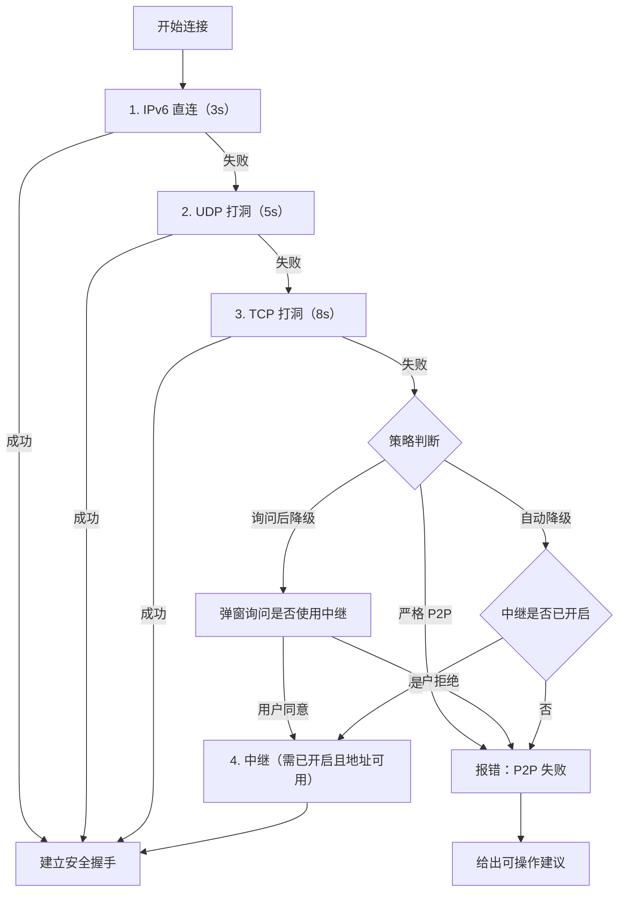

# 05 · 连接与降级策略

> 覆盖两层：连接路径降级（换路径）与质量降级（不换路径）。三档策略可配置，默认「询问后降级」。

---

## 1. 连接降级阶梯

### 1.1 阶梯与判定



| 步骤 | 候选来源 | 成功判定 | 超时 |
|---|---|---|---|
| 1 IPv6 | 双方 AAAA 地址 + 直连探测 | 收到对端握手首包 | 3s |
| 2 UDP | 服务器观测地址 + 本地候选（同时打洞） | 收到对端 PUNCH/握手 | 5s |
| 3 TCP | 服务器协调的 TCP 会合端口（双端同时 connect） | TCP 建连成功 + 握手首包 | 8s |
| 4 中继 | 票据下发的 `relay_addr` | 中继确认双端注册 | 5s |

**候选优先级**：`IPv6 > UDP > TCP > 中继`。同类型多候选按 RTT 探测结果排序（最多探测 4 个）。

### 1.2 失败原因（必须可区分，便于 UI 引导）

| code | 触发 | UI 文案要点 |
|---|---|---|
| `NO_CANDIDATE` | 双方都没有可用候选 | 检查网络 / NAT 类型 |
| `SYMMETRIC_NAT` | 双方均为对称型 NAT | 建议开启中继或换网络 |
| `FIREWALL_BLOCKED` | UDP 全部被丢弃 | 检查防火墙 / 建议 TCP 或中继 |
| `PEER_UNREACHABLE` | 对端无响应 | 确认对方在线 |
| `RELAY_DISABLED` | 需要中继但用户/服务端未开启 | 引导去设置开启 |
| `RELAY_UNREACHABLE` | 中继地址不可达 | 检查中继地址配置 |
| `TIMEOUT` | 阶梯全部超时 | 重试 / 开中继 |

### 1.3 策略三档

| 档位 | 行为 | 默认 |
|---|---|---|
| 严格 P2P | 阶梯失败即报错，**不询问、不用中继** | |
| 询问后降级 | 失败→弹窗「是否使用中继（会消耗服务器带宽）」；同意则本次会话记住 | ✅ |
| 自动降级 | 失败→若中继已开启则直接切；未开启则报错并提示去设置开启 | |

**关键约束**

1. 「自动降级」不等于「自动开启中继」：中继开关仍是用户的显式设置；
2. 「本次会话记住」只影响当前会话，不写回默认策略；
3. 中继关闭时，程序**不建立任何中继 socket**，也不发送任何中继报文。

### 1.4 已连接后掉线

- 指数退避：0.5 / 1 / 2 / 4 / 8 / 15 秒，±20% 抖动，最多 8 次；
- 保留会话状态（会话 ID、密钥、编码协商、权限位、剪贴板缓存）；
- 重连仍按同一阶梯（IPv6 → UDP → TCP）；若原路径是中继，重连仍走中继（因为用户已同意），但不重新询问；
- 重连期间 UI 显示进度与下一次重试时间，可手动"立即重试 / 断开"。

---

## 2. 质量降级阶梯（不换路径）

> **裁决顺序（用户拍板，覆盖本文件旧版本）**
> 冲突时的让位顺序：**保帧率 > 保分辨率 > 保色度 > 保码率**。
> 带宽不足时固定动作序列：**降码率 → 4:4:4 转 4:2:0（含 10-bit→8-bit）→ 降分辨率 → 最后才降帧率**。
> 帧率是最后一道防线：任何情况下不得为画质牺牲 60fps 底线（硬件上限除外）。
> 换言之：**宁可画面糊，也要跟手**。

### 2.0 参考基线与降级的边界

> 下表"参考基线"是**硬件能力参考值**，不是软件上限；软件不截断任何档位，实际档位由能力协商决定（见 `01-总体架构.md` §8、`06-采集与编码.md` §2.7）。

| 指标 | 参考基线（按硬件能力） | 降级时的行为 |
|---|---|---|
| 分辨率 | 被控端原生，常见硬件上限 4K；4K120/1440p144 视编码器能力开放 | 仅按 2160p → 1440p → 1080p → 720p 逐级降，每级必须保持等比 |
| 帧率 | 常见 60；120/144 由显示器刷新率与编码器吞吐决定 | **最后降**；60 以下仅在 720p 仍不足时发生（30fps 为硬下限，移动端 24） |
| 色度/位深 | 4:4:4 + 10-bit 仅部分独显+驱动组合支持（是否可用以探测为准） | 先 4:4:4→4:2:0，再 10-bit→8-bit |
| 码率 | 按内容自适应，不设全局软件上限（由链路与用户设定决定） | **最先降**（每步 -20%） |
| 延迟 | 管线/G2G 双口径 + 分档记录，参考刻度见 `01-总体架构.md` §5.1 | 任何降级不得以"加大缓冲"换稳定；宁可丢帧 |

### 2.1 阶梯


**顺序说明**：②③④ 严格按"码率 → 色度 → 分辨率"执行，帧率永远在最后；⑤ 不属于画质排序，只在 HEVC 路径故障时触发，且**保留分辨率与帧率不变**。

### 2.2 触发阈值

| 级别 | 触发条件（持续 2s 采样） | 动作 | 回退条件（持续 10s） |
|---|---|---|---|
| ① FEC/NACK | 丢包 > 3% 或抖动 > 20ms | M 档 +2；开启 NACK | 丢包 < 1% 且抖动 < 8ms |
| ② 码率 | ①后 10s 内丢包仍 > 5%，或 `send_queue_ms` > 20ms | 码率 ×0.8（不低于 1 Mbps） | 队列 < 5ms 且丢包 < 1% 持续 10s → +10% |
| ③ 色度 | ②后仍有 20ms 级排队 / 带宽不足 | 4:4:4 → 4:2:0；10-bit → 8-bit | 带宽余量 > 30% 持续 15s 且用户未锁画质 |
| ④ 分辨率 | ③ 后仍无法维持目标帧率（`late_frames` 持续上升） | 2160p → 1440p → 1080p → 720p（移动端 540p），保持等比、不二次缩放 | 余量 > 40% 持续 15s，逐级回升 |
| ⑤ 编码器 | HEVC 路径连续 3 次关键帧失败 / 解码端报错 | 切 H.264 硬编（**分辨率与帧率保持不变**） | 不自动回切（避免反复重建编码器），下次会话再试 HEVC |
| ⑥ 帧率 | 720p 下仍持续 `late_frames` | 高刷 144/120 → 90 → 60 → 45 → 30 fps（移动端下限 24） | 余量充足 15s 后按级回升 |

### 2.3 保帧率规则（手感优先）

1. **让步顺序（唯一顺序）**：码率 → 色度（4:4:4→4:2:0、10-bit→8-bit）→ 分辨率 → 帧率。任何实现不得把帧率提到分辨率之前；
2. **帧率下限**：桌面 30 fps、移动端 24 fps；只有在 720p（移动端 540p）仍不足时才允许降帧率；
3. **高刷会话的处理（唯一口径）**：144/120fps 会话在带宽不足时，**先切 4:2:0 / 8-bit（保帧率）**，仍不足才按 144/120 → 90 → 60 → 45 → 30 降帧率。**不存在"先降到 60 而不是先切 4:4:4"的特例**——任何会话的让步顺序都只有一条：码率 → 色度/位深 → 分辨率 → 帧率。
4. **不降输入优先级**：任何降级都不得降低输入通道带宽或优先级；
5. **关键帧控制**：每次重配分辨率/色度只触发 1 次刷新（优先 intra-refresh），且延后到下一个 GOP 边界，避免码率尖峰；
6. **画质锁定**：设置里提供"锁画质（不自动降）"，锁定后只报错提示，不降级；
7. **预览流隔离**：屏幕墙子码流与主码流的降级互不影响（预览降级不得触发主画面降级，反之亦然）。

### 2.4 滞回与防抖

- 每次降级后进入 **5s 冷静期**，期间不再触发更低级别；
- 回升必须连续 10~15s 满足条件；
- 同一级别 60s 内升降超过 3 次 → 判定为震荡，锁在该级别 60s。

---

## 3. 可观测性

### 3.1 界面常驻显示

| 字段 | 位置 | 说明 |
|---|---|---|
| 连接路径 | 会话页顶部徽标 | `直连(IPv6)` / `直连(UDP)` / `直连(TCP)` / `中继` |
| 编码与色度 | 统计面板 | 如 `HEVC 4:4:4 10-bit` |
| 实时码率 / 帧率 | 统计面板 | 1s 刷新 |
| 丢包 / RTT | 统计面板 | 含 p95 |
| 降级原因 | 提示条 | 如「丢包 8%，已降至 1080p30」 |
| 中继流量 | 仅中继路径 | `↑ / ↓ kbps`，累计流量 |

### 3.2 日志（每次降级必须留痕）

```text
[degrade] ts=2026-11-06T12:00:01.123Z level=4 reason=loss_8.2% action=resolution@1080p30
          trigger={loss:8.2, rtt:38, jitter:22, queue_ms:14, bitrate:4200}
          prev={loss:5.1, bitrate:6000, res:1920x1080@60}
```

字段要求：`level`（阶梯级别）、`reason`（人类可读）、`action`、`trigger`（触发指标快照）、`prev`（变更前状态）。日志本地保留 7 天，可在诊断页导出。

---

## 4. 与中继的交互约束

1. 中继开启但打洞成功 → 仍走直连（中继只是"可用兜底"，不是"优先"）；
2. 中继关闭且打洞失败 → 直接报错，UI 提供「前往设置开启中继」按钮（不自动跳转、不自动开启）；
3. 中继状态下若直连恢复（例如网络变化后打洞成功）→ **不自动切回直连**，由用户手动"尝试直连"，避免会话中断；
4. 中继流量统计在关闭开关后立即归零显示。

---

## 5. 与其他流量的联动

### 5.1 文件传输

| 规则 | 说明 |
|---|---|
| 单向影响 | 文件传输**不得触发**画面降级：文件流量不进入视频丢包/延迟/排队的统计样本 |
| 反向暂停 | 视频 `send_queue_ms > 20` 持续 2s、或发生任一级降级 → 文件通道暂停；视频稳定 3s 后自动恢复 |
| 带宽预算 | 单会话默认 ≤ 可用带宽 15%；链路空闲（视频 `send_queue_ms` < 5 且丢包 < 0.5%）时可临时借用至 30%；同一设备多会话时每路按 15% 计算 |
| 优先级 | P4，低于视频；pacer 只在"空闲额度"内发送，不抢占视频令牌桶 |
| 中继 | 走中继时上限收紧为票据 `bandwidth_cap` 的 20% |

### 5.2 剪贴板

| 规则 | 说明 |
|---|---|
| 不参与降级 | 剪贴板流量不触发质量阶梯；拥塞时也不暂停（只做限流与合并） |
| 优先级 | P1，仅次于输入；大段文本/图片受独立令牌桶约束（见 `04-传输协议.md` §2.1） |
| 失败处理 | 超时/超限只提示"本次同步未完成"，不回退画面参数 |

### 5.3 多路会话与屏幕墙

| 规则 | 说明 |
|---|---|
| 独立决策 | 每路会话独立维护质量阶梯状态，互不继承降级结果 |
| 预算切分 | 主码流 ≤ 可用带宽 60%；屏幕墙子码流合计 ≤ 20%；文件 ≤ 15%；控制/剪贴板/统计 ≤ 5% |
| 编码器不足 | 超硬件实例上限时复用实例抽帧，**不因预览而降低主画面参数** |
| 预览降级 | 预览流可降到 1fps 或 JPEG 快照模式（见 `12-多设备与屏幕墙.md`），但该降级只作用于预览 |

### 5.4 全局优先级（资源紧张时的让位表）

| 顺位 | 流量 | 能否被暂停 |
|---|---|---|
| 1 | 输入 | 否 |
| 2 | 剪贴板 | 否（仅限流） |
| 3 | 控制/统计 | 否 |
| 4 | 视频主码流 | 否（只能降参数） |
| 5 | 预览子码流 | 是（可降到快照模式） |
| 6 | 文件 | 是（可暂停/限速） |

---

## 修订记录

| 日期 | 变更 | 来源 |
|---|---|---|
| 2026-11-07 | C01/C02：删除"高刷先降到 60 再切 4:4:4"的特例，让步顺序唯一为 码率 → 色度/位深 → 分辨率 → 帧率；高刷降档补 90 档 | 15 号评审 C01/C02 |
| 2026-11-07 | §2.0 由"硬指标"改为"按硬件能力的参考基线"，延迟改为双口径 + 分档记录 | 用户决策；15 号评审 §3.4 |
| 2026-11-07 | C07：文件带宽预算改为默认 15%、空载可借用至 30%（与 04 号文档对齐） | 15 号评审 C07 |
