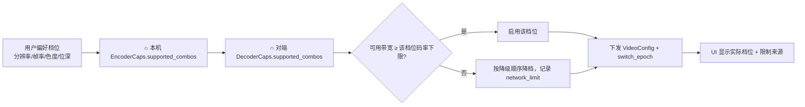

# 06 · 采集与编码

> 参考 Sunshine 的管线结构（采集 → 编码 → 打包），但实现全部自研。
> 编码后端只追求"低延迟 + 高画质 + 可控"三件事。

---

## 1. 采集（rdc-capture）

### 1.1 平台矩阵

| 平台 | 主路径 | 回退 | 帧格式 | 备注 |
|---|---|---|---|---|
| Windows 10 1809+ | **DXGI Desktop Duplication** | Windows Graphics Capture（窗口级/兼容性） | BGRA8 / FP16（HDR） | DXGI 在 UAC 安全桌面、受保护内容、混合 GPU 下会失败，需自动回退；**不支持 Win7/8** |
| macOS 12.3+ | **ScreenCaptureKit** | —（12.3 以下不支持） | BGRA / 10-bit | 需要 TCC 屏幕录制授权；窗口级捕获可用；登录窗/锁屏不可采 |
| Linux X11 | XShm / XComposite | — | BGRA | 支持多屏、可锁定窗口、可无人值守 |
| Linux Wayland | **PipeWire（xdg-desktop-portal）** | — | NV12 / BGRA | **每次会话需用户授权，无法无人值守**；锁屏/登录界面通常不可采；uinput 需 root/input 组 |

### 1.2 采集参数

| 参数 | 默认 | 说明 |
|---|---|---|
| 分辨率 | 被控端原生，最高 4K | **不做二次缩放**；原生超过 4K 时等比降到 3840×2160 |
| 目标帧率 | 60（可配 30/60/120/144） | 与显示器刷新对齐；144 默认单时间层，避免编码器过载 |
| 是否含光标 | 否（分离处理） | 光标位置/形状走独立通道，客户端本地合成；静止画面不再因光标移动而重编码 |
| 脏区 | 开 | 只编码变化矩形；连续 3 帧无变化降到 1 fps 心跳，30s 后降到 0.2 fps |
| 时间码 | 验收模式开 | 画面嵌入不可见时间码，用于客观端到端延迟测量（见 11 号文档 §2.12） |
| HDR | 跟随显示器 | 10-bit + HDR 元数据仅在编码/解码链路都支持时开启 |
| 多屏 | v1 支持 | 协议带 `display_id`；每屏独立采集线程与可选独立编码实例 |

### 1.3 采集线程模型

- 一个显示器一个采集线程，输出到**无锁 SPSC 环形队列（深度 3）**；
- 队列满 → 丢最旧帧并记 `dropped_pre_encode`（绝不阻塞采集回调）；若最旧为 I 帧，则丢次旧 P 帧以保住可解码起点；
- 采集时间戳在"帧到手"瞬间打点，作为整条时延链的起点与时间码基准；
- 帧内存从固定池借用（8 块），归还即复用，禁止逐帧分配。

---

## 2. 编码器抽象（rdc-codec）

### 2.1 能力描述

```
EncoderCaps {
  backend: Nvenc | Amf | Qsv | Vaapi | VideoToolbox | OpenH264
  codecs: [H264, Hevc, Av1]          // 仅列出后端实际可初始化的
  profiles: [...]                     // Main / Main10 / Rext / SCC 等
  chroma: [420, 422, 444]
  bit_depth: [8, 10]
  max_resolution, max_fps             // 仅在 4:2:0 8-bit 下成立，其他组合需实测
  supported_combos: [                 // 关键：按组合记录，不做逐项开关
    {codec, profile, chroma, depth, max_w, max_h, max_fps, min_bitrate, max_bitrate}
  ]
  runtime_reconfigure: bool           // 是否支持在线改分辨率/帧率
  low_latency_modes: [...]            // ULL / TU / RealTime 等
  intra_refresh: bool
  temporal_layers: bool
  qp_map: bool
  scc_tools: [Palette, IntraBC]
  max_instances: u8                   // 并发编码实例上限（实例 ≠ 会话路数）
  max_throughput_px_per_s: u64        // 像素吞吐上限，单路 4K120 可能吃满一个引擎
}

DecoderCaps {
  backend: D3D11VA | VideoToolbox | MediaCodec | VAAPI | Software
  codecs, profiles, chroma, bit_depth
  supported_combos: [{codec, profile, chroma, depth, max_w, max_h, max_fps}]
  max_sessions: u8                    // 并发解码会话上限（屏幕墙预算用）
  zero_copy_texture: bool             // 是否可直出平台纹理
  hdr_display: bool                   // 是否支持 10-bit/HDR 呈现
}
```

**能力探测规则（按组合，不做单点快照）**：

1. 启动时枚举后端与驱动版本，读取 `caps`；查不到 `max_instances` 时按保守值 2。
2. 对候选档位做**真实试编**：至少覆盖 `1080p60 / 1440p60 / 4K60` × `4:2:0 8-bit / 4:2:0 10-bit / 4:4:4 8-bit / 4:4:4 10-bit`，每档 1~2 秒并检查首帧出图与码率落点；失败即从 `supported_combos` 移除。**128×128 单帧探测不能证明 4K120 或 4:4:4 10-bit 可用。**
3. 解码端同样按组合探测，并记录 `max_sessions`；移动端普遍只到 1080p60 / 4:2:0 / 8-bit（这是硬件上限，不是软件限制）。
4. 探测结果缓存到本地（附驱动版本哈希），驱动升级后失效重测；会话建立时只交换缓存摘要，避免每次连接都试编。
5. 探测失败一律"降档并记录原因"，不得静默当作支持。

### 2.2 协商与回落规则

**协商模型：组合交集，不做逐项开关**



**编码后端选择顺序**：HEVC 硬编 → H.264 硬编 → H.264 软编（OpenH264，仅 1080p 兜底）。AV1 仅当两端 `supported_combos` 均含 AV1 且用户显式开启时启用。任一步初始化失败 → 标记该后端本次会话不可用并转下一后端，**不重试风暴**。

**降级阶梯（与 `05-连接与降级策略.md` §2.3 完全一致，只有这一条）**

| 步 | 动作 | 示例（起点 4K120 / 4:4:4 / 10-bit） |
|---|---|---|
| 1 | **降码率**（每步 -20%） | 600 → 480 → 384 Mbps … |
| 2 | **4:4:4 → 4:2:0**（先切色度，保分辨率与帧率） | 4K120 / 4:2:0 / 10-bit |
| 3 | **10-bit → 8-bit** | 4K120 / 4:2:0 / 8-bit |
| 4 | **降分辨率**：2160p → 1440p → 1080p → 720p（等比） | 1440p120 / 4:2:0 / 8-bit |
| 5 | **降帧率**：144/120 → 90 → 60 → 45 → 30（移动端 24 止） | 1440p60、1080p60 |

> **说明**：这是**请求顺序**，不是"必须按此矩阵存在对应的硬件组合"。每一步都先查 `supported_combos`，不支持的组合直接跳过（例如 4K120 4:2:0 8-bit 不存在就跳到 1440p）。**任何情况下不得先降帧率、再切色度**——旧版"高刷先降到 60"的特例已废止。

> **读法**：只要硬件支持，最高档（4K120 / 4:4:4 / 10-bit）就允许启用；表只定义降级路径，不定义软件天花板。

**约束**：4K + 4:4:4 + 10-bit + 120fps 在多数消费级编码器上**不存在可用组合**（`supported_combos` 探测会直接排除），此时按上表逐步降级，并在 UI 明确标注"编码器能力限制"，**不允许"标称 4:4:4 实为 4:2:0"**。

### 2.3 4:4:4 与 10-bit 的启用条件

| 条件 | 4:4:4 | 10-bit / HDR |
|---|---|---|
| 用户偏好 | 设置中开启"高保真文字/设计模式" | 设置中开启 HDR |
| 编码端 | 后端 `caps.chroma` 含 444，且分辨率/帧率在能力内 | 后端含 10-bit 且驱动支持 P010 |
| 解码端 | 客户端硬解支持对应 profile | 客户端支持 10-bit 渲染与 HDR 显示 |
| 内容 | 静态文字/设计类收益最大；高速视频收益低 | 仅 HDR 内容有意义 |
| 网络 | 4:4:4 码率需求约为 4:2:0 的 1.5~2 倍 | 10-bit +30% |
| 失败处理 | 不满足则自动回 4:2:0，并在统计中说明原因 | 不满足则回 8-bit SDR |

> 说明：4:4:4 与 10-bit 都是"能力协商的结果"，不是开关一开就必然生效；UI 必须显示最终生效值。

### 2.4 低延迟参数（各后端要点）

| 后端 | 关键参数 | 说明 |
|---|---|---|
| NVENC | preset P1~P7、`tune=ULL`、CBR、小 VBV、关 B 帧、repeat SPS/PPS、slice 输出 | 消费卡并发会话数有限，需在能力探测阶段记录 |
| AMF | `quality=lowlatency`、关 pre-analysis、关 B 帧 | 4:4:4 仅部分 GPU 支持，需实测 |
| QSV / oneVPL | TU 低延迟档（避免低功耗模式）、关 B 帧 | Arc 支持 AV1 硬编 |
| VAAPI | `rc_mode=CBR`、`bf=0`、`keyint` 可配 | 需注意 NV12 输入限制 |
| VideoToolbox | `RealTime=true`、`AllowFrameReordering=false`、`MaxFrameDelayCount=0` | 仅 macOS；无 AV1 编码 |
| 软件（OpenH264） | `usage=screen`、关 B 帧、单 slice | 兜底用，1080p60 需多核 |

> **NVENC 当前状态（2026-11-08，Phase 1 骨架）**：后端已接入选择链（AMF → NVENC → oneVPL → MFT → 软编），
> `rdc-nvenc.dll` 只负责运行期 `LoadLibrary("nvEncodeAPI64.dll")` 做版本探测，系统驱动 DLL 不随包分发；
> 编码会话尚未实装，`RDC_ENCODER=nvenc` 在能力不可用时会输出 `code=` 回退原因并安全回退到 MFT。
> N 卡实机验收前置条件与判据见 `logs/PLAN-NVENC-20261108.md`；真启用、1080p60、p99、掉帧、
> 10 分钟稳定性、并发会话上限、颜色通道在当前环境一律**未验证**，不得写成通过。

### 2.5 在线重配规则

| 变更 | 实现 | 代价 |
|---|---|---|
| 码率 | 直接改 RC 参数，**不重建会话**；单步限幅 ±20% | 无关键帧 |
| FEC 档位 | 传输层调整，编码无关 | 无 |
| 色度 / 位深 | 优先热重配；不支持则重建会话，并以 intra-refresh 作为新起点 | 抖动 ≤ 200ms，无 IDR 尖峰 |
| 分辨率 | 热重配，或**双编码器预切换**（见 11 号文档 §2.7） | 黑屏 ≤ 200ms；双实例路径可 0 帧黑屏 |
| 帧率 | 重配；分辨率不变时影响小 | 可能短时抖动 |
| 时间层数 | 重配 `temporal_layers` | 无黑屏；高层帧按需丢弃 |
| 编码器切换 | 重建 + 重新协商 | ≤ 500ms 冻结，UI 必须提示 |

**统一要求**：任何重配都必须携带"切换栅栏"（`switch_epoch`），接收端只接受 epoch ≥ 当前值的码流，避免旧帧混入新参数序列。

### 2.6 实例预算（实例 ≠ 会话路数）

| 后端 | 常见并发编码实例 | 单实例能否同时输出主+子两路 | 备注 |
|---|---|---|---|
| NVIDIA GeForce | 2~5（驱动限制，随卡型不同） | **否** | 单路 4K120 或 4:4:4 10-bit 可吃满一个引擎；同卡实例数还受 NVENC 引擎数限制 |
| AMD（RDNA 系） | 约 2~4 | **否** | 多路需多实例或降档共享 |
| Intel QSV / oneVPL | 较高（受内存带宽限制） | **否** | 核显更易撞内存带宽，需实测 |
| VideoToolbox | 通常 2~4 | **否** | macOS 上 4:4:4 不在通用能力内 |
| OpenH264（软件） | 受 CPU 核数限制 | **否** | 仅兜底，不参与屏幕墙 |

**规则**：

1. **主码流每会话独占 1 个实例**（不允许共享，避免互相拖慢）。
2. **预览 / 观看者 / 屏幕墙一律使用独立实例**（低分辨率、低帧率、长 GOP）；`max_instances` 不足时降为 **JPEG 快照模式**（快照不算编码流，也不占用编码实例）。
3. **禁止"单实例双输出"与"观看者不占实例"的资源口径**：单编码会话在 API 层面不支持两个独立分辨率/参数的同时输出，必须按实例计数。
4. **解码侧同样计数**：屏幕墙路数 ≤ `DecoderCaps.max_sessions`；超出时降路数或降为快照，不允许无限加路。
5. **并发会话默认 1 路主码流、最多 2 路**；4 路仅在「编码实例 + 解码实例 + 内存」三项探测均通过后开放（工作站/企业配置）。
6. 实例创建失败 1 次即标记该后端本次会话不可用，转下一后端，**不重试风暴**。

### 2.7 能力协商矩阵（常见编码器参考基线）

> 用途：实现与联调的参考，**不是验收标准，也不是软件上限**。标 ⚠️ 的组合必须在本项目硬件上实测后写回本文；数据来源为公开驱动/SDK 能力边界与 15 号评审 §3.3/§10.5。

| 编码器 | H.264 4:2:0 8-bit | HEVC 4:2:0 8-bit | HEVC 4:2:0 10-bit | HEVC 4:4:4 8/10-bit | 4K60 | 4K120 | 1440p144 | 常见并发实例 | 备注 |
|---|---|---|---|---|---|---|---|---|---|
| NVENC（Turing 及以后） | ✅ | ✅ | ✅ | ⚠️ 部分代际，10-bit 待实测 | ✅ | ⚠️ 待实测（可能吃满 2 个引擎） | ⚠️ | 2~5 | 消费卡 4:4:4 支持有限，驱动差异大 |
| AMF（RDNA2 及以后） | ✅ | ✅ | ✅ | ⚠️ 仅部分 GPU | ✅ | ⚠️ 待实测 | ⚠️ 待实测 | 2~4 | 需 AMF runtime；4:4:4 需白名单 |
| QSV / oneVPL（Gen12+ / Arc） | ✅ | ✅ | ✅ | ⚠️ 待实测 | ✅ | ⚠️ 待实测 | ⚠️ | 较高 | 核显受内存带宽限制 |
| VideoToolbox（macOS） | ✅ | ✅ | ✅ | ❌ 通用能力不含 | ✅ | ⚠️ 待实测 | ⚠️ | 2~4 | macOS 被控常见上限为 4:2:0 |
| VAAPI（Intel / AMD） | ✅ | ✅ | ✅ | ⚠️ 待实测 | ✅ | ❌ 常见不支持 | ⚠️ | 依驱动 | 需 libva 与驱动版本匹配 |
| MediaCodec（移动端） | ✅ | ⚠️ 依 SoC | ⚠️ 依 SoC | ❌ | ❌ | ❌ | ❌ | 1~4 | 常见上限 1080p60 / 4:2:0 / 8-bit |
| OpenH264（软件） | ✅ | ❌ | ❌ | ❌ | ❌ | ❌ | ❌ | 受 CPU 限制 | 仅 1080p 兜底；专利另计 |

图例：✅ 常见支持；⚠️ 部分支持或待实测；❌ 常见不支持。

### 2.8 各档位码率参考区间

| 档位（分辨率 / 帧率 / 色度 / 位深） | 参考码率 | 说明 |
|---|---|---|
| 1080p60 / 4:2:0 / 8-bit | 8~20 Mbps | 主流可用档 |
| 1080p120 / 4:2:0 / 8~10-bit | 20~40 Mbps | 需 120Hz 屏与硬解 |
| 1440p60 / 4:2:0 / 10-bit | 30~60 Mbps | HDR/高色深场景 |
| 1440p120 / 4:2:0 / 8~10-bit | 60~120 Mbps | 高刷 + 高分辨率 |
| 4K60 / 4:2:0 / 8~10-bit | 40~120 Mbps | 编码器吞吐敏感 |
| 4K60 / 4:4:4 / 8-bit | 80~180 Mbps | 仅部分 NVIDIA；解码端需实测 |
| 4K60 / 4:4:4 / 10-bit | 120~250 Mbps | **多数消费级硬件无可用组合** |
| 4K120 / 4:2:0 / 10-bit | 150~250 Mbps | 编码/解码/线材均紧张 |
| 4K120 / 4:4:4 / 10-bit | 300~1500 Mbps | 物理下限极高，多数链路不成立 |

**读法**：区间随内容类型浮动（静态文字/代码可低 30%~50%，高速视频与滚动取上限）。**软件不设全局码率上限**；链路不足时由拥塞控制降档并在 UI 显示 `network_limit`（见 `01-总体架构.md` §8）。

---

## 3. 色彩与 HDR 管线

1. 采集得到 `scRGB`（Windows HDR）或 `sRGB`（SDR）；
2. 按目标输出选择：
   - SDR 路径：`sRGB → BT.709 / 8-bit`；
   - HDR 路径：`scRGB → PQ (BT.2020) / 10-bit`，并附带 HDR10 元数据（maxCLL / maxFALL）；
3. 编码器输入必须是 `P010`（10-bit）或 `NV12`（8-bit），避免中间 RGB 转换带来的额外拷贝；
4. 客户端若为 SDR 显示器：在**解码后**做色调映射（tonemap），不在编码端做（编码端做会丢失信息）。

---

## 4. 码率与帧率控制策略（与传输层联动）

| 项 | 规则 |
|---|---|
| 目标码率 | 由拥塞控制给出（含 FEC 冗余）；编码器按 CBR 执行；软件**不设全局码率上限**，上限由链路能力与用户设定决定 |
| 码率参考区间 | 见 §2.8「各档位码率参考区间」，与帧率/分辨率/色度联动，不单独截断 |
| 关键帧间隔 | 默认 2s；丢包恢复时由 NACK/FEC 触发按需关键帧 |
| 帧内刷新 | 开启 intra-refresh（rolling），削平周期性 IDR 尖峰 |
| 静止画面 | 采集端降帧，编码端随之减少输出 |
| 降级顺序 | 码率 → 色度/位深 → 分辨率 → 帧率（与《05》§2.3 唯一顺序一致）；**删除旧版"先降分辨率再降帧率"表述** |
| 码率超发 | 实测码率 > 目标 110% 持续 2s → 强制降 QP 上限 |

---

## 5. 编码质量调优（v1 范围）

> 本节原标"阶段 5"，按 11 号文档的口径**全部并入 v1**。

| 场景 | 策略 | 对应实现点 |
|---|---|---|
| 文字 / 代码 | 文字块低 QP（QP map / zones），启用 SCC 工具（palette / IntraBC），4:4:4 优先 | `VideoConfig.qp_map` + `scc_tools` |
| 视频 / 游戏 | 保帧率、适度 QP、时间层分级、intra-refresh | `temporal_layers` + `intra_refresh` |
| 演示 / 静态 PPT | 脏区 + 静止降帧 + 长 GOP，恢复时立即补齐 | `dirty_region` + `static_detect` |
| 弱网 | 按 05 的裁决顺序：码率 → 色度 → 分辨率 → 帧率 | `GopController` + 质量阶梯 |
| 屏幕墙预览 | 480p / 5~10fps / 长 GOP / 200~400kbps，**独立实例**；实例不足改用 JPEG 快照 | 见 `12-多设备与屏幕墙.md` |

调优方法：固定内容集（文字滚动、视频播放、3D 游戏、窗口拖动、代码编辑器）在目标硬件上做 A/B，记录 `VMAF/SSIM`、端到端延迟（时间码）、每帧编码耗时，形成每后端参数基线，并纳入 CI 基准（见 11 号文档 §2.13）。

---

## 6. 已知限制（编码/解码侧）

> 这些是硬件与系统限制，不是软件设计缺口；产品行为是"探测 → 降档 → 明示原因"，不得静默假装支持。

| 限制 | 影响 | 产品行为 |
|---|---|---|
| 编码实例数 ≠ 会话路数 | 多路会话/屏幕墙可能无实例可用 | 按 §2.6 实例预算；不足时用独立实例降档或 JPEG 快照，并在 HUD 标注 |
| 单编码会话不支持双输出 | "主码流 + 子码流同实例"不成立 | 子码流/预览走独立实例或快照（§2.6） |
| 4:4:4 + 10-bit 组合不确定 | 部分独显/驱动可用，多数不可用 | 以 `supported_combos` 实测为准；不可用则回落并在 UI 标注 `hw_encoder_limit` |
| VideoToolbox 4:4:4 缺失 | macOS 被控常见只能 4:2:0 | 回落 4:2:0，说明"macOS 编码器不支持 4:4:4" |
| 移动端解码上限（常见 1080p60 / 4:2:0 / 8-bit） | 4K/高刷/10-bit 在手机端不可用 | `DecoderCaps` 判定；由主控端主动降档，不发送超出能力的码流 |
| 解码会话数有限（NVDEC / MediaCodec / VT） | 屏幕墙 16 路不可行 | 路数 ≤ `max_sessions`；超出降路数或快照 |
| Flutter 外部纹理的 10-bit/HDR | 合成管线以 8-bit sRGB 为主 | 10-bit 走"原生视频层 + Flutter 控件叠加"；否则只输出 8-bit，并在 UI 说明 |
| GPU 设备丢失 / TDR / 驱动崩溃 | 编码器中途失效 | 监听 device lost，重建编码器；连续失败则降档或转下一后端 |
| Windows 定时器粒度 15.6ms | 1ms pacer 无法按 1ms 触发 | 启动时 `timeBeginPeriod(1)` 或高精度等待；失败则放宽 pacer 并记录 |

---

## 修订记录

| 日期 | 变更 | 来源 |
|---|---|---|
| 2026-11-07 | §2.1 能力描述扩为 `EncoderCaps` + `DecoderCaps`，探测改为"按组合真实试编"，删除 128×128 单帧探测 | 用户决策；15 号评审 §3.4-8、§7.2 |
| 2026-11-07 | §2.2 改为"组合交集 + 档位回落顺序 D0~D5"，删除"软件最高档"表述 | 用户决策；15 号评审 §3.4-8 |
| 2026-11-07 | 新增 §2.7 能力协商矩阵、§2.8 各档位码率参考区间 | 用户补充要求；15 号评审 §3.3 |
| 2026-11-07 | C31：删除"单实例双输出/观看者不占实例"，改为独立实例或 JPEG 快照；§2.6 改为实例预算模型 | 15 号评审 C31/C30 |
| 2026-11-07 | C28：删除 Windows 7/8 GDI 与 CGDisplayStream 回退，统一 Win10 1809+ / macOS 12.3+ | 15 号评审 C28 |
| 2026-11-07 | C01：§4 降级顺序改为 码率 → 色度/位深 → 分辨率 → 帧率；删除全局 200 Mbps 软件上限 | 15 号评审 C01、§3.4-6 |
| 2026-11-07 | 新增 §6 编码/解码已知限制（实例、双输出、4:4:4、移动端解码、纹理 10-bit、TDR、定时器） | 用户要求（平台限制补正）；15 号评审 §2.1 |
