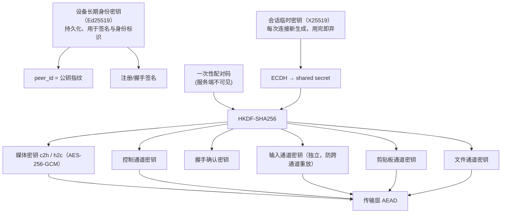
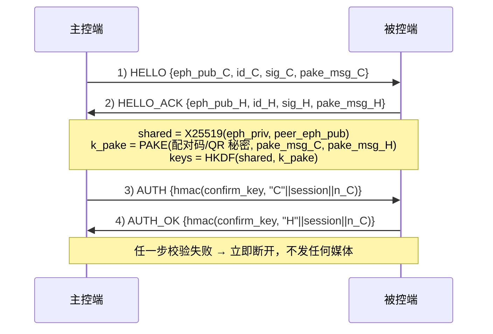
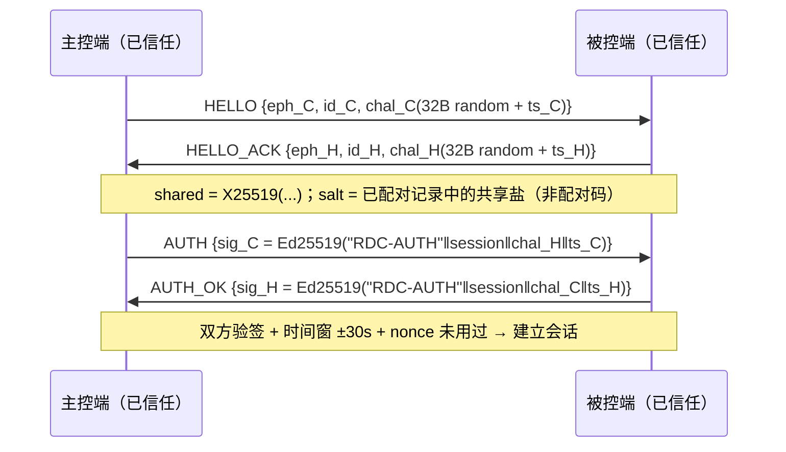

# 07 · 安全设计

> 目标：即使信令服务器与中继都被攻破，攻击者也拿不到画面内容，也无法伪造身份或篡改输入。
> 所有密码学原语使用成熟库，不自研算法。

---

## 1. 密钥体系



| 密钥 | 生命周期 | 存储 |
|---|---|---|
| 身份私钥 | 设备终身（可重置） | Windows DPAPI / macOS Keychain / Linux Secret Service；Android Keystore / iOS Keychain；**禁止明文落盘** |
| 会话临时私钥 | 单次会话 | 仅内存，会话结束清零 |
| 媒体/控制/输入/剪贴板/文件密钥 | 单次会话 | 仅内存；中继切换时重新派生 |
| 配对码 | 120s 一次性 | 仅内存（被控端显示） |
| 信任设备记录（对端公钥 + 别名 + 策略 + 有效期） | 持久 | 公钥可明文存；私钥永不外传 |

---

## 2. 握手流程（4 报文）



**要点**

1. 身份签名（`sig`）覆盖 `eph_pub + session_id + 时间戳`，防中间人替换临时公钥；
2. **配对码不直接做 HKDF salt**，而是作为 PAKE 口令参与密钥交换：攻击者截获报文后无法离线穷举，每次猜测都必须完成一次真实交互（在线），从而被限速机制约束；
3. 握手阶段不传输任何可被重放的长期凭证；
4. 握手超时 5s，最多重试 1 次；连续失败按 §2.1 的限速阶梯处理，而不是只数"3 次"。

### 2.1 配对码方案（高熵 + 分组展示 + PAKE）

| 项 | 规则 |
|---|---|
| 形态 A（默认） | **二维码 / 深链**：随机 128-bit 秘密，含 `peer_id` + 一次性 `pair_id`；零人工输入 |
| 形态 B（手动） | **10 位 Crockford Base32**（去掉 I/L/O/U），50-bit 熵；展示为 `XXXX-XXXX-XX` 分组，支持大小写与连字符容错 |
| 双端确认 | 握手成功后两端显示 **4 位 SAS**（short auth string，由 `k_pake` 派生），用户比对一致才点"确认"；防止未限速场景下的置换攻击 |
| 有效期 | 120s，一次性；成功、失败 3 次或用户手动作废后立即失效；不在任何持久化介质留存 |
| 显示位置 | 仅被控端本地 UI；**不经信令、不经中继、不进日志、不进崩溃报告** |

**失败与限速阶梯（服务端与本地双端执行）**

| 触发条件 | 处置 |
|---|---|
| 单码失败 1~2 次 | 返回统一错误码（不区分"码错/过期"），延迟 1s 后允许重试 |
| 单码失败 3 次 | 该配对码立即作废，被控端 UI 提示"配对码已失效，请刷新" |
| 单 IP 5 次/10 分钟 | 指数退避：1s → 2s → 4s → 8s → 16s → 32s → 60s（封顶），退避期内直接拒绝 |
| 单 IP 15 次/小时 | **临时封禁 15 分钟**，期间该 IP 只能走 TLS 信令但不可发起握手 |
| 同一目标 `peer_id` 10 次/10 分钟 | 封禁该目标的新配对 30 分钟 + 本地告警 + 审计记录 |
| 封禁期再犯 | 封禁时长翻倍（上限 24h），并要求目标设备本地二次确认才解除 |

**抗离线爆破强度计算**

| 形态 | 有效熵 | 离线爆破（无 PAKE） | 引入 PAKE 后 |
|---|---|---|---|
| 手动 10 位 Base32 | 50 bit（2^50 ≈ 1.13×10^15） | 平均 2^49 次；单机 10^6 次/s ≈ 17.8 年，GPU 集群 10^9 次/s ≈ 6.5 天 | **离线不可行**：每次猜测需一次完整 PAKE 交互 |
| 二维码 | 128 bit | 不可行 | 不可行 |
| 在线爆破（PAKE 下唯一路径） | — | — | 单码最多 3 次尝试即作废 → 单码成功率 ≤ 3/2^50；叠加 IP 退避与封禁后，1 小时内成功概率 < 10^-9 |

> 结论：安全性不依赖"码够长"，而依赖 **PAKE（消除离线爆破）+ 单码 3 次作废（消除在线穷举）+ IP 退避/封禁（消除分布式撞库）** 三层。旧版"6 位数字 + 3 次失败"在离线爆破下只需 ~10^6 次尝试，必须废止。

**验证方式**

1. 单测：同一配对码第 4 次尝试必须返回"已失效"，且错误码与"码错"不可区分；
2. 集成测试：脚本从同一 IP 连续发起，断言退避曲线 1/2/4/8/16/32/60s 与 15 次后封禁；
3. 红队用例：抓取握手报文后尝试离线穷举，断言无可用校验路径（PAKE 无离线判别器）；
4. 常量时间：PAKE 与 HMAC 校验失败路径耗时差异 < 5%，防止时序侧信道。

**残留风险**

- 用户主动把配对码截图/转发给他人 → 属社会工程，靠 120s TTL + SAS 双端比对 + 被控端"谁在连接"提示缓解；
- 攻击者已控制被控端进程时可读内存中的码 → 属"本机已被攻破"，超出威胁模型；
- 二维码被摄像头旁路拍摄 → 需物理接近，且仍需 SAS 确认。

### 2.2 免密登录（信任设备挑战-应答，v1）

**首次配对**：走 §2 的 4 报文 + 一次性配对码；成功后双方各自保存对端公钥（`peer_id = 公钥指纹`）、别名、信任策略与有效期。之后不再需要配对码。

**后续连接（免密）**：



| 要素 | 规则 |
|---|---|
| 挑战格式 | `challenge = 32 字节 CSPRNG 随机数 + 8 字节毫秒时间戳`，一次性使用 |
| 签名内容 | `"RDC-AUTH" ‖ session_id ‖ challenge ‖ 发送方 ts`（域分隔防止跨用途重放） |
| 重放防护 | ① 时间窗 ±30s；② nonce 内存滑动窗口保留 5 分钟；③ 会话级 nonce 哈希持久保留 24h（跨重启防重放） |
| 签名失败 | 直接断开，不降级为配对码流程；连续 3 次失败 → 该 peer_id 本地冷却 5 分钟 |
| 密钥交换 | 临时 X25519 每次新生成；长期私钥只用于签名，不参与密钥交换 |

**每台设备的三档策略**（在设备详情页单独设置）：

| 档位 | 行为 | 约束 |
|---|---|---|
| 每次确认（默认） | 连接时被控端弹窗确认（显示对端指纹） | 需本地交互，超时 30s 自动拒绝 |
| 信任设备自动接受 | 验签通过即建立会话，不弹窗 | 仍校验时间窗与 nonce |
| 完全免密（不推荐） | 验签通过 + 跳过一切本地确认 | **仅内网使用**；开启时 UI 红色警示、二次确认、会话顶部常驻提示 |

**密钥存储**：

| 平台 | 私钥存储 | 保护方式 |
|---|---|---|
| Windows | DPAPI（CurrentUser scope）+ 文件 ACL | 绑定当前用户，跨用户不可读 |
| macOS | Keychain（`kSecAttrAccessibleWhenUnlockedThisDeviceOnly`） | 不随 iCloud 同步、不迁移 |
| Linux | Secret Service（GNOME Keyring / KWallet） | 无桌面密钥环时**拒绝自动接受**，仅允许每次确认 |
| Android | Android Keystore（优先 StrongBox） | 密钥不可导出；前置生物识别（`BiometricPrompt`） |
| iOS | Keychain（`kSecAttrAccessibleWhenUnlockedThisDeviceOnly` + `SecAccessControl` biometry） | 读取需 Face ID / Touch ID |

**禁止**：明文私钥落盘、把私钥写进日志/崩溃报告、把私钥通过信令或中继传输、在内存中长久驻留不擦除。

**信任管理**：

1. 列表项：指纹、别名、分组、策略档、有效期、最近连接时间、延迟快照；
2. 单台吊销：删除本地记录 + 加入本地撤销表（下次连接强制重新配对）；
3. 批量清空：二次确认 + 影响说明（所有设备需重新配对）；
4. 有效期：默认 30 天，到期转回"每次确认"，需用户重新确认后才续期；
5. **失效即重配**：系统重装、密钥丢失、指纹变更 → 必须重新配对；不提供任何"记住我"绕过路径。

**移动端**：自动接受前必须先通过系统生物识别/设备凭证解锁私钥；识别失败按"每次确认"处理。

**与信令鉴权的分工**：信令只验证"注册者持有该 peer_id 对应私钥"（防冒名注册），**不承担端到端身份认证**；真正的对端认证在媒体握手（本节）完成，服务端不可见、不可替代。

### 2.3 混合信任模型（v1，方案三）

**核心立场**：账号是**可选增强**，不是使用前提。不登录即可完成配对与连接，功能不阉割。

| 场景 | 信任来源 | 是否需要账号 |
|---|---|---|
| 两台自己的设备（本地模式） | 一次性配对码建立互信，写入本地地址簿 | 否 |
| 同账号多设备 | 登录后上报公钥，服务端下发同账号公钥列表；连接时双向验签即视为可信 | 是（可选） |
| 跨账号 / 他人设备 | 一次性配对码或手动"加入信任" | 否 |

**信任判定优先级**：本地显式信任（含有效期） > 同账号列表匹配 > 未信任（必须配对码）。三档策略（每次确认 / 信任设备自动接受 / 完全免密）对以上三类设备都适用，可按设备单独设置。

**账号服务数据边界**：

| 类别 | 内容 |
|---|---|
| 存 | 邮箱、密码哈希（Argon2id，服务端）、`peer_id`（公钥指纹）、设备名、平台、公钥、最后在线时间、账号归属 |
| **不存** | 画面、文件、剪贴板内容、连接历史、会话内容、设备别名/分组/备注 |
| 密码 | 服务端 Argon2id（内存 ≥ 64MB，迭代 ≥ 3），不存明文、不存可逆哈希 |
| Token | `access_token` 15 min + `refresh_token` 30 d；**与设备公钥指纹绑定**，刷新需设备私钥签名（防 token 被盗后异地使用） |
| 第三方登录 | **不做**（不接 OAuth，减少攻击面与合规面） |

**端到端加密与账号的关系**：会话密钥由 X25519 + Ed25519 派生，**与账号、token、服务端完全无关**；账号服务被攻破、被拖库，攻击者也只能拿到公钥与邮箱，无法解密任何媒体内容。**注意区分**：媒体机密性不受影响 ≠ 访问权限不受影响——旧设计的"账号服务可签发 grant"会让攻击者以主控端身份连上并看到解密画面；现设计已将 grant 改为 **owner 设备签名**（§4.4），因此该路径也一并关闭。

**离线与降级**：

1. 账号服务不可达 → 使用本地缓存（设备列表、信任关系、地址簿）；**不阻断**本地配对与 P2P 连接；
2. Token 失效 → 提示"需重新登录以同步设备列表"，连接功能照常；
3. 服务端下发列表版本回退 → 拒绝并保留本地较新版本（防回滚攻击）。

**吊销与删除**：

| 操作 | 生效范围 | 生效延迟 | 说明 |
|---|---|---|---|
| 账号远程吊销设备 | 该设备从同账号列表移除，下次连接被拒 | 下次启动/刷新 token（≤ 15 min + 心跳 90s） | **不断开已建立的 P2P 会话**（无中心可切断），UI 必须写明 |
| 本机解绑设备 | 删除本地私钥与缓存 | 立即 | 需重新配对或重新登录 |
| 注销账号 | 删除账号记录、设备关联、token | 立即；7 天冷却后硬删除 | 本地地址簿/信任关系不删（本地数据，用户可另行清空） |

**风险登记**：同账号自动互信的安全边界等同于账号服务可信度。因此：

1. 同账号设备默认「自动接受」，但**允许对单台改为「每次确认」**；
2. 「完全免密」仍只允许内网使用，且必须二次确认 + 常驻警示；
3. 服务端永不接触私钥；列表注入只能伪造"同账号"身份，仍需攻破 TLS 与账号本身。

### 2.4 信令通道加密（全程 TLS 1.3 over QUIC，禁止明文 UDP）

**原则**：信令通道承载 `peer_id`、设备地址、`access_token`、中继票据等**高价值元数据**，必须全程加密；**任何 token、peer_id、地址都不得以明文出现在 UDP/TCP 载荷或 URL query 中**。

| 项 | 规则 |
|---|---|
| 传输层 | 主用 **QUIC + TLS 1.3**（HTTP/3 语义）；回退 **TLS 1.3 over TCP**。若部署环境无法用 TLS（如自建覆盖网），必须改用 **Noise Protocol Framework（Noise_XX_25519_AESGCM）** 做等价加密，**不得降级为明文**。裸 UDP 仅允许出现在加密包内部 |
| 证书 | 账号服务使用独立 CA；客户端内置 CA 公钥指纹（pin），版本更新才可换 pin；**Release 构建禁止任何 `insecure`/跳过校验开关** |
| 密钥协商 | TLS 1.3：X25519 密钥交换 + AES-256-GCM 或 ChaCha20-Poly1305；**禁用 0-RTT 携带鉴权数据**（防重放与降级） |
| 鉴权位置 | `access_token` 只放 `Authorization` 头（TLS 内），**不放 query、不放 URL 路径、不写访问日志** |
| 应用层签名 | 注册/上报公钥的请求签名覆盖 `"RDC-SIGNAL"‖peer_id‖ts‖nonce‖body_hash`，服务端验签后才入库 |
| 防重放 | TLS 记录层序号 + 应用层 `ts`（±30s）+ `nonce` 滑动窗口 5 min + 服务端已用 nonce 表 24h；重放请求返回 `409` 并计入风控 |
| 会话票据 | 中继票据只在 TLS 通道内下发，绑定 `session_id` + 双方 `peer_id` + 带宽上限，TTL ≤ 5 min，一次性 |
| 前向保密 | 媒体密钥与会话临时密钥独立派生（§1），**信令 TLS 长期密钥泄露不影响媒体机密性** |
| 证书固定更新 | pin 变更需随客户端版本发布并保留旧 pin 一个版本做灰度，避免"换 CA 即断连" |

**攻击场景与验证**

| 攻击场景 | 修复后结果 | 验证方式 |
|---|---|---|
| 被动抓包读取 token / peer_id | 只能看到 TLS 密文；元数据仅在服务端可见 | 抓包断言无明文 token、无明文 peer_id、URL 无敏感参数 |
| 中间人替换服务端证书 | pin 校验失败即拒绝，不降级 | 集成测试：自签中间证书必须握手失败 |
| 重放旧注册/授权请求 | `ts` + nonce + 服务端 nonce 表三重拒绝 | 重放脚本断言 409，且计数进风控 |
| 0-RTT 重放（QUIC） | 鉴权数据不走 0-RTT，重放无效 | 断言 `early_data` 关闭 |
| 降级到明文 UDP | 客户端拒绝非 TLS 的 token 通道 | 端口扫描：无明文 token 服务 |

**残留风险**

- 服务端是 TLS 终止点，**元数据（ID、IP、时间、连接频次）对服务端可见**；这是"不出画面"的必要代价，需在隐私政策写明；
- 证书 pin 更新依赖客户端版本节奏，旧版本在 CA 轮换后可能失联（用双 pin 灰度缓解）；
- 企业中间盒做 TLS 检查时会破坏 pin（需明确"不支持企业 MITM 证书"）。

---

## 3. 频道加密

| 通道 | 密钥 | Nonce 规则 | 说明 |
|---|---|---|---|
| 视频 / 音频 | 独立 AEAD 密钥 | 4 字节零 + 8 字节单调计数 | 计数严格递增，回绕前必须换密钥（实际不会） |
| 输入 | 独立密钥 | 同上 | 防止把视频包重放进输入通道 |
| 控制 | 独立密钥 | 同上 | 握手、重配、权限位 |
| 剪贴板 | `k_clipboard`（独立） | 同上 | 内容哈希作为附加 AAD，防篡改后"看似一致" |
| 文件 | `k_file`（独立） | 同上 | 每块 AAD 含 `file_id‖block_index‖offset`，块不可互换 |

**报文格式**：头部明文（作为 AAD）+ 载荷 AEAD + 16 字节 tag。头部中的 `seq` 只有通过校验后才推进接收窗口，防重放。

**算法选择**：桌面优先 AES-256-GCM（AES-NI 加速）；移动端可依 CPU 能力选 ChaCha20-Poly1305（同一握手，协商 cipher 位）。

---

## 4. 权限与授权

| 权限位 | 含义 | 默认 |
|---|---|---|
| `VIEW` | 观看画面 | 开 |
| `CONTROL` | 注入键鼠 | 关（需被控端勾选或配对码授权） |
| `CLIPBOARD_TEXT` | 文本剪贴板双向 | 关（可单独开） |
| `CLIPBOARD_IMAGE` | 图片剪贴板双向 | 关（单独授权，默认仅确认后传） |
| `FILE_TRANSFER` | 文件传输（v1） | 关（接收需确认） |
| `AUDIO` | 音频回传（v1 后期补齐） | 关 |
| `POWER` | 电源操作（关机/重启/睡眠/锁屏） | 关（**单次确认**，不可批量授予） |
| `DISPLAY_SWITCH` | 切换显示器 / 选择多屏 | 关（默认锁定当前屏） |
| `RECONNECT` | 允许断线自动重连 | 开 |

> 权限位是 `u16` 位图，**同一位既用于会话内授权，也用于多账号授权令牌**（`03-信令协议.md` §4.7.2）；`POWER` 与 `DISPLAY_SWITCH` 不得出现在"默认全开"的授权模板里。

**授权流程**

1. 主控端在 `call` 中声明请求的权限位；
2. 被控端在 `accept` 前展示「对方请求：观看 / 控制 / 剪贴板」，用户可逐项勾选；
3. 权限位写入会话状态，**运行中不可静默提升**；提升需再次确认；
4. 被控端界面常驻"正在被控制"指示，提供一键断开。

### 4.1 剪贴板内容安全（v1）

| 风险 | 措施 |
|---|---|
| 密码/凭据泄露 | 识别敏感格式（密码管理器专用剪贴板格式、`x-kde-passwordManagerHint`、Windows `ExcludeClipboardContentFromMonitorProcessing`）→ **直接跳过，不读取不发送** |
| 指定应用内容外泄 | 按进程名排除名单（用户可编辑），命中则不采集 |
| 大段内容拖垮通道 | 文本 ≤ 1 MB、图片 ≤ 10 MB；超限压缩或需用户确认；独立令牌桶限流 |
| 跨会话泄露 | 只在已建立加密会话内传输；会话结束即丢弃剪贴板同步缓存 |
| 用户不想同步 | 全局开关（默认关）+ 会话内可随时关闭 + "清空远端剪贴板"操作 |
| 富文本夹带 | 富文本降级纯文本，丢弃隐藏字段与对象嵌入 |

**默认策略**：桌面端文本自动同步需用户先开启"剪贴板同步"总开关；图片与文件一律需确认；移动端一律手动触发。

### 4.2 文件传输安全（v1）

| 风险 | 措施 |
|---|---|
| 路径穿越 | 接收端对每个相对路径做规范化校验：拒绝 `..`、绝对路径、盘符、UNC、以 `/` 开头；规范化后必须仍在受限根目录内 |
| 符号链接逃逸 | 接收端不跟随符号链接（`O_NOFOLLOW`），已存在的链接目标直接拒绝并报错 |
| 覆盖系统文件 | 只写受限根目录（用户选定/默认下载目录），不写系统路径 |
| 块被替换 | 每块 BLAKE3 + AEAD AAD 绑定 `file_id/块号/偏移` |
| 中继窃取 | 文件内容全程 AEAD；中继只转发密文，与直连一致 |
| 恶意大文件 | 单文件与总量上限可配；磁盘余量检查；超限先提示 |
| 传输被滥用 | 需 `FILE_TRANSFER` 权限位；默认每次询问，信任设备可免确认 |

### 4.3 信任设备的额外约束

1. 自动接受只对**已配对且未吊销**的设备生效，且必须验签通过；
2. 开启"完全免密"需二次确认 + 会话内常驻红色提示，日志记录开启行为；
3. 吊销后立即清除本地共享盐与会话缓存，下次连接必须重新配对；
4. 生物识别失败、密钥库不可用（如 Linux 无 Secret Service）→ 自动降级为"每次确认"，不得回退到免认证。

### 4.4 多账号授权的安全约束（v1）

**信任链（设备侧签名，服务端不可伪造）**

```
owner 设备身份密钥（Ed25519，私钥永不出设备）
        │  签名
        ▼
grant_token = { grant_id, owner_pub, host_pub, grantee_pub,
                perms(u16), not_before, expires_at, nonce, revoked_epoch_base }
        │  经信令 TLS 通道分发（服务端只转发密文，不参与签发）
        ▼
被控端（= owner 自己的设备）用地址簿中已配对的 owner 公钥【离线验签】
        ▼
会话权限位 = 请求 ∩ 令牌权限 ∩ 本机允许
```

**核心变更**：授权令牌由 **owner 设备签名**，**不再由账号服务签名**。账号服务只承担"分发、列表同步、撤销广播"，**不持有任何可签发 grant 的密钥**。因此账号服务被攻破、被拖库、被内部人滥用，攻击者**也无法签发一张会被被控端接受的授权凭证**。

**被控端验证路径（五步，任一失败即拒绝）**

| # | 检查 | 失败处置 |
|---|---|---|
| 1 | `host_pub == 本机 peer_id` | 拒绝（防把 A 机器的授权挪到 B 机器） |
| 2 | 用**地址簿中已配对的 owner 公钥**验签（owner 必须已被本机信任） | 拒绝，提示"授权签发者未被本机信任" |
| 3 | `not_before ≤ now ≤ expires_at`，且有效期 ≤ 90 天 | 拒绝并提示"授权已过期" |
| 4 | 权限位取交集；`POWER` / `DISPLAY_SWITCH` 必须本机二次确认 | 拒绝或降权 |
| 5 | 本地 `revoked_epoch` 单调不倒退；令牌 `nonce` 未用过 | 拒绝并告警（疑似回滚/重放） |

> 服务端下发的一切（设备列表、公钥列表、撤销记录）都只是**输入**，**不是信任根**；信任根始终是"本机地址簿里的 owner 公钥"。这就是"账号服务被攻破也签不出可用凭证"的实现方式。

| 风险 | 措施 |
|---|---|
| 伪造授权令牌 | 令牌由 **owner 设备私钥**签名；被控端用**地址簿中已配对的公钥**离线验签，签名公钥不从网络拉取，避免"在线换钥"注入 |
| 旧令牌重放 | 令牌含 `nonce` + `expires_at`；被控端维护已用 nonce 表（24h）与 `revoked_epoch` |
| 列表/授权版本回退 | `grants_version` 与 `revoked_epoch` 只接受单调递增，回退即拒绝覆盖并告警 |
| 授权越权 | 被控端取"请求 ∩ 令牌权限 ∩ 本机允许"三者的交集；**只能削减不能追加**，运行中提权需重新确认 |
| 绕过本机确认 | 授权令牌**不能跳过本机确认策略**：非信任设备仍需本机 accept；信任设备按 §4.3 约束 |
| 一人控制被他人偷控 | 默认 `exclusive`：非控制者的输入包在传输层直接丢弃并计数，不进入注入通道 |
| 注销/撤销后仍可连 | 撤销最终一致（≤ 15 min + 90s）；UI 必须写明，并提供 owner `kick` 立即断开 |
| **账号服务被攻破** | 服务端**无 grant 签发密钥**，无法伪造可用授权；只能拒绝服务、篡改列表/撤销广播（可被"验签失败"与版本单调性发现）。`kick` 同样需 owner 私钥签名并由被控端校验 |
| 授权扩散 | 授权**不可转授**（grantee 不能创建新 grant），接口层面直接拒绝 |

**本机知情权（强制 UI 项）**：

1. 会话期间**常驻**提示条：显示当前控制者 `peer_id`/账号、权限范围、已持续时长；
2. 观看者存在时提示"当前有 N 人正在观看"（人数变化即时更新）；
3. 一键断开：本机可终止任意会话并立即释放编码器实例；
4. 多账号授权不得隐藏"正在被控制"的事实，也不得把提示折叠进二级页面。

**审计日志（本地，默认开启）**：

| 字段 | 说明 |
|---|---|
| `ts` / `session_id` | 时间与会话标识 |
| `peer_id` / `account` / `grant_id` | 谁、以什么身份、凭哪条授权 |
| `perms` | 授权权限位与本次实际使用 |
| `action` | 连接 / 断开 / 接管 / 让位 / 踢出 / 文件传输 / 剪贴板 / 电源 / 切换显示器 |
| `result` | 成功 / 被拒原因 |

**约束**：日志**不记录任何媒体内容**（画面、文件字节、剪贴板文本），只记元数据；本地保留 30 天/10 MB 上限，滚动删除；可选上报到自建端点（默认关，开启需明示）；日志文件权限为仅当前用户可读。

---

## 5. 中继下的加密保证

| 风险 | 保证 |
|---|---|
| 中继读取画面 | 媒体全程 AEAD 加密，中继无密钥 |
| 中继伪造输入 | 输入通道独立密钥 + 序号窗口，中继无法构造合法包 |
| 中继重放 | 序号严格递增；窗口外直接丢弃 |
| 中继被冒用（蹭带宽） | 票据 HMAC 由中继独立验签，票据绑定会话、双方 ID、有效期、带宽上限 |
| 中继日志泄露隐私 | 中继只记录元数据（包量、字节数、时长），不记录载荷；日志保留期 ≤ 7 天 |
| 路径切换降级安全性 | 直连↔中继切换时**重新派生媒体密钥**（路径变化不继承旧密钥） |

---

## 6. 威胁模型（摘要）

| 攻击者能力 | 是否可防 | 机制 |
|---|---|---|
| 被动窃听（ISP / 中继） | ✅ | 端到端 AEAD |
| 主动中间人（替换临时公钥） | ✅ | 身份签名 + PAKE 口令绑定 + SAS 双端比对 |
| 信令服务器被攻破 | ✅（内容）/ ⚠️（元数据） | 服务端无媒体密钥，信令全程 TLS 1.3 且 pin 校验（§2.4）；只能看到 ID 与地址 |
| 信令链路上抓取 token | ✅ | 全程 TLS 1.3；token 只走 `Authorization` 头，URL/日志不含敏感参数（§2.4） |
| 重放旧会话包 | ✅ | 序号窗口 + 会话 ID + 会话密钥 |
| 暴力猜配对码 | ✅ | PAKE（消除离线爆破）+ 10 位 Base32/50-bit 或 QR 128-bit + 120s + 单码 3 次作废 + IP 指数退避与临时封禁（§2.1） |
| 伪装 peer_id | ✅ | ID 由公钥派生 + 注册签名 |
| 重放认证挑战（免密登录） | ✅ | 32B 随机挑战 + 时间窗 ±30s + nonce 24h 持久去重 |
| 私钥被本地窃取 | ⚠️→✅ | 系统密钥库 + 设备绑定（ThisDeviceOnly）+ 移动端生物识别 |
| 剪贴板泄露密码 | ✅ | 敏感格式与进程排除名单直接跳过 |
| 文件路径穿越 | ✅ | 规范化校验 + 拒绝符号链接 + 受限根目录 |
| 信任设备被他人使用 | ⚠️ | 可设有效期、可单台吊销、可要求每次确认 |
| 伪造多账号授权 | ✅ | grant 由 **owner 设备** Ed25519 签名 + 被控端用地址簿公钥离线验签 + host_pub 绑定（§4.4） |
| 账号服务被攻破后签发授权 | ✅ | 服务端不持有 grant 签名密钥，无法产出可被接受的令牌；仅能拒绝服务或篡改列表（可被发现） |
| 授权被转授/扩散 | ✅ | 接口禁止 grantee 创建 grant；权限取交集 |
| 被授权者长期潜伏 | ⚠️ | 有效期上限 90 天 + `revoked_epoch` + 审计日志 + owner `kick` |
| 本机被攻破（读内存） | ❌ | 超出威胁模型（可加内存加密/安全启动缓解） |
| 恶意被控端窃取主控端数据 | ⚠️ | 权限位 + UI 明示 + 断开入口 |

---

## 7. 安全工程约束（实现时强制）

1. 任何密钥不得出现在日志、崩溃转储、UI 文案中；
2. `unsafe` / FFI 边界必须写明所有权与失败路径（编码器句柄、GPU 纹理、跨语言缓冲区）；
3. 随机数只用系统 CSPRNG（`getrandom` / `SecRandomCopyBytes` / `BCryptGenRandom`）；
4. 所有比较使用常量时间比较（`subtle` 类）；
5. 加密相关依赖锁定版本，CI 做 `cargo audit`；
6. 会话结束立即清零临时密钥（`zeroize`）。

---

## 8. 修订记录

| 日期 | 变更 | 来源 |
|---|---|---|
| 2026-11-07 | **安全硬伤 1（配对码）**：6 位数字改为「QR 128-bit / 手动 10 位 Crockford Base32 50-bit + 分组展示」，配对码改作 **PAKE 口令**（不再作 HKDF salt），加 SAS 双端比对、单码 3 次作废、IP 指数退避（1→60s）、15 次/小时临时封禁 15 分钟、目标级封禁；补抗离线爆破强度计算与残留风险 | 15 号评审 S-1、§5.2 |
| 2026-11-07 | **安全硬伤 2（信令通道）**：新增 §2.4，信令强制 TLS 1.3 over QUIC（回退 TLS over TCP），禁止明文 UDP 承载 token/peer_id/地址；补证书 pin、密钥协商、0-RTT 禁用、防重放四层、票据 TTL、前向保密、攻击场景与验证、残留风险 | 15 号评审 S-2、§5.1 |
| 2026-11-07 | **安全硬伤 3（授权令牌）**：grant 改为 **owner 设备签名**、被控端用地址簿公钥离线验签（五步验证路径）；账号服务不再持有签发密钥，被攻破也签不出可用凭证；修正"账号服务被攻破"风险结论 | 15 号评审 S-3、C38、§5.3 |
| 2026-11-07 | C16：默认信任按来源分写（本地配对=每次确认；同账号=自动接受可改；免密仅内网） | 15 号评审 C16 |
| 2026-11-07 | §6 威胁模型表同步更新（新增"信令抓包""账号服务签发授权"两行） | 本次修订 |
