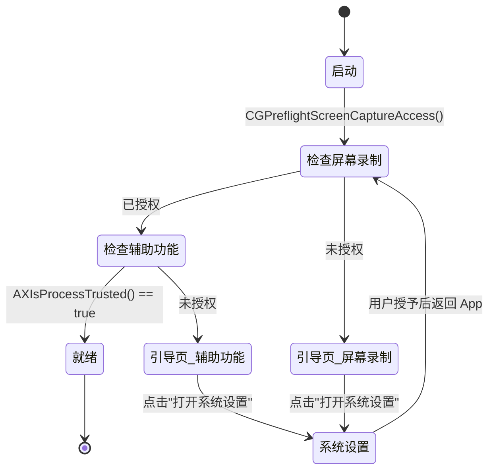
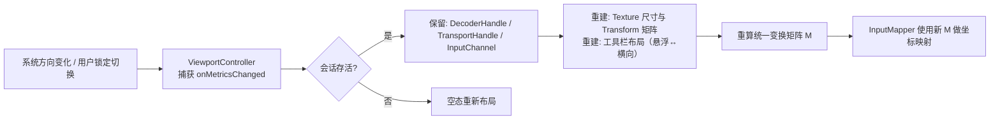

# 08 · 跨平台差异与限制

> 目标：把「一套代码五端跑」这句口号拆成可执行的差异清单。
> 结论先行：**同一个 Rust 核心 + 同一套 Flutter MVC，被控能力靠 `cfg(target_os)` 与平台 crate 分层实现；移动端只做控制端，这是系统限制不是设计取舍。**

---

## 1. 角色矩阵（不可逾越的边界）

| 平台 | 主控端（控制别人） | 被控端（被控制） | 能力上限（参考） | 说明 |
|---|---|---|---|---|
| Windows 10/11 (x64/arm64) | ✅ 完整 | ✅ 完整 | 常见可达 4K60 4:2:0 10-bit；4K120 / HEVC 4:4:4 10-bit 属「部分独显 + 部分驱动」能力，不强承诺。以编码器枚举与 `DecoderCaps` 探测为准 | 主力平台，DXGI/WGC + NVENC/AMF/QSV |
| macOS 12+ (arm64/x64) | ✅ 完整 | ✅ 完整（需授权） | 主控解码常见上限 4K60 4:2:0 10-bit；HEVC 4:4:4 10-bit 不在通用能力内（探测项）；被控编码以 4:2:0 为主 | ScreenCaptureKit + VideoToolbox；必须走 TCC 授权流程 |
| Linux (X11 / Wayland) | ✅ 完整 | ✅ 完整（Wayland 受限） | VAAPI 4:4:4 10-bit 取决于 GPU/驱动；X11 无 HDR 透传，Wayland 依赖合成器能力；以探测为准 | PipeWire + VAAPI；Wayland 下全局输入注入受限，见 §2.4 |
| Android 8+ | ✅ 支持（受右列上限约束） | ❌ 不实现 | 常见硬解上限 1080p60 / 4:2:0 / 8-bit；4:4:4、10-bit、4K120 普遍不支持。实际值以运行时 `DecoderCaps` 探测为准 | 采集/输入注入需系统级权限，且厂商 ROM 差异巨大，不做 |
| iOS 13+ | ✅ 支持（受右列上限约束） | ❌ 不实现 | 同移动端：1080p60 / 4:2:0 / 8-bit 为主；4:4:4、10-bit、4K120 普遍不支持。以 `DecoderCaps` 探测为准 | iOS 沙箱不允许常驻后台采集与合成输入事件，系统层面不可行 |
| Web（未来） | 仅观看 | ❌ | 取决于浏览器 WebCodecs 的探测结果 | 不在当前里程碑范围 |

**硬约束**：`rdc-capture` / `rdc-input` 在两个移动平台上不参与编译。构建脚本用 Cargo feature 裁剪，避免把用不上的原生依赖打进 Android/iOS 产物。

```toml
# crates/rdc-capture/Cargo.toml 目标声明（示意，非实现）
[target.'cfg(any(target_os = "windows", target_os = "macos", target_os = "linux"))'.dependencies]
# 仅桌面三平台引入采集后端
```

### 1.1 能力上限的表述原则（探测优先）

- 上表的「能力上限」是**硬件/系统能力参考**，不是软件自行设定的截断线；软件侧不设人为上限。
- 实际能力以运行时探测结果为准：解码侧查平台解码器能力（统一抽象为 `DecoderCaps`），编码侧枚举后端硬件编码器及其支持的 codec / profile / level / 色彩格式。探测结果作为**协商上界**写入能力协商（见 `04-传输协议.md`）。
- 探测到即允许协商，探测不到才回落；回落必须在 UI 与日志写明「本机解码器/编码器不支持」的实测原因，不写成产品策略。
- 桌面端 HEVC 4:4:4 10-bit 属于「部分独显 + 部分驱动」能力，不做强承诺；常见可达上限为 4K60 4:2:0 10-bit。
- 移动端 4:4:4、10-bit、4K120 普遍不支持；主控端不隐藏这些选项，但能否协商由 `DecoderCaps` 决定。

---

## 2. 三桌面平台的被控实现差异

### 2.1 差异总表

| 维度 | Windows | macOS | Linux |
|---|---|---|---|
| 屏幕采集（首选） | DXGI Desktop Duplication（独占全屏 / 游戏低延迟） | ScreenCaptureKit（macOS 12.3+） | PipeWire（Wayland）+ XShm（X11） |
| 屏幕采集（备选） | Windows Graphics Capture（WGC，窗口级/无 DDA 时） | CGDisplayStream（旧系统兜底，已弃用仍可用） | GDI BitBlt（X11 兜底，性能差） |
| 光标 | DDA 自带 `PointerPosition`，可合成 alpha 光标 | SCK 提供 `SCStreamFrameInfo` 光标信息 | PipeWire 不提供光标，需 XFixes / 合成叠加 |
| 硬件编码 | NVENC / AMF / QSV（MFT） | VideoToolbox | VAAPI（Intel/AMD）+ NVENC（NVIDIA） |
| 硬解 | D3D11VA / DXVA2 | VideoToolbox | VAAPI / VDPAU |
| 输入注入 | `SendInput`（鼠标绝对/相对、键盘扫描码） | `CGEventPost`（需辅助功能权限） | `uinput`（`/dev/uinput`）或 `XTest`（X11） |
| 多显示器 | DDA 按 output 枚举，支持跨屏拼接 | SCK `SCContentFilter` 按 display 枚举 | PipeWire 按 `node` 枚举，X11 按 `Xinerama` |
| 高 DPI | per-monitor DPI aware，必须声明 | Retina 2x，逻辑像素 vs 物理像素 | X11 无统一 DPI，按实际像素 |
| 剪贴板 | Win32 Clipboard API（可带文件） | NSPasteboard（需在 App 沙箱外，非沙箱打包） | X11 selection / Wayland wl-paste（限制多） |
| 权限模型 | 无（普通用户即可，UAC 下不能控制提权窗口） | TCC：屏幕录制 + 辅助功能，必须用户手动授予 | Wayland 需 portal 确认；X11 无 |
| 打包形态 | NSIS 安装包 / MSI / 便携 zip | `.dmg`（ad-hoc 签名） | AppImage + `.deb` |

### 2.2 Windows 被控端

**采集路径选择**：

1. 启动时探测是否支持 DDA（Win8+ 且非 Remote Desktop 会话内）。
2. 默认用 DDA；遇到 `DXGI_ERROR_ACCESS_LOST`（切换分辨率、锁屏、UAC 桌面切换）时重建 duplication 对象，而不是重建整个会话。
3. 需要「只共享某个窗口」或 DDA 连续失败时切到 WGC（Win10 1903+）。
4. 两者都不可用退到 GDI BitBlt（仅兼容兜底，帧率限制 15fps，日志标注降级原因）。

**输入注入**：

- 鼠标绝对坐标用 `SendInput` + `MOUSEEVENTF_ABSOLUTE | MOUSEEVENTF_VIRTUALDESK`，坐标基于虚拟桌面（多屏拼接后的整体矩形），避免负坐标屏失效。
- 键盘优先用扫描码（`KEYEVENTF_SCANCODE`），因为部分游戏/全屏程序只认扫描码；需要文本输入时再补 `VK` 包。
- 被控端进程若以普通权限运行，无法向管理员权限窗口注入。文档与 UI 明确提示「以管理员身份运行才能控制提权窗口」，不做静默提权。

**坑位**：

- DDA 在独显/核显切换（笔记本混合显卡）时会拿到错误的适配器，必须按 output 所属 adapter 创建 `ID3D11Device`。
- 显示器休眠恢复后 `AcquireNextFrame` 会持续超时，需要读取 `DXGI_OUTDUPL_FRAME_INFO.AccumulatedFrames == 0` 判断「无变化」而非「故障」。

**Session 0 隔离（服务 + 用户会话代理）**

Windows 服务运行在 Session 0（隔离的非交互会话），**不能直接采集用户桌面，也不能注入输入**。被控端必须是两段式：

| 角色 | 进程 | 职责 | 运行会话 |
|---|---|---|---|
| 后台服务 | `rdc-service` | 开机自启、设备注册、连接准入、会话守护、拉起代理 | Session 0 |
| 用户会话代理 | `rdc-agent` | DXGI/WGC 采集、编码、`SendInput` 注入、权限状态上报 | 目标用户的交互会话 |

- 服务通过命名管道与代理通信，管道按用户 SID 隔离并校验调用方 SID，禁止跨会话访问（与 `07-安全设计.md` 口径一致）。
- 多用户/快速用户切换时，默认只绑定控制台会话（`WTSGetActiveConsoleSessionId`）；其他会话不提供采集，切换后重建代理与采集链路。
- 代理由服务用 `WTSQueryUserToken` + `CreateProcessAsUser` 在目标会话内拉起；代理始终以用户权限运行，因此无法控制提权窗口（与上文输入注入说明一致）。

**安全桌面 / 锁屏 / 安全序列的边界**：

| 场景 | 画面采集 | 输入注入 | 产品行为 |
|---|---|---|---|
| UAC 提权确认（安全桌面） | 不可（`OpenInputDesktop` 失败、DDA `DXGI_ERROR_ACCESS_LOST`） | 不承诺 | 暂停画面，主控端显示「被控端处于安全桌面，暂不可操作」；安全桌面退出后自动重建 DDA 并恢复 |
| 锁屏 / 登录界面（Winlogon） | 受安全桌面限制，通常不可 | 不承诺 | 状态显示「锁屏中」，主控端标「安全桌面」而非「连接断开」 |
| `Ctrl+Alt+Del`（SAS） | — | **不支持** | 普通进程无法注入 SAS；UI 不提供该按钮，提示需本机操作 |

**TDR / GPU 设备丢失的恢复行为**：

- 编码或采集遇到 `DXGI_ERROR_DEVICE_REMOVED` / `DXGI_ERROR_DEVICE_RESET`（TDR）时，销毁并重建 `ID3D11Device`、duplication 与编码实例，**会话连接不断**，主控端显示「编码器恢复中」。
- 60 秒内连续 3 次重建失败 → 降级：暂停视频、保留控制通道，或退到软件编码（OpenH264，仅 H.264）；恢复成功后回到硬件编码。
- 降级与恢复都写日志（错误码、重建次数、降级原因），UI 明示当前编码路径，不静默切换。

### 2.3 macOS 被控端

**采集**：ScreenCaptureKit（`SCStream` + `SCStreamOutput`），帧以 `CVPixelBuffer`（IOSurface 支撑）交付，可零拷贝进 VideoToolbox。

**必须实现的授权引导**（这是本节的核心交付项）：



| 权限 | 检测 API | 申请 API | 系统设置路径 | 生效条件 |
|---|---|---|---|---|
| 屏幕录制 | `CGPreflightScreenCaptureAccess()` | `CGRequestScreenCaptureAccess()` | 隐私与安全性 → 屏幕录制 | **必须重启 App 进程**才生效（macOS 行为，无法绕过） |
| 辅助功能 | `AXIsProcessTrusted()` | `AXIsProcessTrustedWithOptions({kAXTrustedCheckOptionPrompt: true})` | 隐私与安全性 → 辅助功能 | 立即生效 |

**UI 引导要求（界面必须做到）**：

- `PermissionGuideView` 分两张卡片，各自显示「当前状态 / 一键申请 / 打开系统设置」三个动作。
- 屏幕录制授权后，显示醒目提示「需要重启应用才能生效」，并提供「立即重启」按钮（由 `PermissionController` 调桥接层 `restart_app()`，Rust 侧不参与）。
- 未授权时**不允许**进入「可被控制」状态：`SessionModel` 的 `canBeControlled` 直接为 false，不允许靠「先连上再失败」的方式暴露问题。
- 首次启动时检测到两者都未授权，直接落在引导页，而不是首页。

**坑位**：

- 未签名/临时签名（ad-hoc）的 App，每次重新构建后 TCC 记录可能失效，需要用户重新授权。这是 CI 产物（ad-hoc 签名）的已知体验代价，文档里明确写清，不假装没有。
- `CGEventPost` 需要辅助功能权限；没有权限时调用不报错但静默无效——必须靠 `AXIsProcessTrusted()` 前置判断，不能靠返回值判断。
- 多显示器 + Retina：SCK 给的是物理像素，输入坐标是逻辑点，映射必须显式做 `backingScaleFactor` 换算，否则点击偏移一倍。

**色度与位深能力（探测项，不是永久禁止）**

- VideoToolbox 的 HEVC 硬编以 4:2:0 为主（Main / Main10 profile 常见）；4:4:4 需要 `Main444` 系列 profile 且依赖具体 GPU 与驱动版本，**不在通用能力内**。
- 启动与首次编码前用 `VTCopyVideoEncoderList` / `VTCopySupportedPropertyDictionaryForEncoder` 探测编码器支持的 profile 与位深，结果写入能力协商。
- 探测不到 4:4:4 → **回落 4:2:0**（优先 10-bit），UI 说明「本机编码器不支持 4:4:4，已切换 4:2:0」，并记录探测值；不写成「永久禁止」。
- 探测到 4:4:4 10-bit 时允许作为协商上界，但不强承诺稳定性；高负载下仍按 §2.7 实例预算判定。

### 2.4 Linux 被控端

**采集**：

- Wayland：PipeWire + `xdg-desktop-portal`（`ScreenCast` 接口）。用户每次要在 portal 弹窗里选屏幕，这是 Wayland 的安全模型，不能绕过。
- X11：`XShm` 抓 `XGetImage` 到共享内存，避免逐像素拷贝；多屏用 `Xinerama` 枚举。
- 启动时用 `XDG_SESSION_TYPE` + `WAYLAND_DISPLAY` 判定会话类型，不做「试了再说」。

**输入注入**：

| 会话 | 方案 | 限制 |
|---|---|---|
| X11 | XTest（`XTestFakeMotionEvent` / `XTestFakeKeyEvent`） | 需要 `DISPLAY` 可访问 |
| Wayland | `uinput`（写 `/dev/uinput`） | 需要 root 或 `input` 组；部分发行版默认禁止，需 polkit 规则或 systemd 服务 |
| 兜底 | 提示「当前会话不支持输入注入」并进入只读观看模式 | 不允许假装成功 |

**坑位**：

- Wayland 下无法读取全局光标位置（合成器不暴露），光标必须在客户端侧自绘（`CursorOverlay`），坐标由被控端在帧上合成后发送，主控端不再重复绘制。
- PipeWire 的 DMA-BUF 帧可能是 GPU 内存，直接 CPU 读会极慢；优先走 VAAPI 的 `VASurface` 导入路径，否则退到 `memfd` 映射拷贝。

**Wayland 无人值守限制（产品级缺口）**

- `xdg-desktop-portal` 的 `RemoteDesktop` / `ScreenCast` 授权是**按会话发生**的：用户在 portal 弹窗中选择共享源，授权随会话/进程结束失效，无法提前持久获取。
- 因此「人不在机器前」的无人值守被控在 Wayland 下**不可用**；这不是配置问题，是安全模型。
- `uinput` 需 root 或 `input` 组，且部分合成器不认绝对坐标注入，只能相对移动。
- X11 可无人值守（XTest 无需交互授权），但 X11 正在退场，主流发行版默认已是 Wayland。

**产品行为**：

1. Wayland 会话下被控端必须显示「**本机需确认**」状态，`canBeControlled = requiresLocalConfirm`，不计入「无人值守可用」。
2. 权限前置检查中该项标注「**按平台能力检查**」（与 `13-权限设置页设计.md` 的权限检测口径一致）：只报「当前会话可授权 / 需用户确认」，不承诺持久授权。
3. 无人值守策略（开机自启后自动可连）在 Wayland 下不可用；主控端连接前提示「对方为 Wayland，需要对方本机确认屏幕共享」。
4. 用户在 portal 授权后，本次会话内保持 token 与节点；会话结束即失效，需重新确认。

### 2.5 剪贴板平台实现差异（v1）

| 平台 | 变更通知 | 读取方式 | 限制与坑位 |
|---|---|---|---|
| Windows | `AddClipboardFormatListener` + `WM_CLIPBOARDUPDATE` | `OpenClipboard` + `GetClipboardData`（CF_UNICODETEXT / CF_DIBV5 / CF_HDROP） | 剪贴板可能被其他进程占用 → 重试 3 次（每次 20ms）；`CF_HDROP` 只取路径列表，文件本体走文件通道；尊重"排除监听的格式" |
| macOS | 无通知，**轮询 `NSPasteboard.changeCount`**（默认 200ms） | `NSPasteboard`（`stringForType` / `dataForType`） | 轮询间隔太小耗电、太大迟滞；沙箱外才能读全部类型；读取本身不弹窗 |
| Linux X11 | `XFixesSelectSelectionInput` 事件 | `Selection`（`UTF8_STRING` / `TARGETS` / `image/png`） | 需要窗口句柄；剪贴板内容由"拥有者进程"提供，对方退出后内容可能失效；大内容需增量传输（INCR） |
| Linux Wayland | 无全局剪贴板 API | 仅 `wl_data_device`（需焦点窗口） | **应用无焦点时读不到**；后台常驻的被控进程基本不可用 → 明确降级为"仅当本应用窗口聚焦时同步" |
| Android | 无监听 API（10+ 后台禁读） | 前台 `ClipboardManager` 读取 | **Android 10+ 后台禁止读取剪贴板** → 只能前台手动触发；不主动写远端内容到本地（避免覆盖用户剪贴板） |
| iOS | 无监听 API | `UIPasteboard.general` | 读取会弹系统"是否允许粘贴"提示；必须用户手动触发；不后台同步 |

**统一规则**：

1. 桌面端文本可自动同步（需总开关），图片/文件需确认；移动端一律手动触发；
2. 富文本一律降级纯文本（保留换行）；
3. 行尾符转换：Windows `CRLF` ↔ Unix `LF`，在**接收端落板前**转换，避免远端应用出现双倍换行；
4. Unicode：按 `UTF-8` 传输，落板时转平台原生（Windows `UTF-16LE`、macOS/Linux UTF-8）；
5. 敏感格式（密码管理器专用类型）与进程排除名单命中 → 跳过（详见 `07-安全设计.md` §4.1）。

### 2.6 文件传输平台差异（v1）

| 平台 | 发送 | 接收落点 | 限制 |
|---|---|---|---|
| Windows | 任意路径；长路径 `\\?\` 前缀处理 | 默认 `%USERPROFILE%\Downloads\RDC\<设备名>\` | 文件名非法字符替换；路径 > 260 字符需长路径前缀 |
| macOS | 任意路径（非沙箱打包） | `~/Downloads/RDC/<设备名>/` | 首次写 Downloads 可能触发 TCC 提示；保留 mtime 用 `utimensat` |
| Linux | 任意路径 | `$XDG_DOWNLOAD_DIR`（缺省 `~/Downloads`）/RDC/<设备名>/ | 符号链接拒绝；权限按 umask |
| Android | 通过 SAF 选择文件（`ACTION_OPEN_DOCUMENT`） | **SAF 目录**（`ACTION_OPEN_DOCUMENT_TREE`），或应用私有目录 | 不能写任意路径；需持久化 URI 权限；后台传输需前台服务（`dataSync` 类型） |
| iOS | 通过 Files App 选择（`UIDocumentPicker`） | **Files App 目录**（`UIDocumentPicker` 导出）或 App 沙箱 Documents | 后台会被系统挂起 → 传输中断需恢复；大文件需 `NSFileCoordinator` |

**移动端后台限制（必须写进 UI）**：

| 平台 | 行为 | 应对 |
|---|---|---|
| iOS | 退到后台约 30s 内被挂起，传输中断 | 界面明确提示"离开应用会中断传输"；支持断点续传，回前台自动恢复；不承诺后台传输 |
| Android | 后台超过数分钟被限制网络 | 提供"前台服务保活"方案（常驻通知 + `dataSync` 前台服务）；用户可关闭；Doze / App Standby 下引导加入电池优化白名单（不静默申请） |

**安全**：接收端路径校验（拒绝 `../`、绝对路径、符号链接逃逸）在所有平台一致执行，落到受限根目录（详见 `07-安全设计.md` §4.2）。

### 2.7 GPU 编码实例数量模型

**实例数 ≠ 会话路数。** 硬件编码引擎的并发实例数由 GPU 与驱动给出，单路会话的资源占用取决于分辨率、帧率、色度与位深：

- 单路 4K120，或单路 4:4:4 10-bit，可能**吃满一个编码引擎**；1080p60 4:2:0 通常可以多路共享。
- NVENC / AMF / QSV / VideoToolbox 的**单个编码会话不支持同时输出主码流 + 子码流两个不同分辨率的独立流**——这是 API 层面的限制，不是调参问题。因此主码流固定占 1 个实例，预览/观看者必须用独立实例或 JPEG 快照。
- 并发策略：**默认 1 路、最多 2 路**；4 路仅在实例探测通过（探测到的可用实例数满足每路预算）后开放，不作为默认配置。

| 资源 | 每路占用 | 探测方式 | 预算规则 |
|---|---|---|---|
| 编码实例 | 主码流 1 个；每个独立预览/观看者另 1 个（或 0 个，走 JPEG 快照） | NVENC：会话创建返回码 + `nvEncGetEncodeCaps`；AMF：`AMFCreateComponent` 逐次枚举；QSV：`MFXVideoENCODE_Query`；VideoToolbox：`VTCopyVideoEncoderList` | 实例总数 = 主码流路数 + 独立预览/观看者路数，不得超过探测到的可用实例数 |
| 解码实例 | 主控端每路 1 个（硬解）；软解按 CPU 预算折算 | `DecoderCaps`；Windows D3D11VA 解码器枚举；macOS `VTIsHardwareDecodeSupported` | 硬解实例不足时降级软解或降分辨率/帧率，不静默超限 |

- 探测失败或结果不可信时按保守值（编码 1、解码 1）起算，宁可少开不超限。
- 资源预算在会话建立前判定；超限直接拒绝并在 UI 说明「本机编码实例不足」，不靠失败重试掩盖。
- 与 `12-多设备与屏幕墙.md` 的并发默认值对齐：默认 1 路、最多 2 路。

---

## 3. 移动端：只做控制端

### 3.1 Android 实现路径

| 能力 | 实现 | 备注 |
|---|---|---|
| Rust 库加载 | `jniLibs/arm64-v8a/librdc.so`（cargo-ndk 产出） | 只编 `aarch64-linux-android` + `armv7-linux-androideabi`（可选） |
| 解码 | MediaCodec 硬解（H.265/H.264），输出 `Surface` | 走 `SurfaceTexture` → Flutter `Texture` 外部纹理，不经 FRB 传帧 |
| 渲染 | `Texture` widget + `Transform` 矩阵 | 见 §4 |
| 输入 | Flutter 手势 → `PointerEvent` → 桥接层 → 传输层输入通道 | 触摸转鼠标：单指移动/点击，双指滚动/缩放，长按右键 |
| 权限 | `INTERNET` + `ACCESS_NETWORK_STATE`；Android 13+ 运行时 `POST_NOTIFICATIONS`；Android 14+ 前台服务类型声明 | 不做采集，因此不需要录屏权限 |
| 后台 | 会话期间前台服务 + 常驻通知 + `FLAG_KEEP_SCREEN_ON`；息屏/切后台由前台服务保活；Doze / App Standby 限制后台网络时按下方引导处理 | 不做无声保活，权限被拒时如实提示可能断连 |

**Android 13+/14+ 权限与后台网络限制（必须写进 UI）**：

| 版本 / 机制 | 要求 | 产品行为 |
|---|---|---|
| Android 13+ | `POST_NOTIFICATIONS` 为运行时权限 | 被拒后前台服务无法展示常驻通知；权限页引导开启，并说明「拒绝可能导致后台会话被系统回收」 |
| Android 14+ | 前台服务必须声明 `foregroundServiceType` 并申请对应 `FOREGROUND_SERVICE_*` 权限 | 会话保活声明 `connectedDevice`，文件传输声明 `dataSync`；类型与用途不符会被系统拒绝启动 |
| Doze / App Standby | 息屏与长时间后台会冻结后台网络 | 前台服务保活；提供「不受电池优化限制」白名单的**设置页引导**（不静默申请、不伪造保活）；用户拒绝则接受断连并按 §2.6 恢复 |

**不做的事**（明确写进代码注释，避免后来者反复尝试）：不申请 `MediaProjection`（那是采集，不需要）、不尝试 Accessibility Service 注入（那是被控，不需要）、不打 x86 模拟器包进 release。

### 3.2 iOS 实现路径

| 能力 | 实现 | 备注 |
|---|---|---|
| Rust 库加载 | 静态链接进 Runner（`libdcore.a`），或 `xcframework` | iOS 不允许 dlopen 任意 dylib，必须静态链 |
| 解码 | VideoToolbox 硬解，`CVPixelBuffer` 输出 | 走 `CVPixelBuffer` → `Texture`（`FlutterTexture` 协议） |
| 渲染 | 同上 | |
| 输入 | `UITouch` → 归一化坐标 → 桥接层 | 与 Android 共用同一套 `TouchMapper`（Dart 层） |
| 权限 | 网络 + 本地网络（iOS 14+）：`NSLocalNetworkUsageDescription` +（用 Bonjour 发现时）`NSBonjourServices` | 无麦克风/相册权限（若后续做音频再补 `NSMicrophoneUsageDescription`） |
| 后台 | 进入后台立即暂停渲染，连接保持 ≤ 10s，超时断开 | iOS 后台不允许长时间网络活动 |

**iOS 14+ 本地网络权限（局域网直连的前提）**：

- 配置：`Info.plist` 增加 `NSLocalNetworkUsageDescription`（用途文案示例：「用于在局域网内直连你的电脑，画面不经过服务器」）；若用 Bonjour / mDNS 发现，增加 `NSBonjourServices` 并列出实际服务类型（如 `_rdc._udp`）。
- 触发时机：**首次**向局域网地址发包（首次发现 / 打洞前）时，系统弹出「允许"RDC"查找并连接本地网络中的设备」；不是安装时授权。
- 用户拒绝：应用无法访问 LAN，只能走中继/公网；连接页显示「本地网络权限已关闭 → 仅可通过中继连接」，并提供跳转系统设置（`UIApplication.openSettingsURLString`）。
- 该弹窗由系统控制，**无法用代码绕过或预授权**；拒绝后系统通常不再重复弹窗，只能引导用户去设置里开启。

**iOS 的构建约束**：

- 无签名 ipa 可在 macOS runner 上通过 `xcodebuild -archivePath ... CODE_SIGNING_ALLOWED=NO` 产出，但**无法安装到真机**（真机必须签名）。
- 交付标准：提供可编译的 Xcode 工程 + 无签名 ipa 构建脚本 + 「如何用自己的开发者证书签名安装」的说明。不承诺「下载即装」。
- `Podfile` 与 Swift Package 二选一，优先 SPM（减少 CI 对 CocoaPods 网络依赖）。

### 3.3 移动端共同点

- 只编 Rust 的 `rdc-core`（含 `rdc-protocol`/`rdc-security`/`rdc-connect`/`rdc-transport`/`rdc-codec` 的解码半边），**不编** `rdc-capture`/`rdc-input`/`rdc-relay`。
- 解码能力上限以 `DecoderCaps` 探测为准（见 §1.1）；探测不到 4:4:4 / 10-bit / 4K120 时按协商结果回落，不在客户端静态禁止。
- 桥接层 `rdc-bridge` 在移动端只导出「控制端 API」，被控端 API 用 feature gate 剔除，避免 Dart 侧误调用后在运行时崩溃。
- 移动端不显示「允许被控制」相关 UI，设置页里对应入口整体隐藏（不是置灰，是隐藏，避免用户困惑）。

---

## 4. 横竖屏切换（移动端）

### 4.1 核心原则

> **旋转只换皮，不换核。** 解码器实例、网络连接、输入通道、会话密钥全部保持存活；只重建渲染层与坐标变换。



**禁止事项**（写进代码评审清单）：

- 禁止在 `didChangeAppLifecycleState` 或方向回调里 `dispose()` 解码器。
- 禁止重建 `Texture` widget 的 `textureId`（重建会导致黑屏一帧；只调整 `AspectRatio`/`Transform`）。
- 禁止在旋转期间丢帧队列里的关键帧；旋转期间允许丢 P 帧但必须保留最近 I 帧。

### 4.2 方向策略（可配置三档）

| 档位 | 行为 | 实现 |
|---|---|---|
| 跟随系统（默认） | 系统方向变化即重算视图 | `SystemChrome.setPreferredOrientations([])` |
| 锁定横屏 | 强制横屏，忽略系统旋转 | `setPreferredOrientations([landscapeLeft, landscapeRight])` |
| 锁定竖屏 | 强制竖屏 | `setPreferredOrientations([portraitUp])` |

- 策略存 `AppSettings.orientationPolicy`，切换立即生效且不重建会话。
- 用户可在「工具栏溢出菜单」里快速切换（不必进设置页），三档选择当场记住。

### 4.3 画面适配

| 方向 | 布局 | 交互 |
|---|---|---|
| 竖屏 | 被控端横屏画布**等比缩放**居中，上下留黑边，不裁剪、不变形 | 双指缩放（0.5x~4x）+ 单指拖动平移；双击复位 |
| 横屏 | 沉浸全屏，隐藏状态栏与导航栏（`SystemUiMode.immersiveSticky`） | 同上，但工具栏横向展开覆盖顶部，可自动淡出 |

- 缩放/平移状态由 `ViewportController` 持有（`scale` / `offset`），**不放进 Model**——它是纯视图态，不进持久化。
- 会话切换时复位 `scale=1.0, offset=0`。

### 4.4 统一变换矩阵（唯一坐标真源）

所有输入坐标必须经同一个矩阵，禁止各处手写换算：

```
screenPx = M * remoteNorm
M = T(offset) * S(scale) * F(fit) * R(rotation)
```

| 矩阵因子 | 含义 | 何时重算 |
|---|---|---|
| `fit` | 远端分辨率 ↔ 本地视口的等比适配（含 letterbox 偏移、Retina backingScaleFactor） | 帧尺寸变化、视口变化 |
| `R(rotation)` | 仅在「被控端画面本身随方向翻转」时使用；主控端旋转不改 R | 方向策略变化 |
| `S(scale)` | 用户手势缩放 | 手势过程 |
| `T(offset)` | 用户平移 | 手势过程 |

- 矩阵由 `ViewportController` 计算并下发；`InputMapper`（Model 层）只做「矩阵乘法 + 归一化」，不感知方向。
- 方向切换后**必须同步重算**再放行输入事件；实现上用 `_matrixDirty` 标志，旋转动画结束（`onLayoutDone`）后清标志，期间的输入事件丢弃而不是用旧矩阵（否则出现点击错位）。

### 4.5 工具栏布局随方向

| 方向 | 形态 | 规则 |
|---|---|---|
| 竖屏 | 右下悬浮 FAB 组（主操作 + 展开菜单） | 不遮挡画面中心；距安全区 ≥ 16dp |
| 横屏 | 顶部横向工具栏（图标横排，可自动淡出） | 进入全屏后 3 秒无操作自动淡出，点击画面唤回 |

- 组件：`SessionToolbar`（View）由 `SessionToolbarController` 驱动，两个方向复用同一组 action，仅布局不同。
- 布局切换用 `LayoutBuilder` + 断点（`maxWidth > 900dp` 视为横屏宽布局），不直接依赖 `Orientation`（平板分屏时 `Orientation` 会撒谎）。

### 4.6 旋转期间的状态归属（MVC 明确分工）

| 状态 | 归属 | 说明 |
|---|---|---|
| 方向策略（跟随/锁横/锁竖） | `AppSettingsModel` | 持久化配置 |
| 当前实际方向、矩阵、缩放、平移 | `ViewportController` | 纯视图态，不持久化，旋转期间的唯一协调者 |
| 解码器/网络/输入是否存活 | `SessionModel`（Rust 侧） | 旋转**不得**触碰 |
| 工具栏形态与显隐 | `SessionToolbarController` | 只读 `ViewportController.isWideLayout` |
| 输入映射 | `InputMapper`（Model） | 被动接收矩阵，不主动重算 |

**唯一协调者原则**：旋转事件只进 `ViewportController`，其他 Controller/Model 不直接监听 `onMetricsChanged`，避免多处各算一套矩阵导致错位。

---

## 5. 各平台构建产物形式

| 平台 | 产物 | 安装/运行方式 | 可安装承诺 | 签名要求 | CI Runner |
|---|---|---|---|---|---|
| Windows | `.exe`（NSIS 安装包）；可选 `.msi` | 双击安装，写入 `%LOCALAPPDATA%`，注册卸载项 | ✅ 可安装 | 不签名（用户会看到 SmartScreen 提示，需「仍要运行」） | `windows-latest` |
| macOS | `.dmg`（内含 `.app`） | 拖入 Applications | ✅ 可安装（未公证） | **ad-hoc 签名**（`codesign -s -`）；首次打开需右键「打开」或 `xattr -d com.apple.quarantine` | `macos-latest` |
| Linux | `.AppImage` + `.deb` | AppImage 直接 `chmod +x` 运行；deb 用 `apt`/`dpkg` | ✅ 可安装 | 无 | `ubuntu-22.04` |
| Android | `.apk`（arm64 + armeabi-v7a） | 侧载安装（需允许未知来源） | ✅ 可安装 | debug/自签 release keystore（CI 用临时 keystore） | `ubuntu-latest` |
| iOS | `.xcarchive`（可归档、仅验证可构建）；可选无签名 `.ipa` | 不能直接安装；需用自己的开发者证书自签，或从源码构建 | ❌ **不承诺普通设备安装** | 无签名（`CODE_SIGNING_ALLOWED=NO`） | `macos-latest` |

**可安装口径（与 `10-里程碑与验收.md` §1 / §7.6 一致）**：Windows/Linux/Android 承诺「下载后可安装并启动」；macOS 承诺「可安装但未公证」，首次打开需右键「打开」或移除 quarantine 属性；iOS **不承诺普通设备安装**，只承诺 `.xcarchive` 可归档、源码可用自己的证书自签安装。

**产物附加要求**：

- 每个产物附 `.sha256` 与「本次构建的 git commit + 版本号」。
- Windows/macOS/Linux 产物内含 `rdc-cli` 可执行文件，便于用户自助诊断（`rdc-cli doctor`）。
- Android APK 分 ABI 出包（`arm64-v8a` 必出，`armeabi-v7a` 可选），避免一个包 200MB。

---

## 6. 已知限制（明确写死，避免误判为 bug）

1. **macOS 屏幕录制授权后需重启 App** —— 系统行为，只能提示。
2. **ad-hoc 签名 macOS 产物重装后可能需重新授权 TCC** —— CI 产物的固有代价。
3. **Wayland 无人值守不可用** —— portal 的 RemoteDesktop / ScreenCast 授权按会话发生、无法提前持久获取；`uinput` 需 root 或 `input` 组且部分合成器不认绝对坐标；无配置时进入只读观看。
4. **Wayland 无法读取全局光标** —— 客户端自绘光标。
5. **UAC 提权窗口无法被普通权限进程控制** —— 需以管理员运行，UI 明示。
6. **iOS 真机无法安装 CI 无签名产物** —— 只保证可构建，附自签名说明。
7. **Android/iOS 无被控能力** —— 系统限制，不提供入口。
8. **Linux 无统一的 HDR / 色彩管理** —— X11 下按 sRGB 处理，HDR 仅在 PipeWire + 支持的合成器下尝试。
9. **Windows 服务（Session 0）不能直接采集/注入** —— 必须「后台服务 + 用户会话代理」两段式；安全桌面/锁屏下暂停画面与输入，不支持 `Ctrl+Alt+Del`。
10. **GPU 编码实例数 ≠ 并发路数** —— 单会话不能同时输出主码流 + 子码流；主码流 1 实例、预览/观看者独立实例或 JPEG 快照；并发默认 1 路、最多 2 路。
11. **移动端 4:4:4 / 10-bit / 4K120 普遍不支持** —— 主控端以 `DecoderCaps` 探测结果作为协商上界，探测不到即回落。
12. **iOS 本地网络权限被拒后无法直连局域网** —— 只能走中继/公网，弹窗不可绕过，需用户去系统设置开启。

---

## 7. 本节与其他文档的衔接

- 采集与编码的具体参数：见 `06-采集与编码.md`
- 连接降级与中继开关：见 `05-连接与降级策略.md`
- MVC 分层与 `ViewportController` 的目录位置：见 `02-模块设计.md` 与 `09-目录结构与命名规范.md`
- 构建矩阵的具体 workflow 方案：见 `10-里程碑与验收.md`

---

## 修订记录

> 来源统一为 15 号评审 §2.1 / C19 / C29；下表逐条对应。

| 序 | 修订项 | 位置 | 修订内容 | 来源 |
|---|---|---|---|---|
| 1 | GPU 编码实例模型 | §2.7（新增） | 写明「实例数 ≠ 会话路数」：单路 4K120 或 4:4:4 10-bit 可能吃满一个引擎；单会话不支持主码流 + 子码流两路独立输出；主码流 1 实例、预览/观看者独立实例或 JPEG 快照；并发默认 1 路、最多 2 路，4 路仅在实例探测通过后开放；附实例预算表（编码/解码各一行） | 15 号评审 §2.1（C30 / C31） |
| 2 | Wayland 无人值守 | §2.4、§6 | 说明 portal 授权按会话发生、无法提前持久获取，无人值守不可用；`uinput` 需 root 或 `input` 组且部分合成器不认绝对坐标；产品行为：被控端显示「本机需确认」，权限前置检查标注「按平台能力检查」 | 15 号评审 §2.1 |
| 3 | Windows Session 0 | §2.2（新增） | 服务 + 用户会话代理两段式架构；UAC 安全桌面、锁屏、`Ctrl+Alt+Del` 的可用性边界；TDR / GPU 设备丢失的恢复行为 | 15 号评审 §2.1 |
| 4 | 移动端解码上限 | §1、§1.1、§3.1、§3.2 | 角色矩阵新增「能力上限（参考）」列：移动端 1080p60 / 4:2:0 / 8-bit，4:4:4、10-bit、4K120 普遍不支持；实际值以运行时 `DecoderCaps` 探测为准、软件不静态截断；桌面端 HEVC 4:4:4 10-bit 为「部分独显 + 部分驱动」能力 | 15 号评审 §2.1 / C29 |
| 5 | iOS 本地网络权限 | §3.2 | 补 `NSLocalNetworkUsageDescription` + `NSBonjourServices`；首次发现/打洞前触发弹窗；拒绝后只能走中继/公网；弹窗不可用代码绕过 | 15 号评审 §2.1 |
| 6 | 可安装承诺修正 | §5、§6 | Windows/Linux/Android = 可安装；macOS = 未公证 dmg（右键打开 / 移除 quarantine）；iOS = `.xcarchive` 或源码自签，不承诺普通设备安装；与 `10-里程碑与验收.md` 保持一致 | 15 号评审 §2.1 / C19 |
| 7 | Android 权限补正 | §3.1 | 补 `POST_NOTIFICATIONS`（13+）、前台服务类型声明（14+）、Doze / App Standby 后台网络限制与电池优化白名单引导 | 15 号评审 §2.1 |
