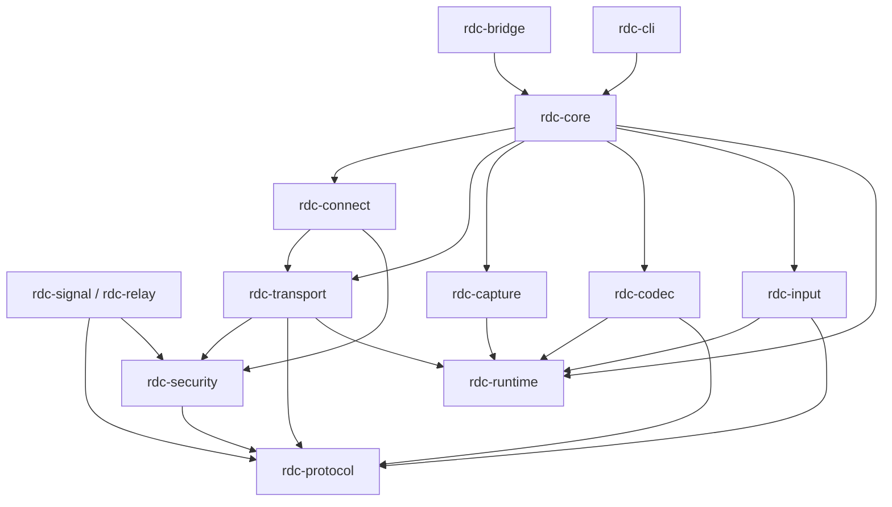

# 09 · 目录结构与命名规范

> 目标：任何人第一次打开仓库，15 分钟内能回答三个问题——「这段代码属于哪一层」「该放进哪个目录」「这个文件里有没有实现代码」。
> 本文件是目录的**唯一真源**：后续新增目录必须先改这里。

---

## 1. 顶层目录树

```
RemoteDesktopControl/
├── docs/                          # 设计文档，一文档一文件，编号即阅读顺序；本文件即目录真源
├── Cargo.toml                     # Rust workspace 根清单，统一管理全部 crate 与依赖版本
├── rust-toolchain.toml            # 锁定 Rust 工具链版本，保证本地与 CI 一致
├── rustfmt.toml                   # 格式化规则（注释分区标记等约定在此固定）
├── clippy.toml                    # 静态检查阈值配置（unsafe 与 unwrap 的 lint 策略）
├── crates/                        # 全部 Rust crate，一个 crate 一个目录，命名前缀统一 rdc-
│   ├── rdc-protocol/              # 纯类型与协议定义：信封、消息、错误码、能力描述；零 IO 零平台依赖
│   ├── rdc-runtime/               # 线程与缓冲基础设施：SPSC 环形缓冲、帧内存池、原子统计、线程构造器
│   ├── rdc-security/              # 密钥、握手、AEAD 封装、权限位、票据校验；只依赖 protocol
│   ├── rdc-connect/               # 连接编排：IPv6 直连→UDP 打洞→TCP 打洞→中继决策与指数退避重连
│   ├── rdc-transport/             # 自研 UDP 传输：包格式、分片、FEC、NACK、pacer、拥塞控制、时钟同步
│   ├── rdc-capture/               # 桌面三平台屏幕采集抽象与实现（DXGI/WGC、SCK、PipeWire/X11）
│   ├── rdc-codec/                 # 编解码抽象与后端（NVENC/AMF/QSV/VAAPI/VideoToolbox/OpenH264）
│   ├── rdc-input/                 # 输入注入（SendInput / CGEvent / uinput/XTest）与坐标映射
│   ├── rdc-core/                  # 会话编排：把上面各 crate 组装成「主控端/被控端」两条流水线
│   ├── rdc-bridge/                # 唯一的 FFI 出口，编 cdylib/staticlib，供 flutter_rust_bridge 调用
│   ├── rdc-signal/                # 信令服务器二进制（UDP/QUIC 21116，备用 TCP/TLS 443）
│   ├── rdc-relay/                 # 中继服务器二进制（媒体转发，默认不启用，需客户端显式开启）
│   └── rdc-cli/                   # 命令行工具：selftest / doctor / 直连 Demo / 抓包回放
├── app/                           # Flutter 应用（严格 MVC 三层，详见 §3）
│   ├── lib/
│   │   ├── main.dart              # 应用入口：RustLib 初始化、路由装配、主题注入
│   │   ├── model/                 # MVC 的 Model 层：数据、业务状态、FFI 封装、事件订阅；禁止出现 Widget
│   │   ├── view/                  # MVC 的 View 层：纯渲染与布局；禁止业务逻辑与直接调 Rust
│   │   ├── controller/            # MVC 的 Controller 层：交互→调 Model→驱动 View 刷新
│   │   └── core/                  # 三层共用基础设施：主题、国际化、工具函数
│   ├── assets/                    # 图标、字体、内置配置模板（不含运行时用户数据）
│   ├── test/                      # Dart 单测与 widget 测试，目录镜像 lib/ 结构
│   ├── windows/                   # Flutter Windows 宿主工程（CMake）
│   ├── macos/                     # Flutter macOS 宿主工程（Xcode）
│   ├── linux/                     # Flutter Linux 宿主工程（CMake）
│   ├── android/                   # Flutter Android 宿主工程（Gradle + jniLibs）
│   ├── ios/                       # Flutter iOS 宿主工程（Xcode）
│   └── pubspec.yaml               # Dart 依赖与 flutter_rust_bridge 生成配置入口
├── packaging/                     # 各平台打包脚本与模板，CI 与本地共用同一套
│   ├── windows/                   # NSIS 脚本、图标、安装向导文案
│   ├── macos/                     # dmg 制作脚本、Info.plist 模板、ad-hoc 签名脚本
│   ├── linux/                     # AppImage 打包、deb 控制文件、desktop 文件
│   └── ios/                       # 无签名 ipa 构建脚本与自签名说明
├── .github/
│   └── workflows/                 # CI 工作流（当前阶段仅保留空目录，方案见 10-里程碑与验收）
└── legacy-go/                     # 迁移占位：上一轮 Go 验证代码的归档目录（见 §7）
```

**根目录纪律**：

- 根目录**只允许**出现上表中的条目。新增顶层目录必须在本文件登记并说明用途。
- 不允许出现 `src/`、`lib/`（根级）、`build/`、`tmp/` 等临时或含糊目录。
- 任何实现文件（`.rs` / `.dart` / `.yml`）不放在 `docs/` 下。

---

## 2. Rust workspace 结构

### 2.1 crate 内部标准结构

```
crates/rdc-transport/
├── Cargo.toml            # crate 清单：名称、依赖、feature、目标平台裁剪
├── src/
│   ├── lib.rs            # crate 根：模块声明 + 对外 re-export；只做组装不做实现
│   ├── error.rs          # 该 crate 的错误类型（统一映射到 rdc-core 的 RdcError）
│   ├── packet.rs         # 包格式定义与解析（唯一真源，桥接层与 CLI 共用）
│   ├── fec.rs            # FEC 编解码（GF(256) Reed-Solomon）
│   ├── nack.rs           # NACK 缓存与重传调度
│   ├── pacer.rs          # 令牌桶发送节流
│   ├── congestion/       # 拥塞控制
│   │   ├── mod.rs        # 控制器 trait 与工厂
│   │   ├── gcc.rs        # 延迟梯度算法
│   │   └── fixed.rs      # LAN 固定码率模式
│   └── clock.rs          # 时钟偏移估计与呈现时间
├── tests/                # 集成测试：跨模块行为（FEC 丢包恢复、拥塞收敛）
└── benches/              # 基准测试（可选）：FEC 吞吐、包解析开销
```

**规则**：

- 每个 crate 必须有 `lib.rs`（二进制 crate 用 `main.rs`），文件头注释写清「用途 / 层级 / 被谁调用」。
- 一个 `.rs` 文件只承担一个职责；超过 500 行考虑拆分目录。
- `tests/` 放跨模块集成测试，单元测试放在被测文件底部 `#[cfg(test)] mod tests`。
- 平台差异实现放 `platform/` 子目录：`platform/windows.rs`、`platform/macos.rs`、`platform/linux.rs`，用 `#[cfg(target_os = "…")]` 选择。

### 2.2 线程与缓冲相关目录约定

| 约定 | 规则 |
|---|---|
| 线程构造 | 一律经 `rdc-runtime::thread`（统一命名/优先级/panic 隔离/退出令牌），**禁止裸 `thread::spawn`** |
| 线程归属模块 | 拥有长驻线程的 crate 建 `src/threads/` 目录，一文件一线程：`threads/capture.rs`、`threads/encode.rs`、`threads/net.rs` |
| 缓冲定义 | 队列/环的容量常量集中在 `src/params.rs`，禁止在调用点写魔法数字 |
| 内存池 | 帧内存池只在 `rdc-runtime/src/pool.rs` 定义，其余 crate 只能借用 |
| 共享状态 | 需要锁的模块放 `src/sync.rs`，一文件内声明全部锁及其范围注释 |

示例（`rdc-codec`）：

```
crates/rdc-codec/src/
├── lib.rs          # 模块声明与 re-export
├── encoder.rs      # 编码器抽象（trait）与工厂
├── threads/encode.rs   # 编码线程：拉取环 A → 编码 → 写环 B
├── params.rs       # 码率/帧率/队列容量常量
└── platform/       # 各平台后端（nvenc/amf/qsv/vaapi/videotoolbox）
```

### 2.3 依赖方向（只允许向下，不允许反向或环）



| crate | 允许依赖 | 明确禁止 |
|---|---|---|
| rdc-protocol | 无（仅标准库 + serde） | 任何 IO、平台 API、其他 rdc crate |
| rdc-runtime | 无（标准库 + 原子原语库） | 任何 rdc crate、任何业务协议 |
| rdc-security | protocol | transport/connect/core |
| rdc-transport | protocol, security, runtime | capture/codec/input/core、**任何 UI 概念** |
| rdc-connect | protocol, security, transport | capture/codec/input |
| rdc-capture | protocol, runtime | transport/connect/core、**codec** |
| rdc-codec | protocol, runtime | transport/connect/core |
| rdc-input | protocol, runtime | transport/connect/core |
| rdc-core | 以上全部 | bridge、任何 Dart/Flutter 概念 |
| rdc-bridge | core, protocol | 业务实现（只做类型转换与生命周期托管） |
| rdc-cli | core, protocol | bridge |

**平台专有后端（不属 crate 依赖）**：`NVENC / AMF / QSV / VideoToolbox` 只在 `rdc-codec/src/platform/` 内出现，不写入任何 `[dependencies]`；须做许可审查，**不得在非对应硬件上模拟**，**不得单独再分发 SDK 运行库**（详见 `02-模块设计.md` §1.2）。

**铁律**：`rdc-protocol` 与 `rdc-security` 不能依赖任何平台 crate；否则整个 workspace 失去可移植性。

---

## 3. Flutter 应用层：MVC 三层目录

### 3.1 完整树

```
app/lib/
├── main.dart                                  # 入口：RustLib.init()、AppSettings 载入、路由表装配
├── model/                                     # ===== Model 层 =====
│   ├── gateway/
│   │   ├── rust_gateway.dart                  # FRB 生成 API 的唯一门面，所有 Rust 调用收口于此
│   │   ├── event_bridge.dart                  # Rust 事件流 → Dart Stream 的桥接与背压控制
│   │   └── rust_types.dart                    # 对生成类型的再包装（避免生成类型泄漏到 View）
│   ├── session/
│   │   ├── session_model.dart                 # 会话状态机、连接路径、协商编码、降级原因
│   │   ├── session_stats_model.dart           # 码率/帧率/丢包/RTT 的滑动窗口聚合
│   │   ├── connect_model.dart                 # 首页连接入口：配对码、连接请求与授权前置状态
│   │   ├── viewport_model.dart                # 方向、缩放、平移与变换矩阵快照（不持有解码器）
│   │   └── frame_sink_model.dart              # 外部纹理注册与帧到达通知（不持有像素数据）
│   ├── settings/
│   │   ├── app_settings_model.dart            # 持久化配置：中继开关/地址、降级策略、方向策略、码率
│   │   └── settings_repository.dart           # 本地存储读写（SharedPreferences / 文件），唯一 IO 出口
│   ├── device/
│   │   ├── device_list_model.dart             # 可信/历史设备列表与配对码生命周期
│   │   └── permission_guide_model.dart        # 系统授权状态（屏幕录制/辅助功能，仅桌面端与 Android）
│   ├── account/                               # 账号增强（可选，未登录时不得影响其他模块）
│   │   └── account_model.dart                 # 登录态、token 缓存与刷新、同账号设备列表、离线降级
│   ├── permission/                            # 远程访问权限页的数据层
│   │   └── permission_model.dart              # 授权列表、权限位、有效期、撤销状态、信任设备、接管策略
│   ├── input/
│   │   ├── input_mapper.dart                  # 统一变换矩阵 → 远端归一化坐标（纯计算）
│   │   └── touch_mapper.dart                  # 移动端手势（单指/双指/长按）→ 鼠标事件语义
│   ├── shell/
│   │   └── shell_model.dart                   # 主界面模式胶囊枚举、当前内容区与镜像开关状态
│   ├── onboarding/
│   │   └── onboarding_model.dart              # 新手引导 6 步任务完成状态与红点
│   ├── notification/
│   │   └── notification_model.dart            # 事件通知列表、未读数与已读状态
│   ├── wall/
│   │   └── wall_model.dart                    # 屏幕墙布局、每路状态、轮巡与筛选（不持有像素）
│   ├── transfer/
│   │   └── transfer_model.dart                # 文件传输任务、进度、暂停/取消与记录
│   ├── clipboard/
│   │   └── clipboard_model.dart               # 剪贴板同步状态、跳过原因与限流提示
│   └── stats/
│       └── diagnostics_model.dart             # 诊断页只读数据：降级历史、指标快照、日志导出状态
├── view/                                      # ===== View 层 =====
│   ├── pages/
│   │   ├── home_page.dart                     # 首页：本机信息、发起连接、最近设备
│   │   ├── session_page.dart                  # 会话页：画面 Texture、工具栏、指标浮层
│   │   ├── settings_page.dart                 # 设置页入口：分组框骨架，区块见 view/settings/sections/
│   │   ├── device_page.dart                   # 设备页：配对码展示、信任管理
│   │   ├── permission_guide_page.dart         # macOS 权限引导页（屏幕录制 / 辅助功能）
│   │   ├── account_page.dart                  # 账号页：登录/登出/注销、同账号设备与吊销（可选）
│   │   ├── diagnostics_page.dart              # 诊断页：连接阶梯结果、日志片段、自检
│   │   ├── wall_page.dart                     # 屏幕墙：多路预览宫格、轮巡与进入单屏
│   │   └── transfer_record_page.dart          # 文件传输记录页：历史任务与结果
│   ├── components/
│   │   ├── remote_surface.dart                # 画面渲染组件：Texture + Transform 矩阵
│   │   ├── session_toolbar.dart               # 工具栏：横屏横向 / 竖屏悬浮两套布局
│   │   ├── stats_overlay.dart                 # 实时指标浮层：路径/编码/码率/丢包/RTT/降级原因
│   │   ├── permission_card.dart               # 权限卡片：状态 + 申请 + 打开系统设置
│   │   ├── relay_switch_tile.dart             # 中继开关项（含带宽消耗提示与实时流量）
│   │   ├── degradation_banner.dart            # 降级原因提示条（如「丢包 8%，已降至 1080p30」）
│   │   ├── transfer_panel.dart                # 文件传输面板：进度、暂停/取消与记录入口
│   │   ├── clipboard_tile.dart                # 剪贴板开关与确认状态
│   │   ├── wall_tile.dart                     # 屏幕墙单路预览卡片
│   │   ├── account_tile.dart                  # 账号入口与登录态展示
│   │   └── takeover_dialog.dart               # 接管申请/让位确认弹窗
│   ├── permission/                            # 远程访问权限设置页（上下单栏，设置内独立入口）
│   │   ├── permission_page.dart               # 页面骨架：7 个区块纵向排列，只做组合与滚动
│   │   └── sections/                          # 每个区块一个文件，禁止写成巨型文件
│   │       ├── access_switch_section.dart     # ① 总开关 + 在线连接数 + 设备 ID
│   │       ├── default_mode_section.dart      # ② 独占 / 一控多观 / 协作（置灰）
│   │       ├── takeover_policy_section.dart   # ③ 接管策略三档
│   │       ├── grantees_section.dart          # ④ 授权访问者列表与邀请
│   │       ├── permission_template_section.dart # ⑤ 权限模板与七位勾选
│   │       ├── local_protection_section.dart  # ⑥ 本机保护区（提示/断开/审计）
│   │       └── trusted_devices_section.dart   # ⑦ 信任设备与三档策略
│   ├── shell/
│   │   ├── shell_page.dart                    # 主界面壳：标题栏 + 模式胶囊行 + 内容区（同路由内切换）
│   │   └── mode_capsule.dart                  # 模式胶囊组件：远程控制/屏幕墙/设备/文件传输
│   ├── quick_settings/
│   │   └── quick_settings_panel.dart          # 快速设置面板：高频可写子集，复用设置 Model
│   ├── onboarding/
│   │   └── onboarding_drawer.dart             # 新手引导抽屉：6 步任务清单 + 一键跳转（可跳过/可再次打开）
│   ├── notification/
│   │   └── notification_center_panel.dart     # 通知中心：连接/设备/授权/接管事件，含未读与全部已读
│   ├── settings/
│   │   └── sections/                          # 设置页分组框（上下单栏，一页多区块）
│   │       ├── general_section.dart           # ① 常规：启动/休眠/语言/更新/通知总开关
│   │       ├── connection_display_section.dart # ② 连接与显示
│   │       ├── keyboard_mouse_section.dart    # ③ 键鼠与快捷键
│   │       ├── file_clipboard_section.dart    # ④ 文件与剪贴板
│   │       ├── network_section.dart           # ⑤ 网络：代理/中继/带宽/双路径
│   │       ├── security_privacy_section.dart  # ⑥ 安全与隐私：凭证/锁定/锁屏/审计
│   │       └── about_update_section.dart      # ⑦ 关于与更新：版本/许可声明
│   └── theme/
│       └── app_theme.dart                     # 主题装配（颜色/字号/暗色模式），不含业务
├── controller/                                # ===== Controller 层 =====
│   ├── home_controller.dart                   # 首页交互：发起连接、输入配对码
│   ├── shell_controller.dart                  # 主界面壳：胶囊切换、内容区装配（不跳路由）
│   ├── session_controller.dart                # 会话交互：连接/断开/重连、发起降级确认
│   ├── viewport_controller.dart               # 视口协调者：方向、矩阵、缩放平移、布局断点
│   ├── session_toolbar_controller.dart        # 工具栏显隐与动作分发
│   ├── quick_settings_controller.dart         # 快速设置：高频项读写与"更多设置"跳转
│   ├── onboarding_controller.dart             # 新手引导：任务进度、跳转与红点消除
│   ├── notification_controller.dart           # 通知中心：列表、未读数与全部已读
│   ├── settings_controller.dart               # 设置页读写、分组区块编排、中继开关确认对话框
│   ├── device_controller.dart                 # 设备列表与配对码操作
│   ├── wall_controller.dart                   # 屏幕墙：布局、轮巡、进入单屏/重排
│   ├── transfer_controller.dart               # 文件传输：发起、确认、重试与记录
│   ├── clipboard_controller.dart              # 剪贴板：开关、手动触发与确认弹窗
│   ├── account_controller.dart                # 账号登录/登出/注销、同账号设备同步开关
│   ├── permission_controller.dart             # 远程访问权限页：开关/模式/接管/授权/模板/保护/信任
│   ├── permission_guide_controller.dart       # 系统授权引导与重启引导（与上者不同页面）
│   └── diagnostics_controller.dart            # 自检与日志导出
└── core/                                      # ===== 共享基础设施 =====
    ├── theme/tokens.dart                      # 设计令牌（间距/圆角/动效时长），View 与组件共用
    ├── l10n/strings.dart                      # 文案集中管理，禁止在 View 里写硬编码中文
    └── utils/
        ├── logger.dart                        # 统一日志门面（含降级事件结构化字段）
        └── formatters.dart                    # 码率/时延/流量的人类可读格式化
```

### 3.2 页面 ↔ Controller ↔ Model 的强制对应

一个可交互页面 = 一个 `Page` + 一个 `Controller` + 一个（或多个）`Model`，命名必须同源：

| 页面（View） | 控制器 | 模型 | 说明 |
|---|---|---|---|
| `home_page.dart` | `home_controller.dart` | `device_list_model.dart` + `connect_model.dart` | 首页设备与连接入口 |
| `session_page.dart` | `session_controller.dart` + `viewport_controller.dart` | `session_model.dart` + `session_stats_model.dart` + `viewport_model.dart` + `frame_sink_model.dart` | 会话页是唯一允许双 Controller 的页面：一个管会话生命周期，一个管视口几何 |
| `settings_page.dart` + `settings/sections/*` | `settings_controller.dart` | `app_settings_model.dart` | 设置读写；分组框页面 |
| `device_page.dart` | `device_controller.dart` | `device_list_model.dart` | 配对与信任 |
| `permission_guide_page.dart` | `permission_guide_controller.dart` | `permission_guide_model.dart` | 系统授权（屏幕录制/辅助功能），与下者不同页面 |
| `account_page.dart` | `account_controller.dart` | `account_model.dart` | 账号增强（**可选**，未登录不影响任何其他页面） |
| `permission_page.dart` | `permission_controller.dart` | `permission_model.dart` | 远程访问权限（设置内独立入口，上下单栏） |
| `diagnostics_page.dart` | `diagnostics_controller.dart` | `diagnostics_model.dart`（只读） | 诊断 |
| `wall_page.dart` | `wall_controller.dart` | `wall_model.dart` | 屏幕墙（主界面胶囊内容之一） |
| `transfer_record_page.dart` | `transfer_controller.dart` | `transfer_model.dart` | 文件传输记录 |

**命名推导规则**：`XxxPage` → `XxxController` → `XxxModel`。差异命名必须在 PR 里说明理由。

**唯一约定内例外**：`view/permission/` 与 `view/settings/` 的多区块页面（`*_page.dart` + `sections/*`）仍对应单一 Controller 与对应 Model，只是 View 层按区块拆文件以避免巨型文件；其余页面保持"一页一文件"。

### 3.2.1 主界面与设置模块的层归属登记

| 结构 | View（`app/lib/view/`） | Controller（`app/lib/controller/`） | Model（`app/lib/model/`） | 所属层 |
|---|---|---|---|---|
| 主界面壳（模式胶囊 + 内容区） | `shell/shell_page.dart`、`shell/mode_capsule.dart` | `shell_controller.dart` | `shell/shell_model.dart` | View / Controller / Model |
| 快速设置面板 | `quick_settings/quick_settings_panel.dart` | `quick_settings_controller.dart` | 复用 `settings/app_settings_model.dart`（不新建 Model） | View / Controller；Model 复用 |
| 新手引导 | `onboarding/onboarding_drawer.dart` | `onboarding_controller.dart` | `onboarding/onboarding_model.dart` | View / Controller / Model |
| 通知中心 | `notification/notification_center_panel.dart` | `notification_controller.dart` | `notification/notification_model.dart` | View / Controller / Model |
| 设置页分组（常规/连接与显示/键鼠与快捷键/文件与剪贴板/网络/安全与隐私/关于与更新） | `settings/sections/*.dart` | `settings_controller.dart` | `settings/app_settings_model.dart` | View / Controller / Model |
| 远程访问权限（13 号既有，设置内独立入口） | `permission/permission_page.dart` | `permission_controller.dart` | `permission/permission_model.dart` | View / Controller / Model |
| 屏幕墙 | `pages/wall_page.dart`、`components/wall_tile.dart` | `wall_controller.dart` | `wall/wall_model.dart` | View / Controller / Model |
| 文件传输与记录 | `components/transfer_panel.dart`、`pages/transfer_record_page.dart` | `transfer_controller.dart` | `transfer/transfer_model.dart` | View / Controller / Model |
| 剪贴板 | `components/clipboard_tile.dart` | `clipboard_controller.dart` | `clipboard/clipboard_model.dart` | View / Controller / Model |
| 账号 | `pages/account_page.dart`、`components/account_tile.dart` | `account_controller.dart` | `account/account_model.dart` | View / Controller / Model |
| 接管确认 | `components/takeover_dialog.dart` | `session_controller.dart` | `session/session_model.dart` | View / Controller / Model |

### 3.3 MVC 边界（可执行的红线）

| 规则 | 允许 | 禁止 |
|---|---|---|
| View 里出现 `import '../model/...'` | ❌ | 只允许 `import '../controller/...` 与 `core/`、`view/components` |
| View 里写 `if (state.isConnected) ... else ...` 的**业务判断** | 只允许**纯表现层**分支（如显隐、颜色） | 连接状态判定、重连决策 |
| Controller 里 `setState` 驱动 | ✅ | 在 Controller 里写 `Container`/`TextStyle` 等样式常量（应放 `theme/tokens`） |
| Model 里出现 `package:flutter/material.dart` | ❌ 仅允许 `ChangeNotifier` 等极小依赖，且需评审 | `Widget`、`BuildContext`、任何渲染代码 |
| Rust 调用位置 | 仅 `model/gateway/rust_gateway.dart` | View/Controller 直接 `import` FRB 生成代码 |
| 事件流消费 | 仅 Model 订阅，再以 `ValueNotifier`/`Stream` 暴露给 Controller | Controller 直接订阅 Rust 事件流 |

**边界一句话**：**Rust 核心不套 MVC**——按 crate 分层（采集/编码/传输/连接/协议/安全）；**MVC 只在 `app/lib` 生效**。任何人往 `rdc-*` crate 里塞 UI 概念（页面、方向、缩放、主题）都算架构违规，评审直接打回。

### 3.4 三种注释分区标记（强制）

| 位置 | 标记格式 | 示例 |
|---|---|---|
| Rust 模块分区 | `// =====** 模块名 =====**` | 见 §4.1 |
| Dart UI 组件分区 | `// =====** 组件名 =====**` | 见 §4.2 |
| Dart Controller / Model 分区 | `// =========** 名称 =========` | 见 §4.3 |

**要求**：一个文件内超过 1 个逻辑单元时必须分区；分区顺序与文件内声明顺序一致；分区标记上下各留一个空行。

---

## 4. 注释规范落地方式

### 4.1 Rust 文件

```rust
//! rdc-transport / 拥塞控制 / 发送节流
//!
//! 层级：L2 能力层（被 rdc-core 与 rdc-connect 调用）
//! 用途：提供基于延迟梯度的码率调节与令牌桶发送节流
//! 调用方：rdc-core::session::uplink

// =====** 令牌桶 pacer =====**

/// 按目标码率对发送节奏做整形，避免突发把链路打爆。
///
/// # Arguments
/// * `target_bps` - 目标码率（比特/秒），由拥塞控制器给出
/// * `burst_bytes` - 允许的突发量，通常取 2~3 个 MTU
///
/// # Returns
/// 成功返回 `Pacer` 实例；调用 `poll_delay()` 得到下一个包应等待的时长
///
/// # Errors
/// `target_bps == 0` 时返回 [`TransportError::InvalidRate`]
pub fn new(target_bps: u32, burst_bytes: u32) -> Result<Pacer, TransportError> { … }
```

**规则**：

- 文件头用 `//!` 模块级注释，必须含「层级 / 用途 / 调用方」三要素。
- 公共项一律 `///`，必须含 `# Arguments` / `# Returns` / `# Errors` 三段（无返回值或无错误时可省略对应段，但需显式说明「不会失败」）。
- 私有函数若有非显然前置条件，同样写 `///`。
- 关键逻辑逐行注释解释**为什么**，不解释「这行在赋值」。
- `unwrap()` / `expect()` / `panic!` 必须紧邻注释说明为什么不可能触发。

### 4.2 Dart View（UI 组件）

```dart
// =====** RemoteSurface =====**
// 画面渲染组件：只负责 Texture 装载与变换矩阵应用，不处理连接与解码逻辑。
// 由 SessionPage 组装；数据来自 ViewportController 与 FrameSinkModel。

// =====** SessionToolbar =====**
// 工具栏：横屏横向展开 / 竖屏悬浮按钮，同一组动作两套布局。
```

**规则**：

- View 文件头写「组件用途 + 由谁组装 + 数据来源」，不写实现细节。
- 每个 Widget 构建方法前用 `///` 说明它渲染什么、依赖哪些状态。

### 4.3 Dart Controller / Model

```dart
// =========** SessionController =========
// 职责：处理会话页用户交互（连接/断开/重连/确认降级），调用 SessionModel，驱动 SessionPage 刷新。
// 边界：不持有渲染状态；不直接调用 Rust（统一走 SessionModel → RustGateway）。

// =========** SessionModel =========
// 职责：会话状态机、连接路径与降级状态的唯一持有者；对外暴露 ValueListenable。
// 边界：不含任何 Widget 代码；不感知屏幕方向与缩放。
```

**规则**：

- 文件头必须写「职责 + 边界」两段，边界段要写清**不该做什么**。
- 每个公开方法用 `///`，参数用 `@param` 或自然语言说明含义，标注返回值与可能的异常。
- Controller 与 Model 的分区标记用 `=========`（五个等号），View 用 `=====`（四个等号）——数量差异是刻意设计，便于全局搜索区分层。

### 4.4 FFI / unsafe 边界（强制模板）

```rust
// =====** FFI: 解码器句柄托管 =====**

/// 把平台解码器句柄交给 Dart 侧持有。
///
/// # Safety
/// - 调用方必须保证 `handle` 在 `release()` 被调用前不被重复释放；
/// - `handle` 所有权自此移交 Dart 侧，Rust 不再读写；
/// - 失败路径：句柄无效时立即返回错误且**不**接管所有权。
pub unsafe extern "C" fn rdc_decoder_attach(handle: *mut c_void) -> Result<()> { … }
```

**四条必须写清的内容**：

1. **安全前提**：指针有效性、线程亲和性、生命周期不重叠。
2. **所有权归属**：谁创建、谁释放、移交时刻。
3. **失败路径**：出错时所有权是否回滚、资源是否泄漏。
4. **跨语言内存**：谁分配谁释放（Rust 分配 → Rust 释放；Dart 分配 → Dart 释放），禁止跨界 `free`。

### 4.5 提交前自检清单

- [ ] 新文件有文件头注释（用途/层级/被谁调用）
- [ ] 公开函数有 `///` 且含参数、返回、错误
- [ ] 关键分支有「为什么」注释
- [ ] 分区标记格式与层对应（Rust `// =====**`、Dart View `// =====**`、Dart C/M `// =========**`）
- [ ] 有 `unsafe` 或 `extern "C"` 的位置写了安全前提与所有权
- [ ] 没有把 UI 概念写进 `crates/`
- [ ] 没有在 View 里直接调用 Rust
- [ ] 新建线程走 `rdc-runtime::thread`，且头部注明了职责/优先级/输入输出缓冲/退出条件
- [ ] 每一处 `Mutex`/`RwLock` 注明锁范围与持有时长上限

### 4.6 线程与并发注释规范（强制）

**线程入口注释模板**（写在 `threads/<角色>.rs` 的函数上方）：

```rust
/// 编码线程：拉取采集环 → 编码 → 写入发送环。
///
/// # 线程契约
/// - 名称：`rdc-enc-{i}`，优先级 P1（AboveNormal，见 `01-总体架构.md` §3.8）
/// - 独占：持有编码器上下文，**禁止跨线程调用**该上下文
/// - 输入：SPSC-A（深 3 帧，满则丢最旧）
/// - 输出：有界环 B（512KB 或 2 帧，满则丢最旧 P 帧）
/// - 退出：收到退出令牌后 flush 编码器、归还帧、返回
///
/// # Errors
/// 编码器返回致命错误时上报 `RdcError` 并退出，由 supervisor 决定是否重建
fn encode_loop(ctx: EncodeCtx) -> Result<(), RdcError> { … }
```

**锁注释模板**：

```rust
// 锁范围：仅保护 VideoConfig 的标量字段；
// 持有时长上限：50 µs；
// 持锁期间禁止：调用平台 API、分配内存、await、回调外部代码。
let cfg = self.config_lock.lock();
```

**SPSC 使用注释模板**（在创建环的位置）：

```rust
// 环：采集 → 编码
// 容量：3 帧（固定）；满时策略：丢最旧（保留 I 帧）
// 生产者：rdc-cap-{display}（唯一）；消费者：rdc-enc-{i}（唯一）
let (tx_ring, rx_ring) = Ring::spsc(3);
```

**规则**：

1. 每个长驻线程必须有「线程契约」注释，缺一段视为未完成。
2. 任何 `unsafe` 的跨线程共享必须额外声明：谁保证不并发、如何保证。
3. 不得用注释解释"这行在赋值"，只解释"为什么这样加锁/为什么这个容量"。

---

## 5. 命名规范

### 5.1 通用

| 类别 | 规则 | 示例 |
|---|---|---|
| 目录 | 小写 + 连字符（Rust crate）/ 小写单词（Dart 目录） | `rdc-transport`、`session` |
| Rust 文件 | snake_case | `congestion.rs`、`fec.rs` |
| Dart 文件 | snake_case | `session_model.dart`、`rust_gateway.dart` |
| Rust 类型 | PascalCase | `VideoEncoder`、`CongestionController` |
| Dart Widget | PascalCase + 后缀区分 | `SessionPage`、`SessionToolbar`、`StatsOverlay` |
| Dart 非 Widget | PascalCase | `SessionModel`、`SessionController` |
| 常量 | Rust `SCREAMING_SNAKE`；Dart `camelCase` 静态常量 | `MAX_FEC_GROUP`、`kDefaultBitrate` |
| Feature/分支 | 小写连字符 | `feat/stage2-hole-punch` |

### 5.2 语义约定

- **crate 命名**：`rdc-<领域>`，领域词用单数（`capture` 不写 `captures`）。
- **trait 命名**：能力用动词或名词短语，不加 `Trait` 后缀（`VideoEncoder` 不叫 `VideoEncoderTrait`）。
- **错误类型**：`<Crate>Error`；跨层统一收敛到 `RdcError`，禁止把内部错误类型泄漏到桥接层。
- **通道/流枚举**：`StreamKind::{Video=0, Audio=1, Input=2, Control=3, Stats=4, Clipboard=5, File=6, VideoSub=7}`——0 视频主码流 / 1 音频 / 2 输入 / 3 控制 / 4 统计 / 5 剪贴板 / 6 文件 / 7 视频子码流（屏幕墙）。**以 `04-传输协议.md` §1.1 为协议语义源，本文件只登记命名**；任何数值改动必须先改 04。
- **Dart 三层后缀**：`*Page`/`*View`（View）、`*Controller`（Controller）、`*Model`（Model）、`*Repository`（持久化）、`*Gateway`（跨语言门面）。后缀即层，不允许混用。
- **布尔命名**：`is`/`has`/`can` 前缀（`isConnected`、`canBeControlled`、`hasPermission`）。
- **禁止缩写**：除 `rdc`、`fec`、`nack`、`rtt`、`fps`、`dpi` 等已在本套文档定义的术语外，不使用自造缩写。

### 5.3 版本与常量

| 项 | 位置 | 说明 |
|---|---|---|
| 协议版本 | `rdc-protocol::version` | 单一常量，服务端与客户端共用 |
| 端口号 | `rdc-protocol::ports` | 21116 信令（UDP/QUIC）/ 443 备用信令（TCP/TLS）/ 21117 中继媒体 / 21118 中继控制 / 21119 健康检查 |
| 默认参数（FEC、NACK、码率） | `rdc-transport::params` / `rdc-codec::params` | 文档与代码同源，改参数必须同步改文档 |
| UI 设计令牌 | `app/lib/core/theme/tokens.dart` | 颜色/间距/动效，禁止散落魔法值 |

### 5.4 线程与缓冲命名

| 类别 | 规则 | 示例 |
|---|---|---|
| 线程名 | `rdc-<角色>[-序号]`，≤ 15 字符（Linux `comm` 上限） | `rdc-cap-0`、`rdc-enc-1`、`rdc-dec-0`、`rdc-tx`、`rdc-rx`、`rdc-in`、`rdc-ctl` |
| 优先级 | 枚举 `ThreadPrio::{Input, Encode, Net, Idle}`，禁止裸整数 | `ThreadPrio::Input` |
| 环容量常量 | `RING_<FROM>_TO_<TO>_CAP` | `RING_CAP_TO_ENC_CAP = 3` |
| 队列容量常量 | `QUEUE_<用途>_LEN` | `QUEUE_INPUT_LEN = 256` |
| 锁变量 | `_lock` 后缀 | `config_lock`、`pool_lock` |
| 原子量 | `_atomic` 后缀或 `Atomic` 前缀类型 | `target_bitrate_atomic` |
| 统计计数器 | `<事件>_count` | `dropped_pre_encode_count` |

---

## 6. 目录卫生规则

1. `docs/` 下只放 `.md`；PDF/图片放 `docs/assets/`（按需创建，需在本文件登记）。
2. `app/assets/` 只放随包发布的静态资源；运行期产物放系统应用数据目录，不入仓库。
3. 构建产物（`target/`、`build/`、`app/build/`、`*.apk`、`*.dmg`）一律 `.gitignore`，不进仓库。
4. `crates/*/tests/` 只放测试代码与测试数据（`tests/fixtures/`），不放生产逻辑。
5. 任何 `TODO` 必须带责任阶段号：`// TODO(stage3): …`，便于按里程碑清账。
6. 禁止提交包含本机绝对路径的配置文件（如 `local.properties`、`.cargo/config.toml` 中的本机路径）。

---

## 7. 遗留 Go 验证代码的归置

历史上位于根目录、用于验证 P2P 打洞可行性的 Go 代码（`bin/`、`cmd/`、`internal/`、`logs/`、`scripts/`、`go.mod`）**不参与本次工程**，处理方式：

| 步骤 | 动作 | 说明 |
|---|---|---|
| 1 | 原样保留，暂不移动 | 用户明确要求「之前残留的 Go 验证文件先别动」 |
| 2 | 待阶段二（打洞握手）验证完成后 | 迁入 `legacy-go/`，并在该目录放 `README.md` 说明「仅作历史参考，不参与构建」 |
| 3 | 迁移后从根 `.gitignore` 中剔除对 Go 产物的忽略规则 | 避免与 Rust 产物规则混淆 |

**迁移前必须确认**：Rust 侧的打洞 Demo 已跑通同类场景，否则保留原始实现作为对照。

---

## 8. 目录与文档的对应关系

| 文档 | 对应目录 |
|---|---|
| 01-总体架构 | 全局（`crates/` + `app/lib/` 分层） |
| 02-模块设计 | `crates/*` 职责、`app/lib/{model,view,controller}` |
| 03-信令协议 | `crates/rdc-signal`、`crates/rdc-protocol` |
| 04-传输协议 | `crates/rdc-transport` |
| 05-连接与降级策略 | `crates/rdc-connect` |
| 06-采集与编码 | `crates/rdc-capture`、`crates/rdc-codec` |
| 07-安全设计 | `crates/rdc-security` |
| 08-跨平台差异与限制 | `crates/*/platform/`、`app/{windows,macos,linux,android,ios}` |
| 09-目录结构与命名规范 | 本文件 |
| 10-里程碑与验收 | `packaging/`、`.github/workflows/` |

---

## 修订记录

| ID | 修订内容 |
|---|---|
| C12 | §5.2 `StreamKind` 由 0~4 补齐为 0~7（新增剪贴板/文件/视频子码流），语义以 `04-传输协议.md` §1.1 为准，本文件只登记命名。 |
| C24 | §3.1 目录树与 §3.2.1 补登记 14 号新增的主界面壳、快速设置、新手引导、通知中心与设置页分组；命名逐项与 02 对齐。 |
| C25 | 明确本文件为唯一命名源：02 的 `devices_page`/`devices_controller` 对齐为 `device_page`/`device_controller`；补齐 `wall_page`、`transfer_record_page`、`transfer_panel`、`clipboard_tile`、`wall_tile`、`account_tile`、`takeover_dialog` 及对应 Model/Controller 条目。 |
| C13 | §5.3 端口常量补 **443（TCP/TLS 备用信令）**，并标注 21116 为 UDP/QUIC；与 `03-信令协议.md` §5.1 一致。 |
| C27 | §2.3 依赖图与允许依赖表作为唯一约束；补"平台专有后端"说明：厂商 SDK 不属 crate 依赖，须许可审查、不得模拟、不得单独再分发。 |
