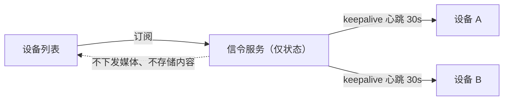
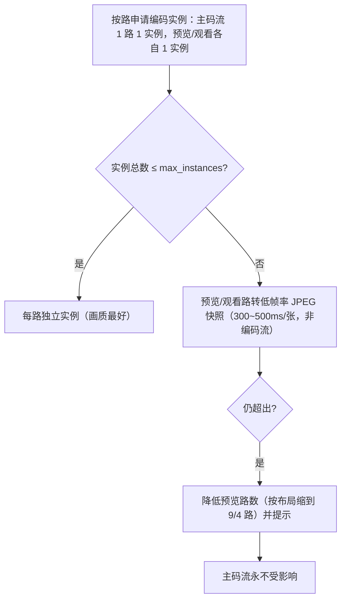
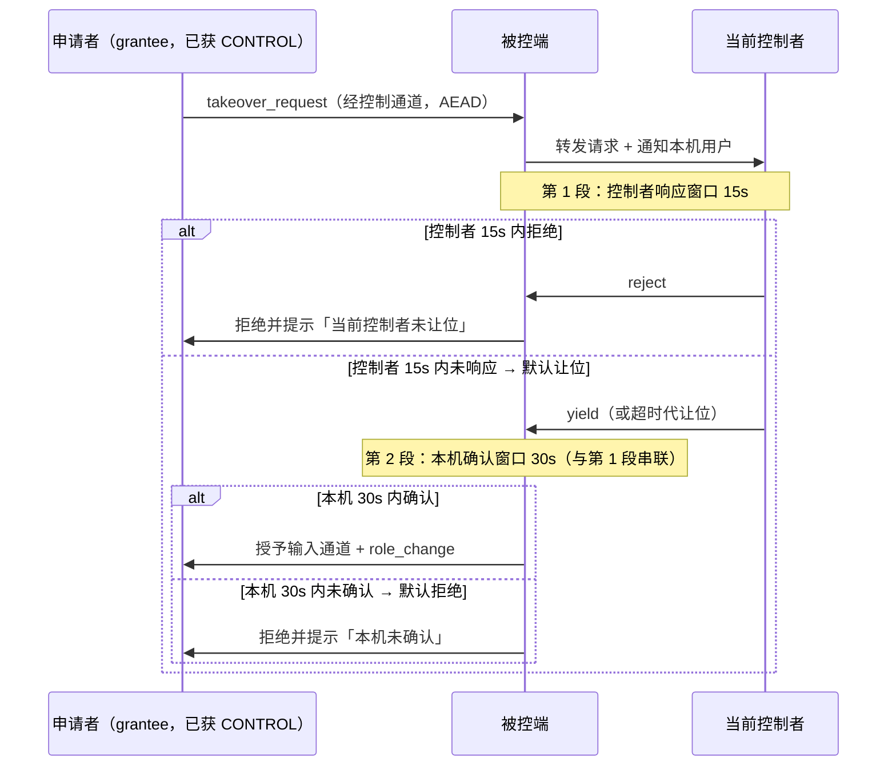

# 12 · 多设备、多会话与屏幕墙

> v1 范围：**设备列表 + 多设备并发会话 + 桌面客户端内的多路预览墙 + 多账号共享控制（§8）**。
> 浏览器端（网页打开即可查看）**不实现**，只在 §7 保留远期评估说明，避免被误当成需求。
> 相关协议细节见 `04-传输协议.md` §2.3，编码能力见 `06-采集与编码.md` §2.6，降级联动见 `05-连接与降级策略.md` §5.3，多账号授权见 `03-信令协议.md` §4.7 与 `13-权限设置页设计.md`。

---

## 1. 设备列表（本地地址簿）

### 1.1 定位

**本地优先，不依赖账号**：默认不登录也能用，设备身份由**公钥指纹**唯一确定（`peer_id = Ed25519 公钥指纹`），别名/分组/备注都是本地标签。账号是**可选增强**（见 §1.5），未登录时设备列表完全来自本地地址簿，功能不缩水。

> 与早期版本的区别：v1 采用**混合信任模型（方案三）**——本地模式 + 同账号自动互信 + 跨账号配对码，账号不是使用前提。详见 `07-安全设计.md` §2.3、`03-信令协议.md` §4.6。

### 1.2 数据模型

| 字段 | 说明 | 来源 |
|---|---|---|
| `peer_id` | 公钥指纹（短格式 8 组 4 位） | 首次配对时交换 |
| `alias` | 用户起的名字（默认取主机名） | 本地 |
| `group` | 分组标签（可多选） | 本地 |
| `note` | 备注 | 本地 |
| `trust_policy` | 每次确认 / 自动接受 / 完全免密 | 本地（见 `07-安全设计.md` §2.2） |
| `expires_at` | 授权有效期（默认 30 天） | 本地 |
| `last_connected_at` | 最近一次成功连接 | 本地 |
| `last_latency_ms` | 最近延迟快照（连接路径 + RTT） | 会话结束时写入 |
| `online_state` | 在线 / 离线 / 被控中 / 连接中 | **信令心跳中转**（不承载媒体） |

### 1.3 在线状态

| 规则 | 说明 |
|---|---|
| 心跳周期 | 30s；3 次未收到判定离线（90s） |
| 状态来源 | 信令服务的"在线位图"，只含 `peer_id + 状态 + 最后心跳时间` |
| 被控中 | 由本机会话管理器上报（仅本机可见"我正在控它"），不广播给第三方 |
| 延迟快照 | 会话建立后 10s 内的 RTT 中位数；离线设备显示上次值并标注时间 |
| 隐私 | 服务端不记录设备别名/分组/备注（这些不上行） |

### 1.4 交互与排序

| 能力 | 规则 |
|---|---|
| 搜索 | 别名 / 备注 / 指纹前缀 / 分组名，防抖 150ms |
| 排序 | 最近连接置顶（默认）→ 在线优先 → 别名升序；用户可切换 |
| 分组折叠 | 折叠状态本地记忆；空分组自动隐藏 |
| 快捷操作 | 双击=发起会话；右键=编辑/信任设置/吊销/删除 |

### 1.5 账号增强（可选，登录后生效）

账号只做"发现与同步"，不承担连接与媒体。登录后设备列表变为**本地 + 同账号**两部分的合并视图。

| 项 | 规则 |
|---|---|
| 合并方式 | 按 `peer_id` 去重合并；**本地记录的别名/分组/备注优先**，账号下发的设备名只作为默认别名写入空位 |
| 来源标记 | 同账号设备在列表里显示"同账号"角标；本地配对设备显示"已配对"；两者都有则显示"已配对 · 同账号" |
| 默认策略 | 同账号设备默认 **自动接受**（免密直连），可对单台改为"每次确认" |
| 列表版本 | 账号服务下发 `list_version`；本地缓存该版本，**版本回退时拒绝覆盖**（防重放与降级攻击） |
| 离线可用 | 账号服务不可达时，使用上次缓存的同账号列表继续工作；缓存过期不阻断本地连接，只把角标标灰 |
| 吊销 | 账号内远程移除设备 → 该设备**下次上线或下次连接时生效**（见 §6 与 `07-安全设计.md` §2.3） |
| 不存内容 | 账号服务只存邮箱、密码哈希、`peer_id`、设备名与平台、公钥、最后在线时间、归属关系；**不存画面/文件/剪贴板/连接历史** |
| 退出登录 | 退出后同账号设备从列表移除（本地配对记录保留），信任关系按各自来源独立存在 |

**同账号不改变端到端安全**：媒体仍走会话密钥加密，账号服务只提供公钥列表与在线状态，**不参与密钥协商、不持有任何会话密钥**。

---

## 2. 多设备并发会话

### 2.1 会话管理器

`SessionManager`（Rust `rdc-core::session_manager`）持有 N 个 `SessionHandle`，每个会话独立的 `session_id`、密钥、编码实例、统计。

| 资源 | 上限（默认） | 超限策略 |
|---|---|---|
| 同时受控会话（主码流） | **默认 1 路，最多 2 路**；**4 路仅在编码实例探测通过后开放**（属工作站/企业配置） | 拒绝新会话并提示"当前硬件仅支持 N 路并发"；不静默降质 |
| 屏幕墙预览路数 | 布局上限 **16 路**；**默认从 4 路起，按解码实例探测逐级开放**（见 §2.3） | 超出时提示并降为快照模式 |
| 编码实例 | 受 `EncoderCaps.max_instances`（消费卡常见 2~5），每路主码流**独占** 1 个 | 见 §2.2 降级链 |
| 线程 | 每主码流会话约 3~4 个线程（采集/编码/解码/控制） | 超过实例预算后不再新增采集线程，改为复用 |
| 内存 | 每路 4K 会话约 300~500 MB（帧池 + 编码器缓冲） | 超限拒绝新会话并提示 |
| 每路带宽 | 主码流 ≤ 可用带宽 60% 共享；单路默认 ≤ 30% | 逐路自适应降码率（见 05） |

**编码实例 ≠ 路数**：`max_instances` 是**实例数**，不是可开的路数。单路 4K120 或 4:4:4 10-bit 可能吃满一个编码引擎，此时即使 `max_instances=4` 也只能跑 1 路主码流。因此"最多 2 路 / 4 路"是**实例探测通过后的上限**，不是默认能力：默认按 1 路主码流 + 1 个预览实例规划，第 2 路主码流探测通过后再开放。

**规则**：并发会话的**降级互不继承**；一路降级不影响其他路参数。

**观看者（只读会话）的资源口径**：观看者使用**独立编码实例**（`stream 7` 子码流，每路 1 个），**不占用主码流的编码实例**；实例不足时转低帧率 JPEG 快照（快照不是视频编码流，不占编码实例）。按实例预算，默认只保证 **1 控制 + 1 观看**；`exclusive` 的 3 个观看位、`one_control_many_watch` 的 8 个观看位在实例探测通过后开放（见 §8），观看者数量同时受**带宽预算**（`05-连接与降级策略.md` §5.3）与**解码实例预算**（§2.3）约束。

### 2.2 消费级 GPU 并发编码限制

| 后端 / 卡型 | 并发实例（经验值） | 说明 |
|---|---|---|
| NVIDIA GeForce | 约 2~5（驱动限制，游戏卡历史上限 2~3，新驱动与 Studio 驱动更宽） | 超过即返回 `NV_ENC_ERR_INVALID_CALL` / 会话数错误 |
| NVIDIA Quadro / RTX A 系 | 更高（无消费卡限制） | 优先使用 |
| AMD Radeon（消费） | 约 2~4 | VCE/VCN 会话限制 |
| Intel 核显 QSV | 受内存带宽限制，通常 3~5 | 低分辨率多路反而更划算 |
| Apple VideoToolbox | 2~4 | 与系统其他编码任务共享 |

**降级链（按序，且只影响预览）**：

**铁律**：编码器不足时**只降预览**，不得降低主画面参数，不得为新预览路而抢占主路实例，**预览/观看也不得与主码流共享实例**（单编码会话不支持两路独立输出）。

### 2.3 解码实例预算（主控端 / 观看侧）

屏幕墙不只是被控端编码问题：主控端每路预览都要占一个**解码会话**，硬解会话数同样有限。

| 后端 | 并发解码会话（经验值） | 说明 |
|---|---|---|
| NVDEC（NVIDIA） | 3~5 | 4K / 4:4:4 10-bit 单会话占用更高，可能一帧解码就吃满一个会话 |
| MediaCodec（Android） | 2~4 | 与系统相机、播放器共享硬解资源，随机型差异大 |
| VideoToolbox（Apple） | 2~4 | 与系统其他解码任务共享 |
| 软解兜底 | 受 CPU 核数限制 | 不作为屏幕墙默认路径，仅单路兜底 |

**规则**：

1. 墙的默认路数与**编码 + 解码双探测**结果挂钩：默认 **4 路（2×2）**起步，探测通过再开放 **9 路（3×3）**、**16 路（4×4）**；
2. 16 路属**工作站/企业配置**，需两侧实例都探测通过；
3. 解码实例不足时：先降预览帧率（5fps → 2fps），再转 JPEG 快照，最后降路数；
4. **主码流解码永远优先**：不得为墙的预览抢占主会话的解码会话。

---

## 3. 屏幕墙（多路预览）

> **入口归属（以 `14-ToDesk设置对照.md` §5 的主界面 IA 为准）**：屏幕墙是主界面**模式胶囊「远程控制 / 屏幕墙 / 设备 / 文件传输」下的内容区**，与远程控制共用同一路由、同一窗口，切换胶囊只换 View；**不设第二条入口**（不进左侧导航、不进设置页）。胶囊内右上角「弹出独立窗口」只是同一入口的展示形态，不是第二入口。本节只描述能力与参数，入口形态以 14 号文档为准。

### 3.1 预览流参数（已定稿）

| 参数 | 值 | 说明 |
|---|---|---|
| 分辨率 | **约 480p**（854×480 或等比） | 不做高清预览，清晰度由点击后的主码流负责 |
| 帧率 | **5 fps** | 足够判断"是否在工作"，不追求流畅 |
| GOP | **长 GOP ≥ 2s**（默认 5s） | 降低码率与关键帧开销 |
| 每路码率 | **200~400 kbps** | 文本为主的桌面取 200，视频内容取 400 |
| 通道 | **`stream 7`（子码流）**，与主码流 `stream 0` 完全独立 | 参数、通道、降级均独立 |
| 编码来源 | **独立编码实例**（`stream 7`），每路预览/观看各 1 个 | 主码流实例**独占**，不共享；实例不足时转 JPEG 快照兜底（见 §3.4） |
| 隔离 | 预览侧任何降级**不得触发主画面降级** | 反之亦然 |

**点击进入单屏**：控制通道发 `switch_to_main`，画面切到 `stream 0` 主码流；主码流编码实例本就在运行，**只切换渲染源，不重建编码器、不新建实例**。

### 3.2 布局与交互

| 项 | 规则 |
|---|---|
| 布局 | 2×2 / 3×3 / 自定义网格；自动按在线设备数选择最少空格布局 |
| 轮巡 | 可选，默认 15s/页；轮巡时暂停非当前页的预览解码（省带宽与 GPU） |
| 格子叠层 | 左下：设备名 + 别名；右上：状态点（在线/离线/被控中）；底部：码率与延迟 |
| 双击 | 进入单屏控制（切换主码流） |
| 筛选 | 只看在线 / 只看某分组 / 只看被控中 |
| 排序 | 拖拽重排，布局与顺序本地记忆 |

### 3.3 带宽与编码负载估算

**单路预览负载**：480p@5fps ≈ 2.05 M 像素/秒 ≈ **1.65%** 的 1080p60 像素吞吐（124.4 M 像素/秒）。因此 16 路预览合计仅 ≈ 26% 的单路 1080p60 编码负载——**算力不是瓶颈，实例数才是**（每路预览仍需 1 个独立编码实例）。

| 规模 | 总码率（200~400 kbps/路） | 编码负载（相对 1080p60） | 实例需求（预览/观看各自独立实例） |
|---|---|---|---|
| **4 路**（2×2） | **0.8~1.6 Mbps** | ≈ 6.6% | 需 4 个编码实例；消费卡常见 2~5，通常需缩到 2 路或转快照 |
| **9 路**（3×3） | **1.8~3.6 Mbps** | ≈ 15% | 需 9 个编码实例；不足时按 §2.3 降帧率 → 快照 → 降路数 |
| **16 路**（4×4） | **3.2~6.4 Mbps** | ≈ 26% | 需 16 个编码实例；仅工作站/企业配置（编码 + 解码双探测通过） |
| 16 路 + 1 路 4K 主码流 | +（主码流 20~60 Mbps） | + 100% | **GeForce 可能触及实例上限** → 预览降为快照或缩到 9 路 |

**带宽预算约束**：屏幕墙总码率 ≤ 可用带宽 **20%**（见 `05-连接与降级策略.md` §5.3）；超出时优先降到 200kbps，再降路数，最后转快照。

**码率口径（C08 重算）**：屏幕墙码率按 **200~400 kbps/路**线性累加——4 路 0.8~1.6 Mbps、**9 路 1.8~3.6 Mbps**、16 路 3.2~6.4 Mbps。

### 3.4 JPEG 快照兜底（更省方案）

| 项 | 规则 |
|---|---|
| 触发 | ① 编码实例不足；② 预览路数 > 12 且带宽紧张；③ 用户手动选择"最省模式" |
| 性质 | **JPEG 快照不是视频编码流**：由图像编码器逐张压缩，**不占编码实例**、不参与 GOP/时间层/关键帧体系 |
| 频率 | **300~500 ms/张（2~3 fps）** |
| 质量 | JPEG q70，480p，单张约 30~50 KB → 每路 **0.5~1.2 Mbps**@2.5fps（或降 q60 到 0.3~0.6 Mbps） |
| 观感代价 | **滚动与视频内容会明显卡顿/跳动**（无帧间预测，每张独立）；文字静态画面可接受；不适合用于判断动画流畅度 |
| 提示 | 进入快照模式时格子右上角显示"快照"角标，顶部提示"为保证主画面质量，预览已降为快照" |
| 恢复 | 编码实例空闲或带宽恢复 5s 后，自动切回子码流（需用户未锁定"最省模式"） |

### 3.5 与主码流的边界（必须写进实现约束）

1. 预览不使用主码流的帧，**独立解码**（同一解码器可输出两路，但预览不阻塞主路）；
2. 预览的任何参数变化不得写入 `VideoConfig`（主路配置对象）；
3. 进入单屏时，预览解码可以继续（用于快速返回墙），但**不得占用主路的解码输出队列**；
4. 退出单屏回到墙时，不重建会话，只切换渲染源。

---

## 4. 状态与 MVC 归属（Flutter 侧）

| 状态 | 归属 |
|---|---|
| 设备列表、别名、分组、信任策略、有效期 | `devices_model`（持久化） |
| 在线状态、延迟快照 | `devices_model`（订阅信令事件） |
| 会话数量与每路状态 | `session_model` / `session_manager_model` |
| 墙布局、轮巡、筛选、当前页 | `wall_model` |
| 切单屏/回墙的渲染源切换 | `wall_controller`（调用 `session_controller`，不改解码器） |
| 像素与纹理 | 不进 Dart，走外部纹理 |

---

## 5. 验收（对应 `10-里程碑与验收.md` S5）

| 项 | 通过标准 |
|---|---|
| 设备列表 | 指纹 ID 显示正确；搜索/排序/分组折叠/置顶可用；在线状态 90s 内准确 |
| 并发 | 默认 1 路主码流可控；第 2 路在实例探测通过后可控；第 3 路被拒绝且有明确提示；4 路仅工作站/企业配置探测通过后允许 |
| 预览 | 默认 4 路 480p@5fps 上屏；实例探测通过后 9 路同时上屏；每路码率 200~400kbps |
| 切单屏 | 双击进入主码流，切换 ≤ 1s，不重建会话 |
| 隔离 | 人为让预览降级，主画面参数不变（对比 HUD 数值） |
| 兜底 | 模拟实例不足 → 自动转快照，角标与提示出现 |
| 性能 | 16 路预览时被控端编码占用增幅 ≤ 30%（相对单路 1080p60 基线） |
| 账号增强（可选） | 登录后同账号设备出现并带来源角标；停掉账号服务后列表仍可用且不阻断连接；注销/吊销流程按 §1.5 生效 |

---

## 6. 已知限制

1. 消费级 GPU 的编码实例上限由驱动决定，无法通过软件绕过；只能靠**独立实例 + 降帧 + 快照**兜底，单路 4K120 / 4:4:4 10-bit 可能吃满一个引擎。
2. 预览画质刻意很低（480p/5fps），**不适合"看清文字"**，只用于状态判断。
3. 16 路 + 4K 主码流在 GeForce 上大概率触发实例限制，属预期行为。
4. 本地地址簿（别名/分组/备注）**不跨设备同步**；登录账号只同步设备身份与默认名，用户自定义标签仍留在本机。
5. 在线状态依赖信令服务可达；信令不可达时全部显示"离线（状态未知）"。
6. **同账号自动互信依赖账号服务**：账号服务不可达时，同账号设备退回"每次确认"，不退回"配对码"（本地已有公钥，只是无法确认归属关系）。
7. 设备吊销是**最终一致**的：账号侧移除后，对端要等到下次上线或下次连接才感知，存在分钟级窗口（见 `07-安全设计.md` §2.3）。

---

## 7. 浏览器端方案（不实现，远期评估）

> **明确结论：v1 不做浏览器访问。** 本节仅记录技术判断，防止后续把它误当成需求。

| 维度 | 现状（桌面客户端） | 若改浏览器（WebRTC） |
|---|---|---|
| 色度 | 支持 4:4:4 / 10-bit | **WebRTC 主流实现强制 4:2:0 8-bit** → 与"4:4:4 + 10-bit"能力协商目标直接冲突 |
| 传输 | 自研 UDP + FEC + 拥塞控制 | 必须走 WebRTC，FEC/NACK/拥塞由浏览器黑盒控制，**无法沿用自研 QoS** |
| NAT | 自研打洞 + 可选中继 | **必须部署 TURN**（对称 NAT 兜底），成本与运维增加 |
| 延迟 | 参考 P99 30ms（LAN，1080p60）；高刷+原生视频层 20ms 为尽力值 | 浏览器解码/渲染路径不可控，通常 +10~30ms |
| 编码 | HEVC/H.264 硬编、intra-refresh、时间层 | 只能用浏览器支持的编码组合，多数场景退化为 H.264 4:2:0 |
| 输入 | 原生注入 | 只能用浏览器事件，剪贴板/文件受限 |
| 客户端形态 | Flutter 五端 | 需另建 Web 前端 + 信令改造 + TURN |

**结论**：改回"桌面端预览墙"后，**不需要 WebRTC，也不需要 TURN 兜底**；浏览器方案若未来重启，应作为独立项目评估（独立协议栈、独立验收标准），不并入本 v1。

---

## 8. 多账号共享控制（v1）

> 协议字段与令牌格式见 `03-信令协议.md` §4.7；安全约束见 `07-安全设计.md` §4.4；设置页见 `13-权限设置页设计.md`。
> 本节只写"多台设备 / 多人同时访问"的产品与资源规则。

### 8.1 归属与授权

| 概念 | 规则 |
|---|---|
| owner | 每台设备有且仅有一个 owner 账号，首次登录时绑定；换绑需本机确认 |
| grantee | 被 owner 邀请的授权访问者，凭 `grant_token` 访问 |
| 授权粒度 | 账号级（覆盖该账号全部设备）/ 设备级（只对某 `peer_id`）；设备级优先 |
| 权限位 | 查看画面 / 键鼠控制 / 剪贴板 / 文件传输 / 音频 / 电源操作 / 切换显示器（位图见 07 §4） |
| 有效期 | 默认 30 天，最长 90 天；到期自动失效，需 owner 续期 |
| 不可转授 | grantee 不能创建新授权；UI 不提供"分享"入口 |

**授权列表的可见性**：owner 看到自己签发的全部授权；grantee 只看到"我收到的"，且只能看到自己的设备归属，不看到同设备其他授权者的身份（避免账号间信息泄露）。

### 8.2 并发模式

| 模式 | 控制者 | 观看者 | 说明 |
|---|---|---|---|
| `exclusive`（默认） | 1 人 | ≤ 3 人（只读） | 其他人要控制必须申请接管；观看者各占 **1 个独立编码实例**（不留主实例），实例不足转 JPEG 快照 |
| `one_control_many_watch` | 1 人 | ≤ 8 人（只读） | 演示/培训；带宽优先给控制者主码流；8 路观看需**编码/解码实例探测通过**，否则按快照或降路数 |
| `collab` | 多人同时注入 | — | **v1 不实现**，仅保留枚举位与开关（收到即 `unsupported_mode`） |

**接管流程**：

**接管策略三档**（设置在 `13-权限设置页设计.md` §3）：

| 策略 | 行为 |
|---|---|
| 自动同意 | 请求即刻授予，当前控制者降级为观看者 |
| **需本人确认（默认）** | 先由当前控制者响应（默认 15s 未响应视为让位），再由本机用户确认（默认 **30 秒超时拒绝**）；两段窗口串联，任一超时按拒绝处理 |
| 禁止接管 | 直接拒绝，控制者只能结束后重连 |

> **口径统一**：15s 是**控制者侧响应窗口**，30s 是**本机用户确认窗口**；两者串联，任一超时按"拒绝"处理（默认拒绝更安全）。两个窗口均可配置，范围 10~60s（见 `13-权限设置页设计.md` §3）。

### 8.3 本机知情权与保护

| 项 | 规则 |
|---|---|
| 常驻提示 | 连接期间显示"正在被 {控制者} 控制"，含权限范围、时长、观看人数；可开关但不能被授权方隐藏 |
| 一键断开 | 常驻入口（桌面：托盘/悬浮条；移动：通知）；本地执行，立即释放编码器实例 |
| 本机确认 | 多账号授权**不得绕过**本机确认策略（信任设备按各自策略除外） |
| owner 踢出 | owner 可强制断开任意会话；在线 ≤ 3s 生效，离线退化为下次连接被拒 |
| 审计 | 本地环形日志，记录谁、何时、权限、动作、结果；不记录媒体内容 |

### 8.4 与设备列表 / 屏幕墙的联动

| 场景 | 规则 |
|---|---|
| 设备列表角标 | 被他人控制时显示"被控中"，并显示控制者账号（仅授权范围可见时） |
| 屏幕墙预览 | 观看者模式可直接把目标设备加入墙；墙上的预览仍走 480p 子码流，不因"多人观看"提升画质 |
| 并发上限 | 观看者**不占主码流实例**，但每个观看者各占 1 个独立编码实例（或用 JPEG 快照）；`one_control_many_watch` 的 8 路观看合计带宽按 **1.6~3.2 Mbps** 估算（200~400kbps/路，见 §3.3） |
| 降级隔离 | 任何观看者/预览侧的降级**不得**触发控制者主码流降级 |

### 8.5 验收（对应 `10-里程碑与验收.md` S5）

| 项 | 通过标准 |
|---|---|
| 邀请 | owner 按邮箱发出邀请 → grantee 接受 → 权限生效（离线也能连，停账号服务不影响已授权连接） |
| 权限裁剪 | 被控端只能削减不能追加；越权请求返回 `perm_exceeded` |
| 独占 | 非控制者输入被传输层丢弃并计数，画面仍可观看 |
| 接管 | 三种策略各验证一次；控制者 15s 内未响应 → 默认让位，本机随后 30s 内未确认 → 默认拒绝；让位后旧控制者变观看者 |
| 踢出 | owner 在线踢出 ≤ 3s；离线时下次连接被拒并提示 |
| 撤销延迟 | 撤销后最迟 15 min + 90s 内拒绝新连接（文档写明，不接受"立即生效"承诺） |
| 提示 | 被控端全程可见控制者身份与观看人数；一键断开可用 |
| 审计 | 连接/接管/文件/剪贴板/电源均有记录，且无任何媒体内容 |

---

## 修订记录

| 编号 | 位置 | 修改 | 依据 |
|---|---|---|---|
| C30 | §2.1 | 并发会话模型改为"**默认 1 路、最多 2 路；4 路仅编码实例探测通过后开放（工作站/企业配置）**"；补"编码实例 ≠ 路数"说明（单路 4K120 / 4:4:4 10-bit 可能吃满一个引擎） | 与 `06-采集与编码.md` §2.6 一致 |
| C31 | §2.1、§2.2、§3.1、§3.3、§8.2、§8.4 | 删除"观看者复用主码流实例、不占实例"与"同一编码器输出主+子码流"；改为"主码流独占 1 个实例，预览/观看使用**独立实例**，实例不足转低帧率 JPEG 快照（快照不是编码流）" | 与 `04-传输协议.md` §2.3、`06-采集与编码.md` §2.6 一致 |
| C15 | §8.2 | 接管图示改为两段串联：控制者 **15s** 未响应 → 默认让位；本机随后 **30s** 未确认 → 默认拒绝 | 与 `13-权限设置页设计.md` §3③、`03-信令协议.md` §4.7.4 一致 |
| C08 | §3.3、§8.4 | 9 路码率按 200~400kbps/路重算为 **1.8~3.6 Mbps**，删除 9 Mbps 口径；同步修正 8 路观看带宽为 1.6~3.2 Mbps | 与 `04-传输协议.md` §2.3 修正后一致 |
| C36 | §3 | 屏幕墙入口以 `14-ToDesk设置对照.md` §5 的主界面 IA 为准：作为**模式胶囊下的内容区**，**不设第二条入口**；本文件只保留能力与参数描述 | `14-ToDesk设置对照.md` §5.3 |
| 解码实例预算 | §2.3（新增） | 补 NVDEC / MediaCodec / VideoToolbox 并发解码会话限制；墙默认路数与实例探测挂钩（默认 4 路起，9/16 路逐级开放） | 不删 9/16 路能力，只按硬件实例口径修正默认值 |
