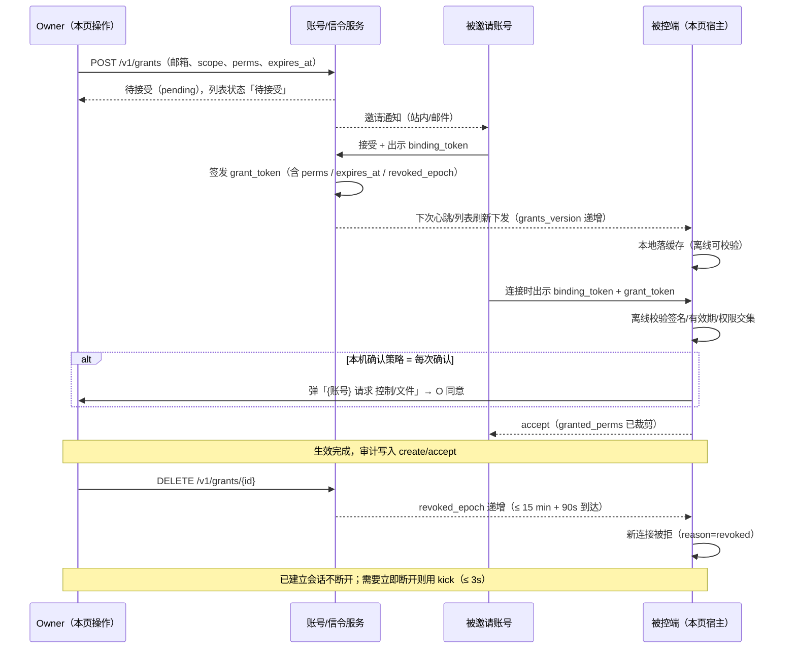

# 13 · 权限设置页设计（远程访问权限）

> 本文件只描述页面结构、字段语义、MVC 划分与交互流程，不写实现代码。
> 协议字段见 `03-信令协议.md` §4.7；安全约束见 `07-安全设计.md` §4.4；多设备规则见 `12-多设备与屏幕墙.md` §8。
> 一句话定位：**这是被控端的"谁能连我、能干什么、我能随时掐断"的唯一入口**。

---

## 1. 定位与入口

| 项 | 规则 |
|---|---|
| 入口 | 设置 → 「远程访问权限」（独立一级入口，不在"通用设置"里折叠） |
| 页面形态 | **上下单栏**，最大内容宽度 720px，区块纵向排列，**不采用左右分栏 / 不使用左侧导航** |
| 面向角色 | 被控端（Host）；主控端不显示本页 |
| 前提 | 未登录账号也可完整使用本页（本地模式）；登录后额外支持"按邮箱邀请" |
| 刷新 | 页面进入时拉一次；在线连接数/授权状态按 **4 Hz** 事件增量更新；授权列表按 `grants_version` 变更时整表刷新 |

---

## 2. 页面结构（上下单栏）

```
┌──────────────── 远程访问权限 ────────────────┐
│ ① 总开关区                                    │
│    [允许远程访问]  ● 开    当前在线 2    本机ID ⧉ │
├───────────────────────────────────────────────┤
│ ② 默认模式区                                  │
│    (•) 独占   ( ) 一控多观   (×) 协作（后续）    │
│    说明：独占 = 1 人控制 + 最多 3 人观看 …       │
├───────────────────────────────────────────────┤
│ ③ 接管策略区                                  │
│    ( ) 自动同意  (•) 需本人确认  ( ) 禁止接管    │
│    确认超时 [30s ▾]（10~60s）                   │
├───────────────────────────────────────────────┤
│ ④ 授权访问者列表                              │
│    [＋ 邀请]                                   │
│    名称 | 账号/指纹 | 权限摘要 | 有效期 | 状态 | ⋯ │
│    …                                          │
├───────────────────────────────────────────────┤
│ ⑤ 权限模板区                                  │
│    只读 / 标准控制 / 完全控制 / 自定义           │
│    ☑查看画面 ☐键鼠 ☐剪贴板 ☐文件 ☐音频 ☐电源 ☐切屏 │
├───────────────────────────────────────────────┤
│ ⑥ 本机保护区                                  │
│    常驻提示 [开]  断开入口 [托盘 ▾]             │
│    审计日志 →   保留 [30 天 ▾]                  │
├───────────────────────────────────────────────┤
│ ⑦ 信任设备区                                  │
│    本地配对[每次确认] · 同账号[自动接受]         │
│    完全免密仅内网+二次确认（警示）               │
│    设备列表（吊销 / 批量清空）                  │
└───────────────────────────────────────────────┘
```

**布局纪律**：

1. 区块之间用分割线，不嵌套卡片、不做二级 Tab；
2. 每屏最多 1 个主操作按钮（`④ 邀请`），其余为行内次级操作；
3. 危险操作（吊销、批量子空、完全免密）统一使用二次确认对话框。

---

## 3. 区块字段说明

> 每一行都回答四件事：**数据来源 / 可编辑性 / 校验规则 / 空状态**。

### ① 总开关区

| 字段 | 数据来源 | 可编辑 | 校验规则 | 空状态 |
|---|---|---|---|---|
| 允许远程访问 | 本地设置（`AppSettings.remote_access_enabled`） | ✅ 开关 | 开启前**按平台能力检查**屏幕采集与输入注入权限：macOS/Windows 可提前持久取得，未取得则开关回弹并弹权限引导；**Wayland 下 portal 授权按会话发生、无法提前持久取得**，开关可开但状态栏显示"每次连接需本机确认" | 不适用（默认 **关**） |
| 当前在线连接数 | Rust `SessionManager` 原子统计（4 Hz 事件） | ❌ 只读 | — | 无连接时显示"0（无连接）" |
| 本机设备 ID | Rust 身份模块的 `peer_id`（公钥指纹短格式） | ❌ 只读，可复制 | 复制到剪贴板时使用"不含敏感内容"的短格式；不得显示私钥任何片段 | 身份未初始化时显示"正在生成…"并禁用复制 |

**联动**：总开关关闭时，②③⑤保持可编辑（配置留存），④⑦只读并显示"远程访问已关闭"提示条；正在进行的会话**不被强制断开**，但页面顶部提示"关闭后新连接将被拒绝"。

### ② 默认模式区

| 字段 | 数据来源 | 可编辑 | 校验规则 | 空状态 |
|---|---|---|---|---|
| 并发模式 | 本地设置（枚举 `exclusive` / `one_control_many_watch` / `collab`） | ✅ 单选 | `collab` 置灰不可选，标注"后续版本"；选择后仅对**新会话**生效，已建立会话按原模式 | 默认 `exclusive` |
| 模式说明 | 常量文案（随选择切换） | ❌ 只读 | — | — |

**三种模式的行为差异（页面内必须直白写出）**

| 模式 | 控制者 | 观看者 | 接管 |
|---|---|---|---|
| 独占（默认） | 1 人 | ≤ 3 人只读 | 可申请，按 ③ 处理 |
| 一控多观 | 1 人 | ≤ 8 人只读 | 可申请，按 ③ 处理 |
| 协作（后续） | 多人同时注入 | — | 不适用；**v1 不可选** |

### ③ 接管策略区

| 字段 | 数据来源 | 可编辑 | 校验规则 | 空状态 |
|---|---|---|---|---|
| 接管策略 | 本地设置（`auto` / `confirm` / `forbid`） | ✅ 单选 | 默认 `confirm`；`auto` 需二次确认（"他人可随时夺走控制权"） | 默认"需本人确认" |
| 确认超时 | 本地设置，枚举 10/15/20/30/45/60 秒 | ✅ 下拉 | 默认 **30s**；范围 10~60s；`auto` / `forbid` 时该项置灰 | 默认 30s |
| 通知状态 | 系统通知权限（平台查询） | ❌ 只读，附"去开启" | 通知权限被拒时：降级为"应用内确认"；应用不在前台则**按拒绝处理** | 无权限时显示警告行 |

**口径说明**：本页 30s 是**本机用户确认窗口**；控制者侧另有响应窗口（默认 15s，见 `03-信令协议.md` §4.7.4）。两个窗口串联，任一超时都按"拒绝"处理（默认更安全）。

### ④ 授权访问者列表

| 列 / 字段 | 数据来源 | 可编辑 | 校验规则 | 空状态 |
|---|---|---|---|---|
| 名称 | 本地别名优先；无别名取账号资料设备名，再退化为指纹前 8 位 | ✅ 行内编辑（仅本地） | ≤ 32 字符；去首尾空格；重名允许但需角标区分 | — |
| 账号 / 设备指纹 | `grant_token.grantee_account` + `binding_token.peer_id` | ❌ | 账号显示打码邮箱（`a***@x.com`）；未登录来源只显示指纹 | — |
| 权限摘要 | `grant_token.perms` 位图 → 摘要文案 | ✅ 进入"编辑权限" | 至少包含 `VIEW`；摘要最多显示 3 项 + "等 N 项" | — |
| 有效期 | `grant_token.expires_at` | ✅ 编辑（续期/改期） | **必须设置**；可选 1 小时 / 1 天 / 7 天 / 30 天（默认）/ 90 天（上限）；不得早于当前时间；**到期需在线续签**，离线不自动延期 | **未设置有效期时不可授予** |
| 状态 | 本地缓存 + 在线状态订阅 | ❌ | 取值：在线 / 离线 / 已过期 / 已吊销 / 待接受 | — |
| 来源 | `grant_token.scope` | ❌ | 账号级 / 设备级角标 | — |
| 行尾操作 | — | ✅ | 编辑权限 / 吊销 / 查看日志 | — |

**列表空状态**

| 场景 | 文案与操作 |
|---|---|
| 从未授权过 | "还没有授权访问者" + 「通过邮箱邀请」/「粘贴配对码添加」两个入口 |
| 全部已过期 | "授权均已过期" + 「一键续期 30 天」 |
| 账号服务不可达 | 顶部横幅："账号服务暂不可达，正在显示本地缓存（最后更新 {时间}）"，列表仍可吊销（本地立即生效） |
| 未登录 | 邮箱邀请入口置灰，提示"登录账号后可邀请他人"；配对码路径仍可用 |

**邀请（顶部入口）**

| 方式 | 字段 | 校验规则 | 空状态 |
|---|---|---|---|
| 邮箱邀请 | 邮箱、权限模板、有效期（1 小时 / 1 天 / 7 天 / 30 天 / 90 天，默认 30 天，**必选**）、范围（账号级/设备级，默认设备级） | 邮箱格式校验；不能邀请自己；未注册账号 → 生成待接受邀请，7 天后失效；同一邮箱重复邀请合并为一条 | 邮箱为空时"邀请"按钮禁用 |
| 配对码添加 | 6 位配对码 | 数字 6 位；120s 有效；连续 3 次错误作废；仅本机可见的短时效码 | 无配对码时提示"其他设备上生成配对码后填入" |

### ⑤ 权限模板区

| 字段 | 数据来源 | 可编辑 | 校验规则 | 空状态 |
|---|---|---|---|---|
| 预置模板 | 常量（`readonly` / `standard` / `full`） | ✅ 选择 | 选择模板即覆盖当前勾选；之后手动改动自动切换为"自定义" | 默认"只读" |
| 七个勾选行（八位） | `u16` 位图 | ✅ 逐位勾选 | `VIEW` 必选且不可取消；`POWER`、`DISPLAY_SWITCH` 勾选时二次确认 | 全部未选时回退到"只读" |
| 应用范围 | 当前编辑的授权 / 新邀请默认值 | ✅ | "设为默认模板"仅影响新邀请，不改已有授权 | — |

**模板与权限位映射（必须与 `07-安全设计.md` §4 一致）**

| 权限位 | 只读 | 标准控制 | 完全控制 |
|---|---|---|---|
| 查看画面 `VIEW` | ✅ | ✅ | ✅ |
| 键鼠控制 `CONTROL` | — | ✅ | ✅ |
| 剪贴板 `CLIPBOARD_TEXT` / `CLIPBOARD_IMAGE` | —（默认关） | ☐ 不预置（默认关，需单独勾选） | ☐ 不预置（默认关，需单独勾选） |
| 文件传输 `FILE_TRANSFER` | —（协议默认关） | ⚠️ **超出协议默认**，UI 勾选后生效 | ✅（UI 勾选后生效） |
| 音频 `AUDIO` | — | — | ✅ |
| 电源操作 `POWER` | — | — | ✅（单次确认） |
| 切换显示器 `DISPLAY_SWITCH` | — | — | ✅ |

> `RECONNECT` 不是"访问权限"，不出现在本页勾选列表中，由连接侧策略管理。
>
> **位宽口径**：协议按 `07-安全设计.md` §4 的**九位 `u16`**（含 `RECONNECT`）；本页是**七个勾选行**，剪贴板的 `CLIPBOARD_TEXT` / `CLIPBOARD_IMAGE` 合并为一行展示、但仍是两个独立位。"七行"不是"七位"。

**模板口径（C23 / C37）**

1. **模板只是 UI 预设，不改变协议默认**：协议侧默认权限集合仍只有 `VIEW`，其余位一律关；令牌校验按 `03-信令协议.md` §4.7.2 的最小权限执行。
2. "**标准控制**"模板中的 `FILE_TRANSFER` **超出协议默认**，UI 必须标注"超出协议默认"，由用户**显式勾选后才写入** `grant_token.perms`；未勾选时权限摘要不显示文件传输。
3. **剪贴板默认关闭**（与 `07-安全设计.md` §4 一致）：模板**不预置**文本/图片剪贴板；首次连接由引导提示"剪贴板同步默认关闭，可在权限页开启"，用户开启后才生效。
4. 勾选 `POWER` / `DISPLAY_SWITCH` 仍需二次确认（不变）。

### ⑥ 本机保护区

| 字段 | 数据来源 | 可编辑 | 校验规则 | 空状态 |
|---|---|---|---|---|
| 连接常驻提示 | 本地设置 | ✅ 开关 | 默认 **开**；在"完全免密"策略下**强制为开**且置灰（不允许隐藏被控事实） | — |
| 一键断开入口 | 本地设置（托盘 / 悬浮条 / 系统通知，按平台可用项） | ✅ 单选 | 移动端仅"系统通知"；不可全部关闭 | 平台不支持时隐藏该项 |
| 审计日志入口 | 跳转诊断页审计页签 | ✅ 跳转 | 需要本机用户确认（防止误触导出） | 无日志时"暂无记录" |
| 日志保留天数 | 本地设置，枚举 7/30/90 | ✅ 下拉 | 默认 **30 天**；可选 **7 / 30 / 90 天**；**硬上限 180 天或 10 MB，先到者生效**（不再提供 1~180 任意值） | 默认 30 天 |

### ⑦ 信任设备区

| 字段 | 数据来源 | 可编辑 | 校验规则 | 空状态 |
|---|---|---|---|---|
| 本地配对设备默认策略 | 本地设置 | ✅ 单选 | 默认 **每次确认**；可选自动接受 / 完全免密 | 默认"每次确认" |
| 同账号设备默认策略 | 本地设置（登录后出现） | ✅ 单选，可下钻到单台 | 默认 **自动接受**；可对单台改为"每次确认"；账号服务不可达时退回"每次确认" | 默认"自动接受" |
| 完全免密 | 本地设置 | ✅ 单选（受限） | **仅内网地址**可用 + **二次确认** + 常驻红色警示；外网地址强制不可选 | 默认关 |
| 信任设备列表 | 本地地址簿 + 信任标记 | ✅ 单台吊销 / 批量清空 | 吊销需二次确认；批量清空需输入设备 ID 后 4 位 | 空列表："尚未信任任何设备" |
| 每台设备有效期 | 本地记录 | ✅ | 默认 30 天；到期转回"每次确认" | — |

---

## 4. MVC 划分（严格三文件）

| 层 | 文件 | 职责 | 禁止 |
|---|---|---|---|
| View | `app/lib/view/permission/permission_page.dart` | 页面骨架、滚动、7 个区块组合、主题令牌引用 | 直接调 FFI、直接改 Model、写业务判断 |
| View（区块） | `app/lib/view/permission/sections/*.dart` | 每个区块一个纯展示组件，接收 `state` + 回调 | 在区块里发请求、弹确认框（交给 Controller） |
| Controller | `app/lib/controller/permission_controller.dart` | 意图处理（开关、改模式、邀请、改权限、吊销、续期）、确认弹窗编排、错误映射、`ViewState` 组装 | 持有 Widget、直接拼 UI、直接读写数据库 |
| Model | `app/lib/model/permission/permission_model.dart` | 调 `RustGateway`（主机配置、授权列表、信任设备、审计）、持久化、订阅事件、对外暴露不可变数据 | 出现 `Widget` / `BuildContext` / 导航 |

**文件规模约束**：`permission_page.dart` 只做组合（建议 ≤ 120 行）；每个 `sections/*.dart` 单文件 ≤ 200 行；Controller ≤ 400 行；超过即拆分，不允许写成巨型文件。

**分区标记（强制）**：

- View 区块文件顶部：`// =====** 总开关区 =====**`（名称与本文件语义一致）；
- Controller / Model 文件顶部：`// =========** PermissionController =========` / `// =========** PermissionModel =========`；
- 一个区块内若有多个子块，用二级标记 `// =====** 在线连接数 =====**`，不得省略。

**数据流**：`View 事件 → Controller 意图 → Model 方法 → RustGateway → Rust 核心`；回程 `Rust 事件 → Model → Controller（组装 ViewState）→ View`。ViewModel 只暴露不可变快照，避免 View 直接改状态。

---

## 5. 交互流程（邀请 → 接受 → 生效 → 吊销）



**状态文案（列表行）**

| 状态 | 触发 | 用户可见文案 |
|---|---|---|
| 待接受 | 已邀请未接受 | 待接受（7 天后失效） |
| 在线 | 对方当前有会话 | 在线 · 正在控制 / 在线 · 正在观看 |
| 离线 | 有授权但无会话 | 离线 · 最近 {时间} |
| 已过期 | 超过 `expires_at` | 已过期 · {日期}，提供「续期」 |
| 已吊销 | `revoked_epoch` 命中 | 已吊销 · {时间}（保留 7 天可追溯） |

---

## 6. 权限变更的审计记录

权限相关操作必须写审计（本地环形日志，结构由 Rust 定义，Dart 只展示/导出）：

| 字段 | 说明 |
|---|---|
| `ts` | 单调时钟 + 墙钟 |
| `actor_account` / `actor_peer_id` | 操作者（owner 或本机用户） |
| `action` | `grant_create` / `grant_accept` / `grant_update_perms` / `grant_extend` / `grant_revoke` / `takeover` / `kick` / `policy_change` / `trust_revoke` |
| `target_account` / `target_peer_id` / `grant_id` | 被操作对象 |
| `scope` | `account` / `device` |
| `old_perms` / `new_perms` | 权限位变化前后的位图（按位展示） |
| `old_expires_at` / `new_expires_at` | 有效期变化 |
| `source` | `ui` / `api` / `auto_expire` |
| `result` | `ok` / 失败原因（`no_permission` / `not_owner` / `service_unreachable`） |
| `session_id` | 若操作关联当前会话则记录 |

**约束**：审计**不记录**画面、文件字节、剪贴板文本；日志文件仅当前用户可读；导出时二次确认并提示"包含账号与设备标识"。

---

## 7. 错误与降级

| 场景 | 页面表现 | 系统行为 |
|---|---|---|
| 账号服务不可达 | 顶部黄色横幅 + 最后更新时间；邀请入口置灰 | 本地缓存授权继续可校验；已授权连接不受影响 |
| `grants_version` 回退 | 横幅"授权列表版本异常，已保留本地较新版本" + 日志告警 | 拒绝覆盖缓存 |
| 通知权限被拒 | ③ 区显示"通知不可用，确认将改为应用内弹窗" | 接管确认降级；应用在后台则拒绝 |
| 未登录 | ④ 区邮箱邀请置灰，说明原因 | 配对码路径与本地信任仍可用 |
| 总开关关闭 | 顶部提示"新连接将被拒绝" | 现有会话不强制断开 |
| 授权令牌校验失败 | 行内红点 + "授权无效（签名/过期/已撤销）" | 连接侧拒绝，原因回传审计 |

---

## 8. 平台差异

| 平台 | 差异点 |
|---|---|
| Windows | 常驻提示用托盘气泡 + 悬浮条；系统通知需用户允许；本机 ID 复制走剪贴板 |
| macOS | 通知需授权（未授权降级为应用内确认）；常驻提示用菜单栏图标；录屏/辅助功能权限缺失时总开关不可开 |
| Linux | 托盘依赖发行版（无托盘时退化为窗口标题栏提示）；通知走 libnotify，不可用则应用内确认 |
| Android（仅主控端） | 本页不出现；相关设置在"信任设备"页签内，通知为系统通知渠道 |
| iOS（仅主控端） | 同上；通知需用户授权 |

---

## 9. 验收（写入 `10-里程碑与验收.md` S5）

| 项 | 通过标准 |
|---|---|
| 布局 | 页面为上下单栏、无左右分栏；7 个区块顺序与本文一致；在 720px/1280px 宽度下不错位 |
| 总开关 | 关闭后新连接被拒、现有会话不断；设备 ID 可复制且格式正确 |
| 模式 | 独占/一控多观可切换，协作置灰并标注后续；切换只影响新会话 |
| 接管 | 三档各验证一次；确认超时按设置生效（默认 30s 拒绝）；通知被拒时降级正确 |
| 邀请 | 邮箱邀请 → 对方接受 → 权限生效；配对码路径同样可用；未登录时邮箱入口置灰且有说明 |
| 列表 | 五列信息与五种状态显示正确；编辑/吊销/查看日志可用；空状态文案正确 |
| 模板 | 三套模板覆盖七个勾选行正确（剪贴板两位仍独立生效）；`VIEW` 不可取消；`FILE_TRANSFER` 在"标准控制"中标注"超出协议默认"且未勾选不生效；剪贴板默认关；`POWER`/`DISPLAY_SWITCH` 需二次确认 |
| 保护区 | 常驻提示开关、断开入口、审计入口、保留天数均可操作；完全免密下提示强制开启 |
| 信任区 | 本地配对默认"每次确认"、同账号默认"自动接受"、完全免密仅内网 + 二次确认；单台吊销与批量清空有二次确认 |
| 审计 | 权限创建/变更/吊销均有记录，含前后权限位与结果，且不含媒体内容 |
| MVC | 三文件与目录符合 §4；页面文件只做组合；无 View 直连 FFI |
| 降级 | 停掉账号服务后页面可读、本地吊销可执行、已授权连接不受影响 |

---

## 修订记录

| 编号 | 位置 | 修改 | 依据 |
|---|---|---|---|
| C14 | §3④、邀请表 | 删除"永久 / 未设置"选项；`expires_at` **必须设置**：可选 1 小时 / 1 天 / 7 天 / 30 天（默认）/ 90 天（上限），到期需**在线续签**；空状态"未设置有效期时不可授予" | `03-信令协议.md` §4.7.1 |
| C16 | §2 图示、§3⑦ | 默认信任策略按来源分写：**本地配对默认每次确认**、**同账号设备默认自动接受**（可按单台改为每次确认）、**完全免密仅内网 + 二次确认** | `03-信令协议.md` §4.6.2、`07-安全设计.md` §2.2 |
| C18 | §3⑥ | 审计日志保留统一为"**默认 30 天，可选 7/30/90 天，硬上限 180 天或 10 MB 先到**" | `07-安全设计.md` §7 |
| C23 | §3⑤ | 明确模板是 UI 预设、协议默认仍是 `VIEW`；"标准控制"含 `FILE_TRANSFER` 需 UI 标注"超出协议默认"，用户勾选后才生效 | `07-安全设计.md` §4 |
| C37 | §3⑤ | 剪贴板默认关闭（模板不预置文本/图片剪贴板），首次连接由引导提示开启；删除"文本默认开" | `07-安全设计.md` §4 |
| C35 | §3① | 总开关的权限前置改为"按平台能力检查"：macOS/Windows 可提前持久取得；**Wayland 的 portal 授权按会话发生，无法提前持久取得**，开关可开但标注"每次连接需本机确认" | `08-跨平台差异与限制.md` §2.4 |
